依據：RULINGS（UIUX 11/24 拍板）＋ M2-character-1280.md ＋ M2-character v1.1

角色頁桌機 1280×720（M2-character-1280）。修正輪 **dpoe-char1280-fix1**（`b7c18f15`）＋ **dpoe-char1280-fix2**（`4d8fcd0e`）＋ **dpoe-char1280-fix3**（`6f0f2ec4`）＋ **fix4**（`aedb27de`）＋ **fix5**，HEAD `4b26ef98`。

## fix5：`#pinv` 補 `--panel-edge`（UIUX 定案，head `4b26ef98`）
這輪只做一件事（**dpoe-char1280-fix5**）：
- `css/style.css` 的 `#pinv { … }` 補 `--panel-edge: var(--d2-panel-edge);`（`#a8927f`，`:root` 既有 token；依 M2-36 與 M2-character-1280.md 第 19 行）。只在 `#pinv` 定義，`:root` 沒動，沒有換別的 token、沒有自造 token。
- fix4 加的後備 `var(--panel-edge, transparent)`：**保留沒動**（現在值由 `#pinv` 的定義決定，後備用不到）。
- `tools/char_check.js` 加 4 項斷言（既有斷言沒放寬）：`--d2-panel-edge` 有定義；`#pinv.c12` 內框、`.c12p` outline、`.c12p` ①–④ 層 section 的 border-bottom 都是 `--d2-panel-edge` 的值、寬 1px。
- 其他程式沒動（另有 `docs/production/CHANGELOG.md` 一行與證據檔）。

| 規則 | 修改前（`aedb27d`） | 修改後 |
|---|---|---|
| `#pinv.c12` box-shadow 第一層 | `rgba(0, 0, 0, 0) 0px 0px 0px 1px inset` | `rgb(168, 146, 127) 0px 0px 0px 1px inset` |
| `.c12 .c12p` outline | 沒畫（style `none`） | `1px solid rgb(168, 146, 127)` |
| `.c12 .c12p section` ①–④ border-bottom | `0px none` | `1px solid rgb(168, 146, 127)` |
| `.c12 .c12p .l5`（⑤）border-bottom | `0px none` | `0px none` |

**分層線是 4 條不是 5 條**：⑤ 操作層（最後一層）原本就自己寫 `border-bottom: 0`，這輪沒動它，斷言照這樣寫（①–④ 有線、⑤ 沒線）。

### 1280×720 修改前後對照（修改前｜修改後｜差異塗洋紅）
同一頁、同一份存檔、同一個狀態（`requestAnimationFrame` 停住），只換 `style.css`（修改前＝`aedb27d`）。做法與完整數字：[fix5-diff.md](https://github.com/Shiroyashatw/dpoe/blob/4b26ef98447764b076c02d6f09da2a272b47b051/docs/production/evidence/character-1280/fix5-diff.md)。

| 畫面 | 不同像素（共 921,600） | 右欄內框 1px | 浮窗 outline 1px | 分層線 4 條 | 其他 | 同 CSS 重截雜訊 |
|---|---|---|---|---|---|---|
| [01 數值頁](``````` https://github.com/Shiroyashatw/dpoe/blob/4b26ef98447764b076c02d6f09da2a272b47b051/docs/production/evidence/character-1280/fix5-01-stats-before-after.png ```````) | 1,920 | 1,920／1,920 | — | — | 0 | 0 |
| [02 長按選單](``````````` https://github.com/Shiroyashatw/dpoe/blob/4b26ef98447764b076c02d6f09da2a272b47b051/docs/production/evidence/character-1280/fix5-02-menu-before-after.png ```````````) | 1,920 | 1,920／1,920 | — | — | 0 | 0 |
| [03 編輯釘選](```````````` https://github.com/Shiroyashatw/dpoe/blob/4b26ef98447764b076c02d6f09da2a272b47b051/docs/production/evidence/character-1280/fix5-03-pin-edit-before-after.png ````````````) | 1,920 | 1,920／1,920 | — | — | 0 | 0 |
| [04a 比較浮窗](````````````` https://github.com/Shiroyashatw/dpoe/blob/4b26ef98447764b076c02d6f09da2a272b47b051/docs/production/evidence/character-1280/fix5-04a-compare-before-after.png `````````````) | 9,999 | 1,460／1,460 | 1,812／1,812 | 1,832／1,832 | **4,895** | 0 |
| [04b 比較浮窗（Alt）](`````````````` https://github.com/Shiroyashatw/dpoe/blob/4b26ef98447764b076c02d6f09da2a272b47b051/docs/production/evidence/character-1280/fix5-04b-compare-alt-before-after.png) `````````````` | 9,952 | 1,000／1,000 | 1,888／1,888 | 1,832／1,832 | **5,232** | 0 |
| [07 空格](``````````````` https://github.com/Shiroyashatw/dpoe/blob/4b26ef98447764b076c02d6f09da2a272b47b051/docs/production/evidence/character-1280/fix5-07-empty-before-after.png ```````````````) | 1,920 | 1,920／1,920 | — | — | 0 | 0 |

**「其他」差異（只有 04a／04b，全在比較浮窗裡，x 808–1243、y 218–447／459）**：①–④ 層的 border-bottom 從 0 變 1px，section 是固定 `min-height`，外框不變、裡面可用高度少 1px，所以
- ② 基底層的標籤與數字上移 0.5px（y 211.5 → 211）；
- ④ 換上層的框與字上移 0.5px、框高 32.5 → 32（04a y 415.5 → 415；04b 427.5 → 427）；
- ① 兩欄高 69 → 68、③ 詞綴捲動區高 75 → 74（04b 87 → 86），字的位置沒變。

右欄、浮窗、五層 section 的外框位置與大小前後一樣；01／02／03／07 沒有任何元件移動。右欄內框被浮窗／長按選單陰影蓋到的地方看起來較暗，是陰影疊在線上。

## 測試（fix5，main `202fc04a` vs `4b26ef98`，都在本機實際跑）
| 檢查 | main 202fc04a | fix5 4b26ef98 |
|---|---|---|
| `node tools/check.js` | 951/0 | **951 ✅ / 0 ❌** |
| `node tools/char_check.js` | （main 沒有這支）fix4 `aedb27d` 跑自己的版本 8 次都 66/0 | **70 ✅ / 0 ❌**（66＋新增 4）。定版斷言共跑 9 次：7 次 70/0；2 次沒過（一次 68/1「手把方向鍵」；一次 66/3「V 開角色頁位置 812≠788」「左下特殊詞圖示」「手把方向鍵」），都是既有的計時型斷言、新增的 4 項每次都過，之後連 6 次 70/0，沒查到底 |
| touch_check 390×844 | 161/0 | 161/0 |
| touch_check 375×667 | 161/0 | 161/0 |
| touch_check 844×390 | 16/0 | 16/0 |
| touch_check 667×375 | 16/0 | 16/0 |
| touch_check 1280×720 | 16/0 | 16/0 |
| touch_check 1440×900 | 16/0 | 16/0 |
| touch_check 1280×800 | 16/0 | 16/0 |
| pro_check | 35/0 | 35/0 |
| hide_check | 52/0 | 52/0 |
| world_check | 42/0 | 42/0 |
| prettier 3.3.3 | — | `tools/char_check.js` 符合 |

沒跑：`ui_perf.js`、`ui_look.js`（只加一個顏色 token，沒動互動與版面結構）；AI 試玩回歸（沒改 `VER`、系統、經濟）。

## fix4：`.c12` 段 4 條陰影改成有效寫法（head `aedb27de`）
只改 `css/style.css` 這 4 條宣告裡的陰影色，加 `tools/char_check.js` 4 項斷言（既有斷言一行沒動、沒刪）；其他程式、既有圖檔沒動。

| 規則 | 屬性 | 修改前（算出來） | 修改後（算出來） |
|---|---|---|---|
| `body:not(.touch) #pinv.c12` | box-shadow | `none` | `rgba(0, 0, 0, 0) 0px 0px 0px 1px inset, rgba(10, 7, 4, 0.6) 0px 12px 40px 0px` |
| `.c12 .cq > i` | text-shadow | `none` | `rgb(10, 7, 4) 0px 1px 2px` |
| `.c12 .cmenu` | box-shadow | `none` | `rgba(10, 7, 4, 0.6) 0px 8px 24px 0px` |
| `.c12 .c12p` | box-shadow | `none` | `rgba(10, 7, 4, 0.7) 0px 12px 32px 0px` |

- 寫法：`rgb(var(--scrim-rgb) / α)` → `rgb(var(--scrim-rgb), α)`（跟 fix2 的 `rgb(var(--corr-dash-rgb), 1)` 同一種）。沒用 `rgba(`：check.js「M2-38 顏色」那一項不准這一段出現 `rgba(`，我先試 `rgba(` 時它就掛了。
- **右欄那一條多改一個地方，請知悉**：只換陰影色之後 `#pinv.c12` 的 box-shadow 還是 `none`，因為同一條宣告裡的 `var(--panel-edge)` 在 `#pinv` 沒有定義（`--panel-edge` 只定義在 battle-hud 的 `#bh, #pidle, #pnav, #dnav, .bh-aul, .bh-xp`）。加了後備值 `var(--panel-edge, transparent)`：外陰影畫出來，內框 1 px 跟修改前一樣不畫（沒有猜顏色）。
- 同類無效寫法 `rgb(var(--x-rgb) / α)`：`css/`、`js/`、`index.html` 全搜過，就這 4 個，沒有第 5 個。
- **沒改、要裁定**：`--panel-edge` 在 `#pinv` 沒定義，所以 `.c12 .c12p` 的 `outline: 1px solid var(--panel-edge)`（算出來 outline-style `none`）和 `.c12 .c12p section` 的 `border-bottom: 1px solid var(--panel-edge)`（算出來寬 0）現在都沒畫，也就是規格的「1 px `--panel-edge` 分層線」目前沒有線。這輪照指示沒動。

### 1280×720 修改前後對照（修改前｜修改後｜差異塗洋紅）
同一頁、同一份存檔、同一個狀態，只換 `style.css`（修改前＝`6f0f2ec`）。完整數字與做法：[fix4-diff.md](https://github.com/Shiroyashatw/dpoe/blob/aedb27de9293de6550c196c93da0bcefd85eef12/docs/production/evidence/character-1280/fix4-diff.md)。

| 畫面 | 不同像素（共 921,600） | 格角標字 | 長按選單外側 | 比較浮窗外側 | 右欄外側 | 範圍外 | 同 CSS 重截雜訊 |
|---|---|---|---|---|---|---|---|
| [01 數值頁](``` https://github.com/Shiroyashatw/dpoe/blob/aedb27de9293de6550c196c93da0bcefd85eef12/docs/production/evidence/character-1280/fix4-01-stats-before-after.png ```) | 100,519 | 953 | — | — | 99,374 | 192 | 8 |
| [02 長按選單](````` https://github.com/Shiroyashatw/dpoe/blob/aedb27de9293de6550c196c93da0bcefd85eef12/docs/production/evidence/character-1280/fix4-02-menu-before-after.png `````) | 128,283 | 953 | 30,576 | — | 96,554 | 200 | 0 |
| [04a 比較浮窗](`````` https://github.com/Shiroyashatw/dpoe/blob/aedb27de9293de6550c196c93da0bcefd85eef12/docs/production/evidence/character-1280/fix4-04a-compare-before-after.png ``````) | 107,189 | 0（浮窗蓋住） | — | 85,594 | 21,556 | 39 | 11 |
| [04b 比較浮窗 Alt](```````````````` https://github.com/Shiroyashatw/dpoe/blob/aedb27de9293de6550c196c93da0bcefd85eef12/docs/production/evidence/character-1280/fix4-04b-compare-alt-before-after.png) ```````````````` | 107,192 | 0（浮窗蓋住） | — | 85,594 | 21,556 | 42 | 8 |

**不是「只有 4 處陰影」的地方（照實列）**：
- 右欄裡面約 150 px、色差 ≤ 2 階（鞋子格災魘爪痕線約 100 px、關閉鈕一帶 14 px、「編輯釘選」鈕邊 14 px）；逐條關陰影確認是右欄陰影開了才會變，肉眼看不出來，原因沒查到底（推測重新點陣化的捨入差）。
- HUD 生命／魔力條兩端 39 px、色差 ≤ 7 階（x 796–818、y 652–698；x 340–341、y 676–695），一樣是右欄陰影開了才變，離右欄下緣 90 px 以上、不在陰影範圍，原因沒查到底。
- 0–11 px 是 CSS 動畫雜訊（同一份 CSS 連截兩張也不同）。

[01](```````` https://github.com/Shiroyashatw/dpoe/raw/aedb27de9293de6550c196c93da0bcefd85eef12/docs/production/evidence/character-1280/fix4-01-stats-before-after.png ````````)
[02](````````` https://github.com/Shiroyashatw/dpoe/raw/aedb27de9293de6550c196c93da0bcefd85eef12/docs/production/evidence/character-1280/fix4-02-menu-before-after.png `````````)
[04a](`````````` https://github.com/Shiroyashatw/dpoe/raw/aedb27de9293de6550c196c93da0bcefd85eef12/docs/production/evidence/character-1280/fix4-04a-compare-before-after.png ``````````)

## 測試（fix4，main `202fc04a` vs `aedb27de`，都在本機實際跑）
| 檢查 | main 202fc04a | fix4 aedb27de |
|---|---|---|
| `node tools/check.js` | 第一次 950/1（「M2-30 卡牆」，隨機）；重跑 951/0 | **951 ✅ / 0 ❌**（跑兩次都是） |
| `node tools/char_check.js` | （main 沒有這支）fix3 `6f0f2ec` 跑自己的版本 4 次：62/0、60/1、62/0、60/1（滾輪捲候選、名詞提示 0.25 秒，計時型） | **66 ✅ / 0 ❌**（多的 4 項＝陰影斷言；數字含最後一行總結）。跑 6 次：4 次 66/0，2 次 64/1，掛的都是既有的「手把方向鍵…焦點格立即出比較浮窗」（等 120 ms 的計時型，沒改它）。新斷言拿去跑 fix3 的 CSS：4 項全 ❌（`none`） |
| touch_check 390×844 | 161/0 | 161/0 |
| touch_check 375×667 | 161/0 | 161/0 |
| touch_check 844×390 | 16/0 | 16/0 |
| touch_check 667×375 | 16/0 | 16/0 |
| touch_check 1280×720 | 16/0 | 16/0 |
| touch_check 1440×900 | 16/0 | 16/0 |
| touch_check 1280×800 | 16/0 | 16/0 |
| pro_check | 35/0 | 35/0 |
| hide_check | 52/0 | 52/0 |
| world_check | 第一次 41/1（「AI：踩到怪物方的地面就往外走」）；重跑 42/0 | 42/0 |
| prettier 3.3.3 | — | 全部符合 |

第一版斷言把 `.cx`（圖示列，自己寫 `text-shadow: none`）也算進「格角標字」，隨機存檔下會誤判，`aedb27de` 改成 `.cq > i:not(.cx)`。

## fix3：比較浮窗 ③ 捲動（UIUX 11/24 定案）＋破裂／追憶定稿圖
### A. ③ 捲動（取代 fix1「滑鼠在候選格上滾輪就捲 ③」，舊做法已移除）
- 按住 Alt：滾輪捲 ③（`preventDefault`，候選清單不動）；沒按 Alt：滾輪照常捲候選清單、③ 不動。
- 手把：按住 Y（同時是詳細模式）時右搖桿上下捲 ③（死區 0.2）。
- ③ 放不下時 ③ 底部多一列「▼ 還有 n 條」（n＝在可視區下面的詞綴條數，兩欄合計；捲到底就淡掉但列位留著，不跳版），捲動條沿用 fix1 的 4 px 自繪軌（`.csb`：軌 `--border`、滑塊 `--tx-dim`，沒有新色）。
- 回頂端：換格（`chHov`）、按下或放開 Alt／Y（`chAlt`）、視窗失焦。戰鬥中面板重畫時保留 ③ 的捲動位置（`CH.l3`）。
- 改動：`js/charpanel.js`（`chL3`、`chAlt`、`chSb` 補「還有 n 條」、wheel／手把）、`css/style.css`（`.l3` 第 3 列 `.l3m`，捲動軌下緣讓出 20 px）。
- `tools/char_check.js`：原有斷言沒有放寬；拿掉的只有舊做法那一項「③ 放不下：在候選格上滾輪捲 ③」，換成新的：沒按 Alt 滾輪捲清單、③ 不捲／按住 Alt「▼ 還有 n 條」＋4 px 條（色同候選捲動條）／按住 Alt 滾輪捲 ③、n 跟著減、滑塊移動／捲到底淡掉不跳版／放開 Alt 回頂端／滑鼠移到別格再回來回頂端／手把按住 Y 右搖桿捲 ③、放開 Y 回頂端；另加 DPR1／DPR2 圖示 2 項。54 → 62。
- 截圖：捲動前 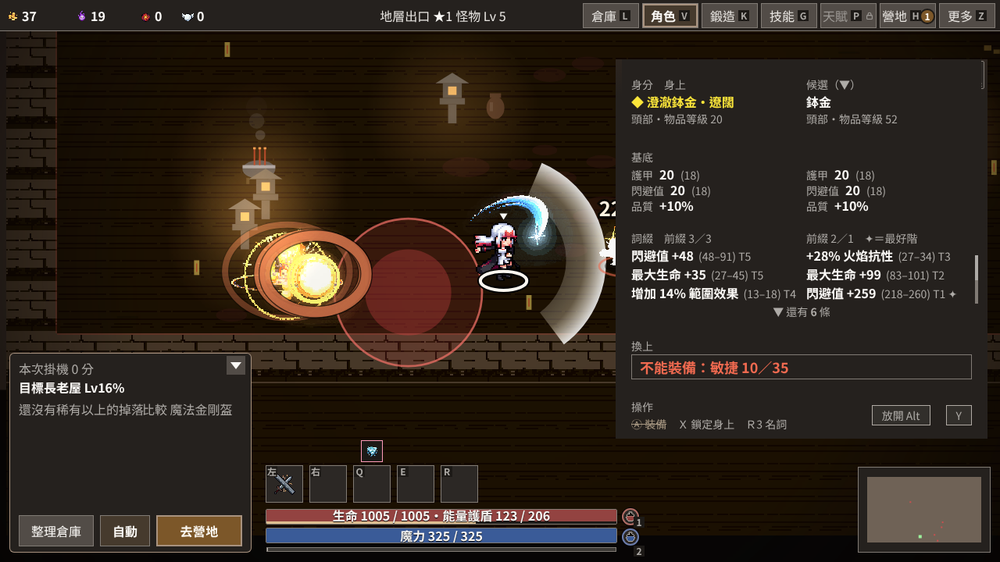 捲動後 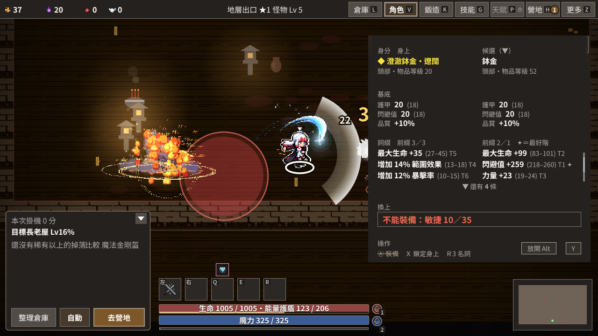

### B. 破裂／追憶換定稿原檔
- `git checkout origin/assets/affix-icons-final-1124 -- art/icons/affix/affix_{frac,mem}_16{,@2x}.png`（cc1ea88；沒有 merge 那個分支、沒有刪分支）。mumi 2026-11-21 11:37 定稿：破裂＝胖五角星、追憶＝墨瓶加一滴墨。
- sha256 核對（4 個都相符）：
  - `28b588c5655c83502f572262dcd6fee05d5eea1502cad731813b2a45a9ba7360` affix_frac_16.png ✅
  - `7753b35fed8994a6bea7354a09f25c60b83f5f20e0c9eb8c8043ee82b3533533` affix_frac_16@2x.png ✅
  - `6250622ccef630d63fb6fadb6974fecda6fb96cbbc1adf682d5e5ac16597d8c1` affix_mem_16.png ✅
  - `46db574efd195a4eb41e55deefb7cbd8c08fba193f88e2ee6ff4c54ff80dd141` affix_mem_16@2x.png ✅
- 原圖 16×16／32×32，外框在 16 格內。程式本來就沒有墊 18×18（`.cx img` 16×16），沒改；DPR2 用 `16@2x`，char_check 新斷言驗了 src、原圖尺寸與畫成 16×16。
- 移除 `evidence/character-1280/README.md` 的「暫代／佔位」註記。沒有放 32 原生圖或 txt。
- DPR1 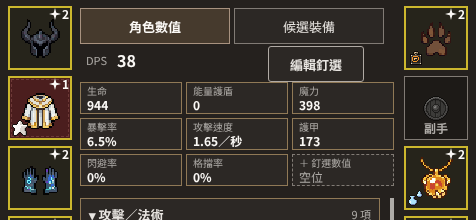 DPR2 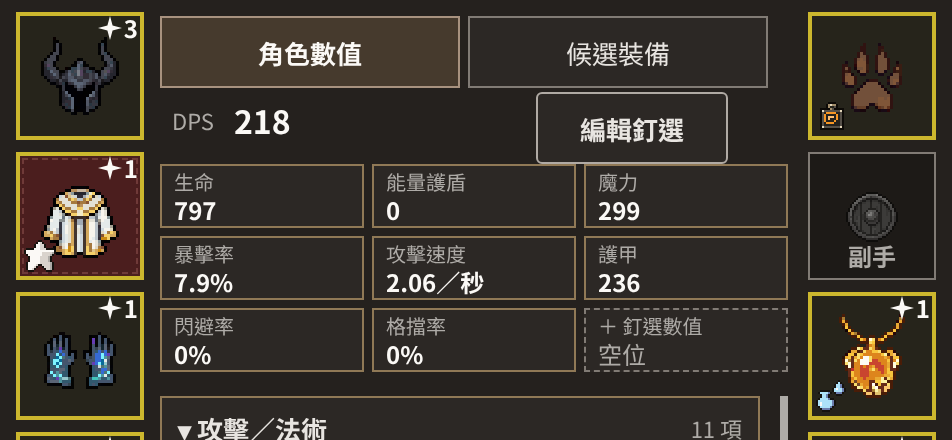

## 測試（fix3，main `202fc04a` vs `6f0f2ec4`，都在本機實際跑）
| 檢查 | main 202fc04a | fix3 6f0f2ec4 |
|---|---|---|
| `node tools/check.js` | 951 ✅ / 0 ❌ | **951 ✅ / 0 ❌** |
| `node tools/char_check.js` | （main 沒有這支） | **62 ✅ / 0 ❌**（fix2 head 是 54/0） |
| touch_check 390×844 | 161/0 | 161/0 |
| touch_check 375×667 | 160/1 → 重跑 161/0（「快速一撥＝翻滾」時序） | 161/0 |
| touch_check 844×390 | 16/0 | 16/0 |
| touch_check 667×375 | 16/0 | 16/0 |
| touch_check 1280×720 | 16/0 | 16/0 |
| touch_check 1440×900 | 16/0 | 16/0 |
| touch_check 1280×800 | 16/0 | 16/0 |
| pro_check | 35/0 | 35/0 |
| hide_check | 52/0 | 52/0 |
| world_check | 42/0 | 42/0 |
| prettier 3.3.3 | — | 符合 |

**char_check 不穩（這輪沒改，既有的）**：連續重跑時，新舊版都偶爾有 1–2 項和這輪無關的失敗：面板 x 812（應 788）、長按選單點外面關、手把方向鍵、第三隻戒指 x 偏移、王印圖示空字串。fix2 head `4d8fcd0` 單獨重跑 6 次有 2 次失敗，fix3 這 7 項新斷言在所有重跑中都沒失敗過。

## fix2：腐化虛線 token 與 check.js（依 mumi 11/24「照工程師建議：立 --corr-dash-rgb 並改 check.js 那 3 項，B2-CAT 改成允許 .c12、.cq、.ccl 用 --cat-cal」）
- `css/style.css` `:root` 立 `--corr-dash-rgb: 111, 58, 56;`（＝`#6f3a38`，照既有 `-rgb` 三元組寫法），腐化虛線 `--d` 改 `rgb(var(--corr-dash-rgb), 1)`；css／js／index.html 不再有 `#6f3a38`（註解也拿掉）。
  - 用逗號寫法不用 `/ 1`：`rgb(var(--x-rgb) / 1)` 代入後變成 `rgb(111, 58, 56 / 1)`，逗號跟斜線混用，Chrome 判成無效值，虛線整個消失（char_check「腐化…虛線」實際抓到 `background-image: none`）。check.js「M2-38 顏色」兩種寫法都允許。
- `tools/check.js`（只動這 4 項，其他斷言不動、不放寬）：
  - 新增 `corrDash()`：`:root` 有 `--corr-dash-rgb: 111, 58, 56`；`:root` 以外只有一條規則用它，選擇器是 `.c12 .cq.co::before`，而且 `--d: rgb(var(--corr-dash-rgb), 1) 0 3px, transparent 3px 5px;`；style.css（含註解）、js/*、index.html 都沒有 `6f3a38`；JS／HTML 不碰這個 token。
  - 「M2-38 顏色」「CSS 色票：style.css 的規則與 8 支 JS 都沒有寫死 hex、rgb()」「色票：style.css 的 :root 以外沒有寫死的色碼」三項：原條件全部保留，各多 `&& corrDash()`，名稱加「；腐化虛線走 :root 的 --corr-dash-rgb」。
  - 「B2-CAT」：`--cat-cal` 從「還沒有元件用到」改成只准 `:root` 以外、選擇器（逗號拆開後每一段）同時有 `.c12`、`.cq`、`.ccl` 的規則用，而且至少一條（現在是 `.c12 .cq .ccl stop`）；這些規則不准用 `--cat-cal-hi`、不准重新定義 `--cat-cal`；JS／index.html 有 `var(--cat-cal` 照舊失敗。`--cat-corr` 部分不動。
  - 總數 951 → 951：沒有新增或刪除斷言，只改了上面 4 項的條件和名稱。
  - 突變測試（改完還原）：虛線寫回 `#6f3a38` → 3 項 ❌；token 值改成 111, 58, 57 → 3 項 ❌；別的規則也用 `--corr-dash-rgb` → 3 項 ❌；`.bag .ccl` 用 `--cat-cal`、`.c12 .cq .ccl` 用 `--cat-cal-hi`、`.c12 .cq .x`（少 `.ccl`）用 `--cat-cal` → 各自 B2-CAT ❌。
- 文件：`M2-36-palette-tokens.md` 色票表補 `--corr-dash-rgb` 一列；`docs/production/CHANGELOG.md` 最上面記 mumi 原話。
- 外觀：1280×720 @2x 修改前（`b7c18f1` 的 css）跟修改後同一存檔的胸甲（腐化）、鞋子（災魘）格逐像素比：鞋子完全相同；胸甲只差右上 ✦{n}（測試存檔每次隨機骰詞綴，0 對 2），遮掉那塊後完全相同，虛線像素仍是 (111, 58, 56)。
  - 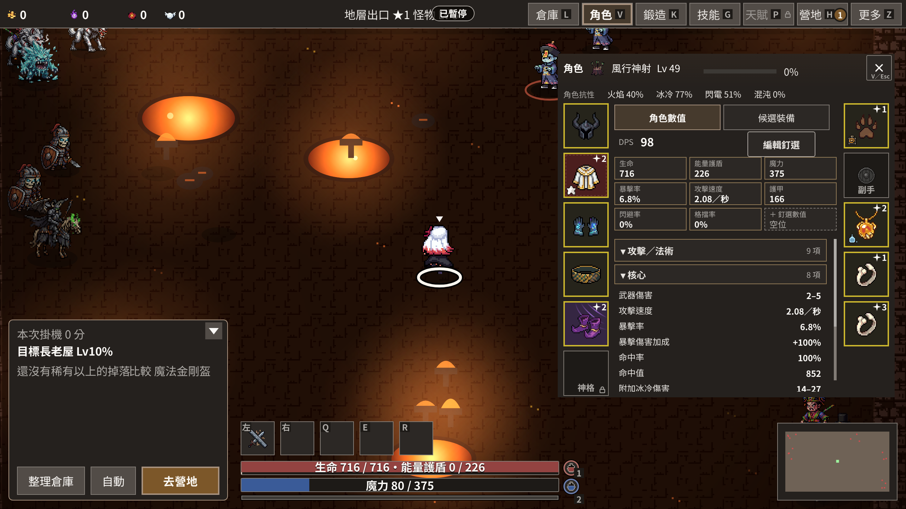
  - 格子前後（左二：胸甲 修改前／後；右二：鞋子 修改前／後）：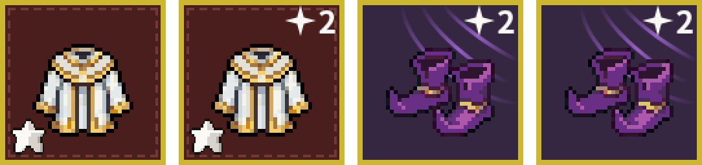
- **另外發現（這次沒改）**：本 PR 前幾輪在 `.c12` 段另外寫了 4 個 `rgb(var(--x-rgb) / α)`，代入後也是逗號、斜線混用的無效值（行 2810 `#pinv.c12` box-shadow、2841 `.c12 .cq > i` text-shadow、2893 `.c12 .cmenu`、2914 `.c12 .c12p`），那些陰影其實沒畫出來。要不要改成 `rgb(var(--x-rgb), α)` 請裁定。

## 測試（fix2，main `202fc04a` vs `4d8fcd0e`）
| 檢查 | main 202fc04a | fix1 b7c18f15 | fix2 4d8fcd0e |
|---|---|---|---|
| `node tools/check.js` | 951 ✅ / 0 ❌ | 947 / 4 | **951 ✅ / 0 ❌** |
| `node tools/char_check.js` | （沒有這支） | 54 / 0 | **54 ✅ / 0 ❌**（單獨跑兩次都 54/0；跟 touch_check 同時跑時有一次手把方向鍵時序失敗，單獨重跑沒有重現） |
| touch_check 390×844 | 161/0 | 161/0 | 161/0 |
| touch_check 375×667 | 161/0 | 161/0 | 161/0 |
| touch_check 844×390 | 16/0 | 16/0 | 16/0 |
| touch_check 667×375 | 16/0 | 16/0 | 16/0 |
| touch_check 1280×720 | 16/0 | 16/0 | 16/0 |
| touch_check 1440×900 | 16/0 | 16/0 | 16/0 |
| touch_check 1280×800 | 16/0 | 16/0 | 16/0 |
| pro_check | 35/0 | 35/0 | 35/0 |
| hide_check | 52/0 | 52/0 | 52/0 |
| world_check | 42/0 | 42/0 | 42/0 |
| prettier 3.3.3 | — | 符合 | 符合 |

## 合併 main
用 merge（沒有 rebase、沒有 force push）把 main `202fc04a` 併進來。衝突只有 `docs/production/CHANGELOG.md` 最上面幾行：兩邊都保留，依時間排序（main 的 15:39、15:35 在上，本分支的 13:36 在下）。

## 這次修的項目
| 編號 | 做了什麼 |
|---|---|
| V-1 #1 | 長按選單：關閉監聽改掛在視窗層（capture 的 pointerdown），點右欄外任何地方都關；Esc 先關選單、面板留著（`js/charpanel.js`） |
| V-2 #2 | 格內：右上 ✦{n}（n＝頂階詞條數，0 不畫；12 px 四角星 SVG＋12/700；右緣 −3、上緣 +框寬）；左下特殊詞 16 px 圖示（x 4、y 44、間距 2、最多 2 個，破裂 > 追憶 > 印；印用王印 16）；腐化：`--cell-corrupt` 底＋框內 3 px 處 1 px 虛線 `#6f3a38`（3 亮 2 暗，在道具圖下面）；災魘：`--cell-cal` 底＋§4 貝茲三道爪痕（1.5 px、`--cat-cal` 中段 70%、兩端淡出；層序 格底→爪痕→道具圖→框→角標；框直角）。稀有格框改用 `--rar-rare-frame`。`css/style.css` 補 `--cell-corrupt`、`--cell-cal`、`--rar-rare-frame` 三個 token |
| V-4 #4 Q8 | 浮窗左上 796,76、寬 460；簡易高 448–486、詳細 486、下緣 ≤ 562。③ 放不下時層內捲動（滑鼠在候選格上滾輪捲 ③，出 4 px 軌），①②④⑤ 永遠完整；不再裁切詞綴 |
| V-5 #5 Q3 | 拿掉浮窗頂「懸浮時才出現」「懸浮時才出現・按住 Alt／Y 中」與名詞提示帽「名詞提示 停留 0.4 秒／手把 Ｒ3」；名詞提示只留正文。⑤ 的「按住／放開 Alt」保留 |
| V-6 #6 Q12 | 「可以換的 n 件，▲ k」只算穿得上的；不能裝備的仍在「全部／未鎖」、排在可裝備件之後（判定與最新兩種排序都是）、不給判定角標、右下 12 px 斜線 `--bad`（有鎖時畫在鎖左邊，不重疊）、不淡化；讀屏與 ④ 寫「不能裝備：{原因}」、⑤ Ⓐ 裝備停用、點了也不換上。空格的候選數與讀屏也只算穿得上的 |
| Q4 | 第三隻戒指：已在右柱第 6 格 1192,496（核對過，char_check 有斷言）；護符列下一版 |
| Q7 | ⑤ 改「Ⓐ 裝備 Ｘ 鎖定身上 Ｒ3 名詞」 |
| Q9 | 核對：全為 0 寫「沒有變化」、不能裝備寫原因不列差值（已有，補斷言） |
| Q11 L-12 | 手把方向鍵在裝備格與候選格之間移焦點（候選 4×3 照行列），焦點格立即出比較浮窗；另外修了面板重畫（戰鬥中一直重畫）會把焦點丟掉的問題 |
| L-7 | 輔助字一律 400（抗性標與值、Lv、DPS 標、固定 3 格標、釘選標、可以換的、數值列名） |
| L-8 | 暴擊率固定一位小數（7.0%） |
| L-9 | 選單「說明」：沒有 TERMS 就不畫那一行（原本就是這樣，補斷言） |
| L-10 | 數值清單、候選區、浮窗 ③ 改自繪 4 px 軌（軌 `--border`、滑塊 `--tx-dim`），內容超出才出現；清單 1178,338 4×200、候選 1150,254 4×204 |
| L-13 | 本說明的疊圖與原圖連結都改成正常 Markdown |

`#dnav` 維持 7 格，`tools/check.js` 沒動。

## 測試（fix1：main `202fc04a` vs 修正後 `b7c18f15`）
| 檢查 | main 202fc04a | 修正後 |
|---|---|---|
| `node tools/check.js` | 951 ✅ / 0 ❌ | **947 ✅ / 4 ❌**（見下方「規格與 check.js 衝突」） |
| `node tools/char_check.js` | （main 沒有這支）；修正前 c2064b6 跑自己的版本 36/0 | **54 ✅ / 0 ❌**（新斷言拿去跑修正前的程式，在格狀態那一步就掛掉） |
| touch_check 390×844 | 161/0 | 161/0 |
| touch_check 375×667 | 161/0 | 161/0 |
| touch_check 844×390 | 16/0 | 16/0 |
| touch_check 667×375 | 16/0 | 16/0 |
| touch_check 1280×720 | 16/0 | 16/0 |
| touch_check 1440×900 | 16/0 | 16/0 |
| touch_check 1280×800 | 16/0 | 16/0 |
| pro_check | 35/0 | 35/0 |
| hide_check | 52/0 | 52/0 |
| world_check | 42/0 | 第一次 41/1（「AI：踩到怪物方的地面就往外走」，跟角色頁無關）；重跑兩次都 42/0 |
| prettier 3.3.3 | — | 全部符合 |

`char_check.js` 的改動：簡易浮窗「剛好 448」改成高 ∈ [448, 486]、下緣 ≤ 562、左上 796,76、寬 460（照 RULINGS）；「最新」排序改成「新的在前、不能裝備的排在後面」（照 V-6）；舊的「6＋6 詞綴」測試換成更嚴的雙防禦＋6＋6（12 條詞綴都在 DOM、可捲、①②④⑤ 完整，簡易／詳細都驗）。其他舊斷言都還在。新增：點右欄外三個座標＋Esc 關選單、✦{n}、16 px 破裂／追憶／印、腐化底＋虛線、災魘底＋爪痕、稀有框色、輔助字 400、暴擊率 n.n%、不能裝備（n、排序、斜線、Ⓐ 停用、④ 原因）、空格候選數、自繪捲動軌、沒有標注文字、⑤「鎖定身上」、第三隻戒指 1192,496、手把方向鍵。

## 疊圖（1280×720 實機 vs 示意圖；紅框＝圖例、綠框＝實機）
逐項差在 [diff.md](https://github.com/Shiroyashatw/dpoe/blob/b7c18f1504f26ff0ea568d32016e1505ab4eade4/docs/production/evidence/character-1280/diff.md)：**108 項全部 Δ ≤ 1 px**（含這次新加的：16 胸甲破裂圖示 800,260 16×16、43 清單捲動軌 1178,338 4×200、46 候選捲動軌 1150,254 4×204，都是 +0,+0 +0,+0）。浮窗：04a 796,76 460×448、04b 796,76 460×486，① 796,98 高 68、② y 191、③ y 276（04a 94／04b 106）、④ y 395／407、⑤ y 472／484，全部 Δ 0。

| 01 | 02 | 03 |
|---|---|---|
| 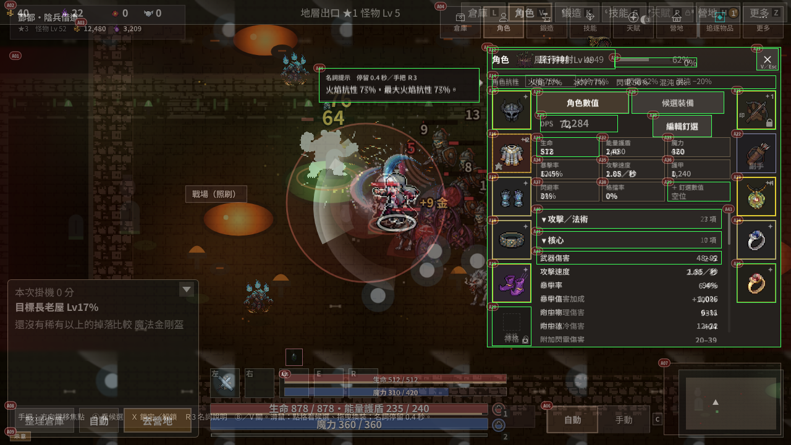 | 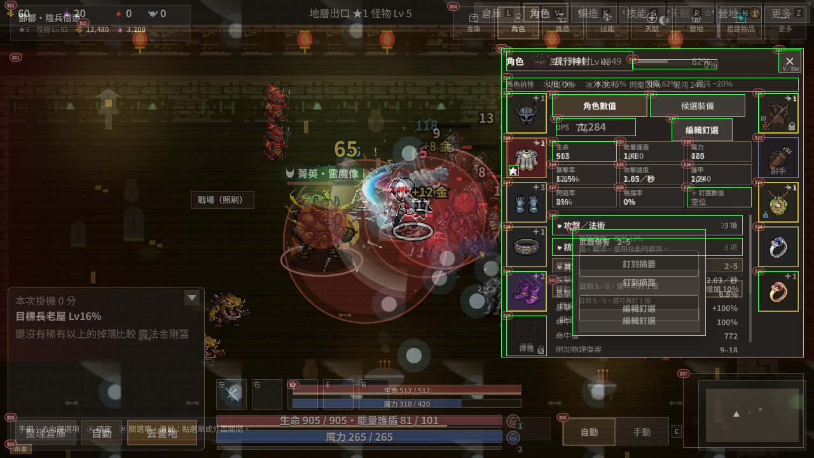 | 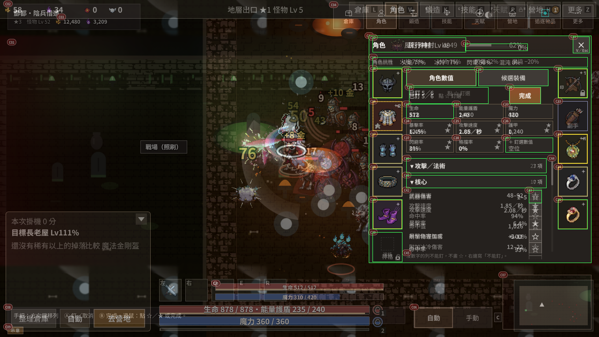 |
| **04a** | **04b** | **07** |
| 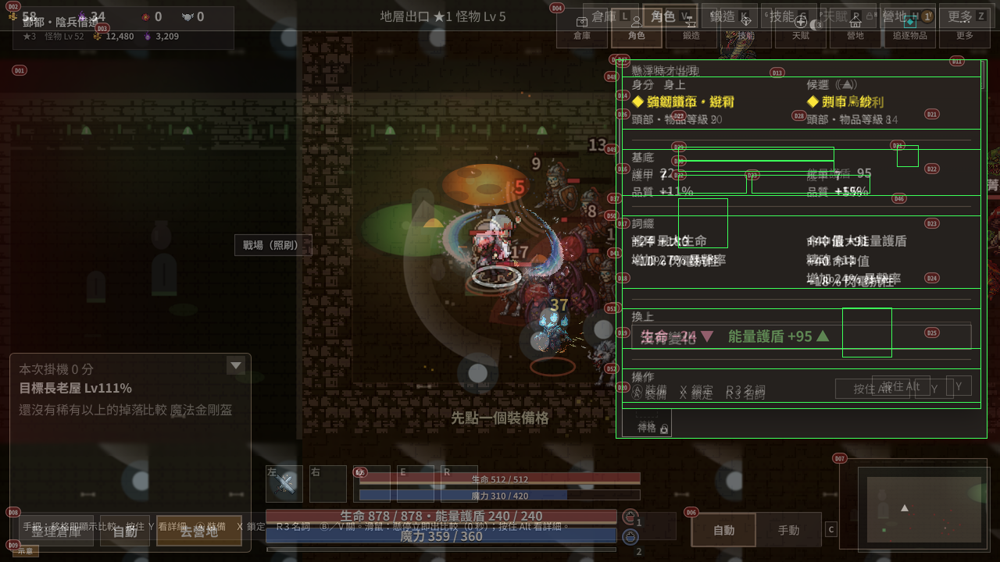 | [overlay-04b](`` https://github.com/Shiroyashatw/dpoe/raw/b7c18f1504f26ff0ea568d32016e1505ab4eade4/docs/production/evidence/character-1280/overlay-04b-cands-hover-alt.png ``) | 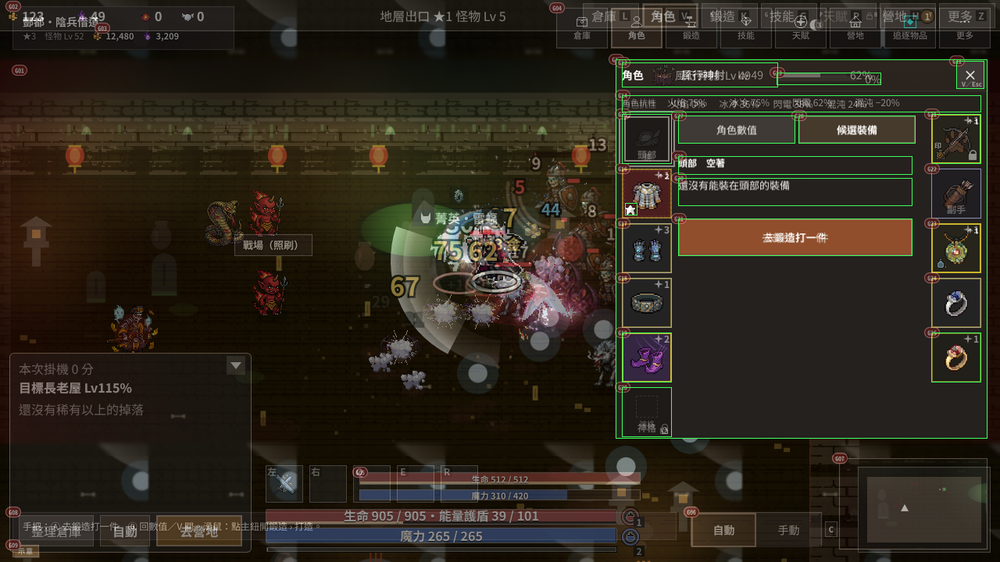 |

實機原圖：````````````````` [01](https://github.com/Shiroyashatw/dpoe/blob/b7c18f1504f26ff0ea568d32016e1505ab4eade4/docs/production/evidence/character-1280/01-stats.png)、[02](https://github.com/Shiroyashatw/dpoe/blob/b7c18f1504f26ff0ea568d32016e1505ab4eade4/docs/production/evidence/character-1280/02-stats-menu.png)、[03](https://github.com/Shiroyashatw/dpoe/blob/b7c18f1504f26ff0ea568d32016e1505ab4eade4/docs/production/evidence/character-1280/03-pin-edit.png)、[04a](https://github.com/Shiroyashatw/dpoe/blob/b7c18f1504f26ff0ea568d32016e1505ab4eade4/docs/production/evidence/character-1280/04a-cands-hover.png)、[04b](https://github.com/Shiroyashatw/dpoe/blob/b7c18f1504f26ff0ea568d32016e1505ab4eade4/docs/production/evidence/character-1280/04b-cands-hover-alt.png)、[07](https://github.com/Shiroyashatw/dpoe/blob/b7c18f1504f26ff0ea568d32016e1505ab4eade4/docs/production/evidence/character-1280/07-empty.png)；390×844：[390x844-char.png](https://github.com/Shiroyashatw/dpoe/blob/b7c18f1504f26ff0ea568d32016e1505ab4eade4/docs/production/evidence/character-1280/390x844-char.png)。 `````````````````

### 這次改到的部分的截圖
| 角標、腐化／災魘底（01：胸甲腐化＋破裂、鞋子災魘爪痕、項鍊追憶、武器王印、✦n） | 長按選單點 (300,300) 後已關 |
|---|---|
| 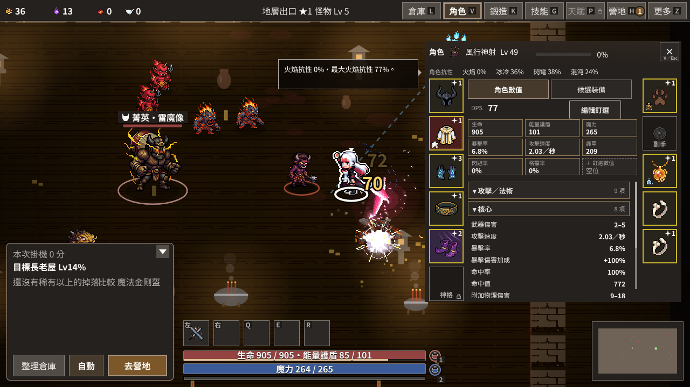 | [menu-closed](```` https://github.com/Shiroyashatw/dpoe/raw/b7c18f1504f26ff0ea568d32016e1505ab4eade4/docs/production/evidence/character-1280/02-menu-closed-click-300-300.png ````) |
| **不能裝備（斜線、排後面、可以換的 3 件）** | **雙防禦＋6＋6 詞綴：③ 層內捲、浮窗不超出右欄** |
| 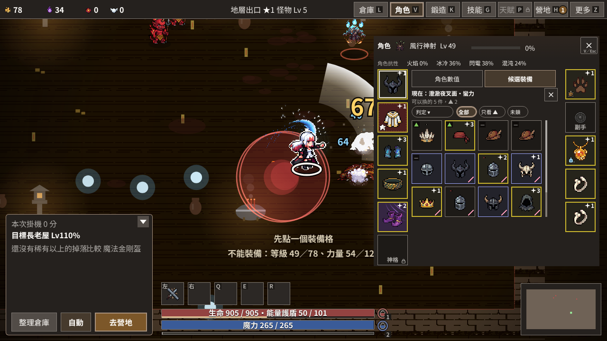 | 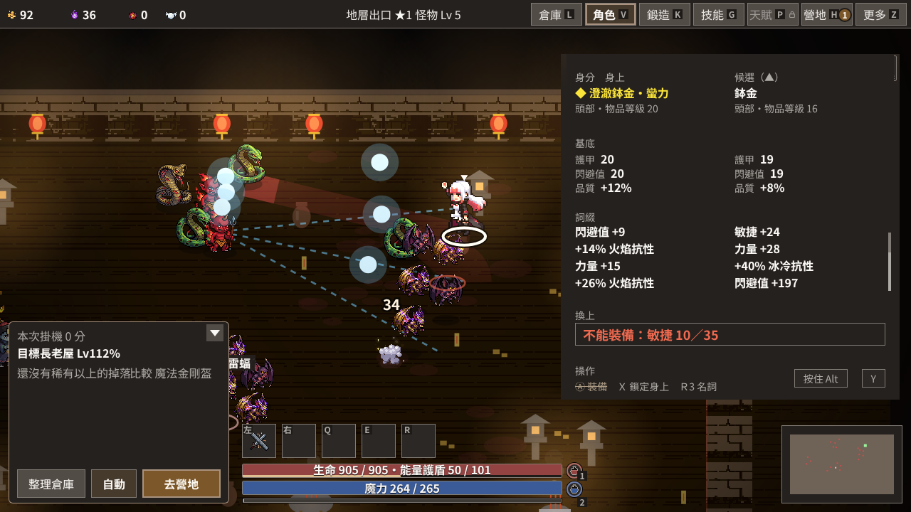 |

詳細版雙防禦：[04b-dualdef-6affix.png](`````````````````` https://github.com/Shiroyashatw/dpoe/blob/b7c18f1504f26ff0ea568d32016e1505ab4eade4/docs/production/evidence/character-1280/04b-dualdef-6affix.png)。截圖裡的裝備、詞綴、數字都是測試存檔隨機產生的，不是示意圖的示例。 ``````````````````

## 規格與 check.js 衝突（fix2 已依 mumi 11/24 裁定處理，見上方 fix2 段；以下保留 fix1 當時的紀錄）
修正後 check.js 多 4 項失敗，全部來自 V-2 照 RULINGS 做的兩件事，而 check.js 這次不准改：
1. **腐化虛線色 `#6f3a38`**：RULINGS 寫「palette 沒有 `--corr-dash`，不要自造 token」，直接用 item-display K2 色值；但 check.js 三項禁止 `:root` 以外寫死色碼——「M2-38 顏色」「CSS 色票：style.css 的規則都沒有寫死 hex」「色票：:root 以外沒有寫死的色碼 #6f3a38」。我試過用現有 `-rgb` 三元組加 α 疊出這個色，最接近也差 4（`--bad-rgb` 0.19），語意也不對，所以沒有用。
2. **爪痕用 `--cat-cal`**：RULINGS／M2-character §4 指定，但 check.js「B2-CAT」斷言「`--cat-cal*` 還沒有元件用到」（註解寫「之後徽章批次才用」）。

可行做法（擇一，需要裁定）：在 palette 立一個虛線色 token（例 `--corr-dash-rgb 111, 58, 56`）並更新 check.js 三項；B2-CAT 改成允許 `.c12 .cq .ccl` 用 `--cat-cal`。

## 其他要知道的
- **破裂／追憶定稿原檔讀不到**：RULINGS 給的 `/workspace/dpoe-docs/...`、`/workspace/character-panels-1124/...` 在雲端工作環境不存在，任何分支也沒有。先放：`art/icons/affix/affix_frac_16(@2x).png` 從定稿示意圖 `01-stats-color.png` 胸甲格取出（示意圖是 3 px 一格的點陣，不是剛好 16@2x）；`affix_mem_16(@2x).png` 是我畫的墨瓶佔位。**要換成定稿原檔**（同檔名覆蓋就好，程式不用改）。
- **③ 怎麼捲**：浮窗不接滑鼠（Q2），RULINGS 只寫「③ 層內捲動」沒寫怎麼捲。我做成「滑鼠在候選格上滾輪時，③ 放不下就捲 ③」（這時候選區不捲）。請 UIUX 確認。
- 爪痕「碰到角標底板時在底板外 1 px 切斷」沒做（✦n 沒有底板，▲ 底板在左上不會碰到右上的爪痕）。
- 規格補則（RULINGS 寫「下次改 M2-character-1280.md 時寫入」：7 格分頁、第三隻戒指 1192,496、02「或停留」刪除、浮窗蓋住候選格是預期）這次沒改規格檔。

## 未做（照 RULINGS）
- 下一版：護符列、拖曳換裝、數值清單結構（等 character-stats-list 定稿）、長按選單完整 TERMS 說明文。
- 不做：停留開長按選單（Q6／L-11）、浮窗改位置（Q2）。
- 未驗：桌面 Chrome 實機捲動條寬度、實機 gamma／色弱下爪痕與虛線辨識、④ 差值與 04b 區間重算。

## 【問 mumi】
1. **桌機分頁要不要從現行 7 格改回 8 格（加追逐物品 Y）？** 角色示意圖畫了八格（沿用 11/17 的 M2-37.4），但 11/20 已核准戰鬥 HUD 七格、追逐放在「更多」與 Y 鍵。本版維持七格、不改 HUD、不改 check.js；八格若要做放下一版或另開 HUD PR。

https://claude.ai/code/session_01LdUmBJVpPfS71M4VG4PBcs
https://claude.ai/code/session_01LdUmBJmkLfKEar5NFnH19P
https://claude.ai/code/session_01LdUmBKVKuE7e5QDEXFnjeu


---
_Generated by [Claude Code](https://claude.ai/code)_
