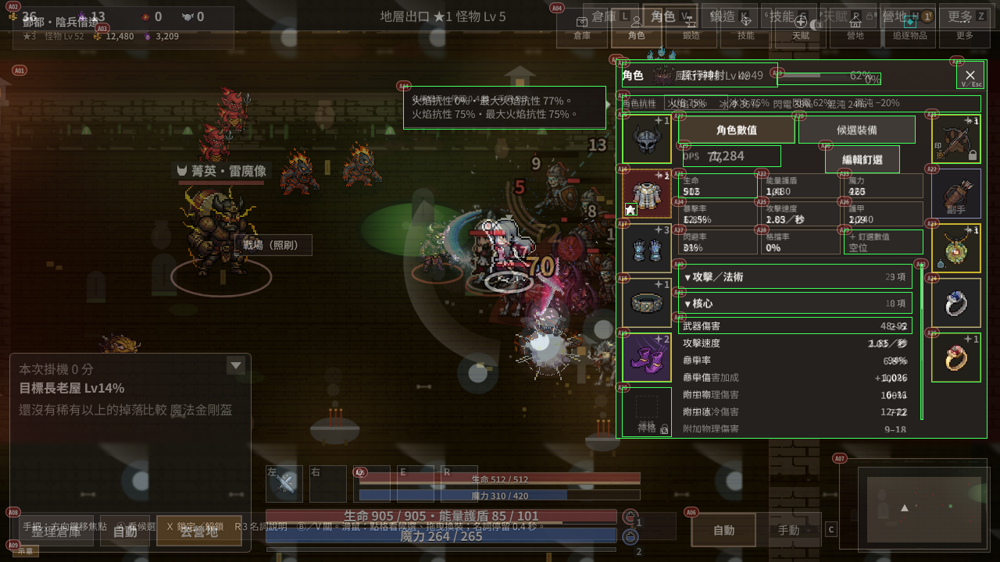
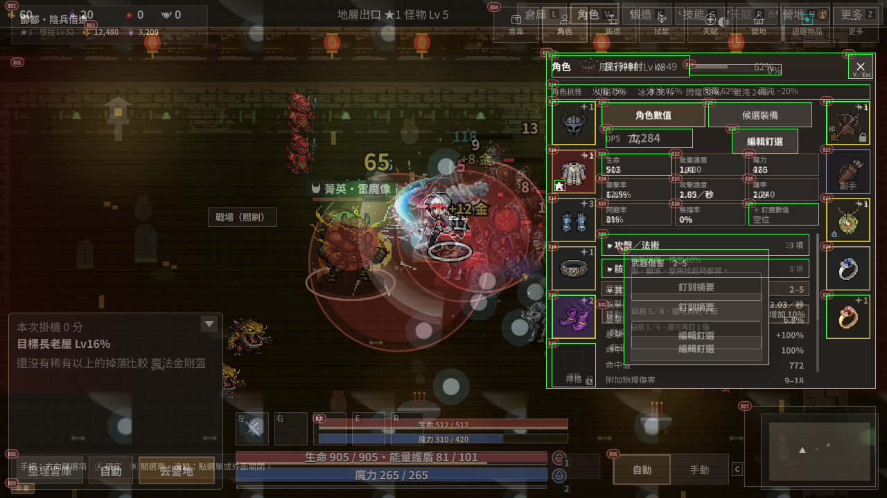
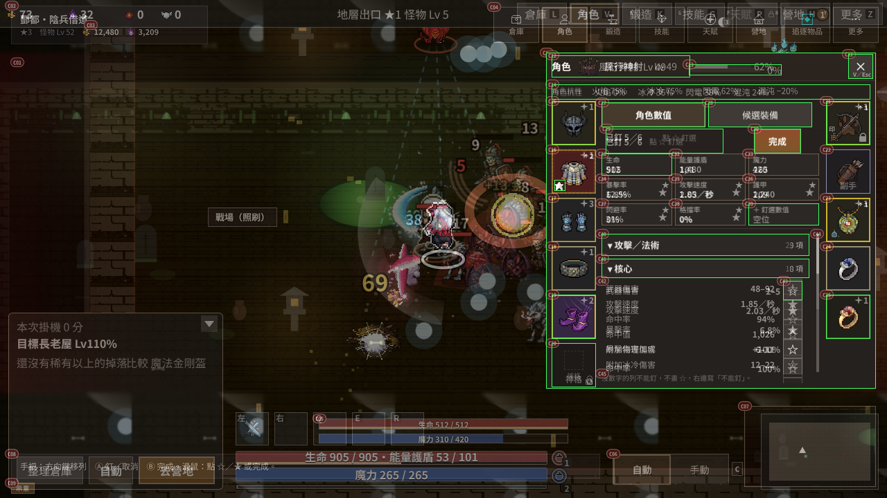
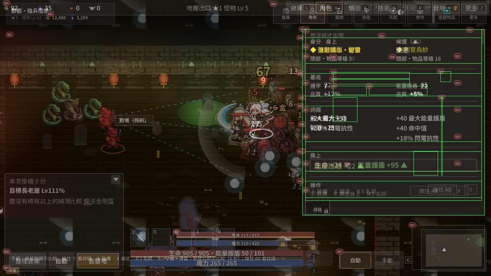
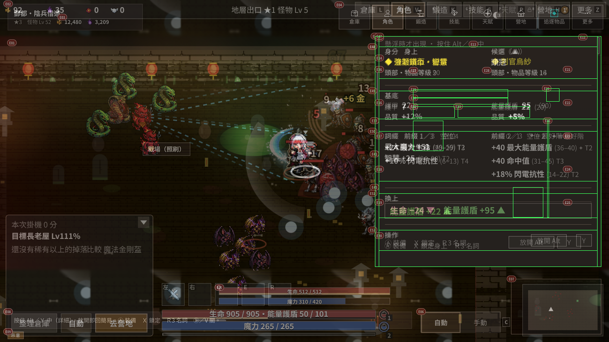
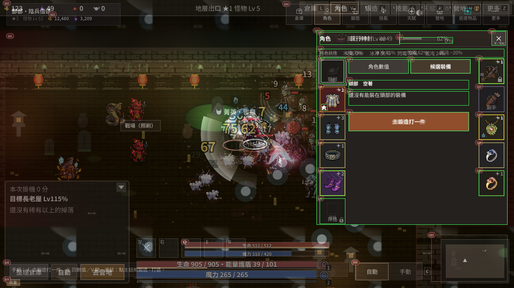

# 角色頁 1280×720 疊圖：示意圖圖例座標 vs 實機（px）

紅框＝示意圖圖例座標，綠框＝實機（`tools/char_check.js` 量 DOM）。差值＝實機 − 規格；`—`＝實機沒有這個元素。浮窗各層的高度已扣掉層間距下半（padding 12＋線 1），跟圖例的層高同一個量法。

## 01-stats

| 圖例 | 規格 x,y w×h | 實機 x,y w×h | 差 Δx,Δy Δw,Δh | 符合 |
|---|---|---|---|---|
| 10 右欄 | 788,76 476×486 | 788,76 476×486 | +0,+0 +0,+0 | ✅ |
| 11 關閉 | 1224,78 36×36 | 1224,78 36×36 | +0,+0 +0,+0 | ✅ |
| 12 標題列 | 796,80 200×32 | 796,80 200×32 | +0,+0 +0,+0 | ✅ |
| 13 經驗條 | 994,93 134×16 | 994,93 134×16 | +0,+0 +0,+0 | ✅ |
| 14 抗性列 | 796,122 460×22 | 796,122 460×22 | +0,+0 +0,+0 | ✅ |
| 15 頭部 | 796,146 64×64 | 796,146 64×64 | +0,+0 +0,+0 | ✅ |
| 19 鞋子 | 796,426 64×64 | 796,426 64×64 | +0,+0 +0,+0 | ✅ |
| 20 神格 | 796,496 64×64 | 796,496 64×64 | +0,+0 +0,+0 | ✅ |
| 21 武器 | 1192,146 64×64 | 1192,146 64×64 | +0,+0 +0,+0 | ✅ |
| 25 戒指 | 1192,426 64×64 | 1192,426 64×64 | +0,+0 +0,+0 | ✅ |
| 27 切換 角色數值 | 868,148 150×36 | 868,148 150×36 | +0,+0 +0,+0 | ✅ |
| 28 切換 候選裝備 | 1022,148 150×36 | 1022,148 150×36 | +0,+0 +0,+0 | ✅ |
| 16 胸甲 破裂圖示（左下 x 4、y 44） | 800,260 16×16 | 800,260 16×16 | +0,+0 +0,+0 | ✅ |
| 29 DPS | 874,186 126×28 | 874,186 126×28 | +0,+0 +0,+0 | ✅ |
| 30 編輯釘選 | 1056,186 96×36 | 1056,186 96×36 | +0,+0 +0,+0 | ✅ |
| 31 固定格 生命 | 868,222 102×32 | 868,222 102×32 | +0,+0 +0,+0 | ✅ |
| 39 空釘位 | 1080,294 102×32 | 1080,294 102×32 | +0,+0 +0,+0 | ✅ |
| 40 分組 攻擊／法術 | 868,338 300×32 | 868,338 300×32 | +0,+0 +0,+0 | ✅ |
| 41 子組 核心 | 868,374 300×28 | 868,374 300×28 | +0,+0 +0,+0 | ✅ |
| 42 數值列（第一列） | 868,406 300×22 | 868,406 300×22 | +0,+0 +0,+0 | ✅ |
| 43 清單捲動軌 | 1178,338 4×200 | 1178,338 4×200 | +0,+0 +0,+0 | ✅ |
| 44 名詞提示 | 516,110 260×56 | 516,110 260×56 | +0,+0 +0,+0 | ✅ |

## 02-stats-menu

| 圖例 | 規格 x,y w×h | 實機 x,y w×h | 差 Δx,Δy Δw,Δh | 符合 |
|---|---|---|---|---|
| 10 右欄 | 788,76 476×486 | 788,76 476×486 | +0,+0 +0,+0 | ✅ |
| 11 關閉 | 1224,78 36×36 | 1224,78 36×36 | +0,+0 +0,+0 | ✅ |
| 12 標題列 | 796,80 200×32 | 796,80 200×32 | +0,+0 +0,+0 | ✅ |
| 13 經驗條 | 994,93 134×16 | 994,93 134×16 | +0,+0 +0,+0 | ✅ |
| 14 抗性列 | 796,122 460×22 | 796,122 460×22 | +0,+0 +0,+0 | ✅ |
| 15 頭部 | 796,146 64×64 | 796,146 64×64 | +0,+0 +0,+0 | ✅ |
| 19 鞋子 | 796,426 64×64 | 796,426 64×64 | +0,+0 +0,+0 | ✅ |
| 20 神格 | 796,496 64×64 | 796,496 64×64 | +0,+0 +0,+0 | ✅ |
| 21 武器 | 1192,146 64×64 | 1192,146 64×64 | +0,+0 +0,+0 | ✅ |
| 25 戒指 | 1192,426 64×64 | 1192,426 64×64 | +0,+0 +0,+0 | ✅ |
| 27 切換 角色數值 | 868,148 150×36 | 868,148 150×36 | +0,+0 +0,+0 | ✅ |
| 28 切換 候選裝備 | 1022,148 150×36 | 1022,148 150×36 | +0,+0 +0,+0 | ✅ |
| 16 胸甲 破裂圖示（左下 x 4、y 44） | 800,260 16×16 | 800,260 16×16 | +0,+0 +0,+0 | ✅ |
| 29 DPS | 874,186 126×28 | 874,186 126×28 | +0,+0 +0,+0 | ✅ |
| 30 編輯釘選 | 1056,186 96×36 | 1056,186 96×36 | +0,+0 +0,+0 | ✅ |
| 31 固定格 生命 | 868,222 102×32 | 868,222 102×32 | +0,+0 +0,+0 | ✅ |
| 39 空釘位 | 1080,294 102×32 | 1080,294 102×32 | +0,+0 +0,+0 | ✅ |
| 40 分組 攻擊／法術 | 868,338 300×32 | 868,338 300×32 | +0,+0 +0,+0 | ✅ |
| 41 子組 核心 | 868,374 300×28 | 868,374 300×28 | +0,+0 +0,+0 | ✅ |
| 42 長按選單 | 900,360 210×168 | 900,360 210×168 | +0,+0 +0,+0 | ✅ |

## 03-pin-edit

| 圖例 | 規格 x,y w×h | 實機 x,y w×h | 差 Δx,Δy Δw,Δh | 符合 |
|---|---|---|---|---|
| 10 右欄 | 788,76 476×486 | 788,76 476×486 | +0,+0 +0,+0 | ✅ |
| 11 關閉 | 1224,78 36×36 | 1224,78 36×36 | +0,+0 +0,+0 | ✅ |
| 12 標題列 | 796,80 200×32 | 796,80 200×32 | +0,+0 +0,+0 | ✅ |
| 13 經驗條 | 994,93 134×16 | 994,93 134×16 | +0,+0 +0,+0 | ✅ |
| 14 抗性列 | 796,122 460×22 | 796,122 460×22 | +0,+0 +0,+0 | ✅ |
| 15 頭部 | 796,146 64×64 | 796,146 64×64 | +0,+0 +0,+0 | ✅ |
| 19 鞋子 | 796,426 64×64 | 796,426 64×64 | +0,+0 +0,+0 | ✅ |
| 20 神格 | 796,496 64×64 | 796,496 64×64 | +0,+0 +0,+0 | ✅ |
| 21 武器 | 1192,146 64×64 | 1192,146 64×64 | +0,+0 +0,+0 | ✅ |
| 25 戒指 | 1192,426 64×64 | 1192,426 64×64 | +0,+0 +0,+0 | ✅ |
| 27 切換 角色數值 | 868,148 150×36 | 868,148 150×36 | +0,+0 +0,+0 | ✅ |
| 28 切換 候選裝備 | 1022,148 150×36 | 1022,148 150×36 | +0,+0 +0,+0 | ✅ |
| 16 胸甲 破裂圖示（左下 x 4、y 44） | 800,260 16×16 | 800,260 16×16 | +0,+0 +0,+0 | ✅ |
| 29 已釘 n／6 | 874,186 170×36 | 874,186 170×36 | +0,+0 +0,+0 | ✅ |
| 30 完成 | 1088,186 68×36 | 1088,186 68×36 | +0,+0 +0,+0 | ✅ |
| 31 固定格 生命 | 868,222 102×32 | 868,222 102×32 | +0,+0 +0,+0 | ✅ |
| 39 空釘位 | 1080,294 102×32 | 1080,294 102×32 | +0,+0 +0,+0 | ✅ |
| 40 分組 攻擊／法術 | 868,338 300×32 | 868,338 300×32 | +0,+0 +0,+0 | ✅ |
| 41 子組 核心 | 868,374 300×28 | 868,374 300×28 | +0,+0 +0,+0 | ✅ |
| 43 ☆／★（第一顆） | 1130,406 28×28 | 1130,406 28×28 | +0,+0 +0,+0 | ✅ |

## 04a-cands-hover

| 圖例 | 規格 x,y w×h | 實機 x,y w×h | 差 Δx,Δy Δw,Δh | 符合 |
|---|---|---|---|---|
| 10 右欄 | 788,76 476×486 | 788,76 476×486 | +0,+0 +0,+0 | ✅ |
| 29 候選標題 | 868,188 200×18 | 868,188 200×18 | +0,+0 +0,+0 | ✅ |
| 30 可以換的 n 件 | 868,206 200×14 | 868,206 200×14 | +0,+0 +0,+0 | ✅ |
| 31 收起 × | 1148,186 28×28 | 1148,186 28×28 | +0,+0 +0,+0 | ✅ |
| 32 排序 | 868,224 88×24 | 868,224 88×24 | +0,+0 +0,+0 | ✅ |
| 33 篩選 | 962,224 152×24 | 962,224 152×24 | +0,+0 +0,+0 | ✅ |
| 34 候選第 1 格 | 868,254 64×64 | 868,254 64×64 | +0,+0 +0,+0 | ✅ |
| 45 候選第 12 格 | 1078,394 64×64 | 1078,394 64×64 | +0,+0 +0,+0 | ✅ |
| 46 候選捲動軌 | 1150,254 4×204 | 1150,254 4×204 | +0,+0 +0,+0 | ✅ |
| 47 比較浮窗 | 796,76 460×448 | 796,76 460×448 | +0,+0 +0,+0 | ✅ |
| 48 ① 身分層 | 796,98 460×68 | 796,98 460×68 | +0,+0 +0,+0 | ✅ |
| 49 ② 基底層 | 796,191 460×60 | 796,191 460×60 | +0,+0 +0,+0 | ✅ |
| 50 ③ 詞綴層 | 796,276 460×94 | 796,276 460×94 | +0,+0 +0,+0 | ✅ |
| 51 ④ 換上層 | 796,395 460×52 | 796,395 460×52 | +0,+0 +0,+0 | ✅ |
| 52 ⑤ 操作層 | 796,472 460×44 | 796,472 460×44 | +0,+0 +0,+0 | ✅ |

## 04b-cands-hover-alt

| 圖例 | 規格 x,y w×h | 實機 x,y w×h | 差 Δx,Δy Δw,Δh | 符合 |
|---|---|---|---|---|
| 10 右欄 | 788,76 476×486 | 788,76 476×486 | +0,+0 +0,+0 | ✅ |
| 29 候選標題 | 868,188 200×18 | 868,188 200×18 | +0,+0 +0,+0 | ✅ |
| 30 可以換的 n 件 | 868,206 200×14 | 868,206 200×14 | +0,+0 +0,+0 | ✅ |
| 31 收起 × | 1148,186 28×28 | 1148,186 28×28 | +0,+0 +0,+0 | ✅ |
| 32 排序 | 868,224 88×24 | 868,224 88×24 | +0,+0 +0,+0 | ✅ |
| 33 篩選 | 962,224 152×24 | 962,224 152×24 | +0,+0 +0,+0 | ✅ |
| 34 候選第 1 格 | 868,254 64×64 | 868,254 64×64 | +0,+0 +0,+0 | ✅ |
| 45 候選第 12 格 | 1078,394 64×64 | 1078,394 64×64 | +0,+0 +0,+0 | ✅ |
| 46 候選捲動軌 | 1150,254 4×204 | 1150,254 4×204 | +0,+0 +0,+0 | ✅ |
| 47 比較浮窗 | 796,76 460×486 | 796,76 460×486 | +0,+0 +0,+0 | ✅ |
| 48 ① 身分層 | 796,98 460×68 | 796,98 460×68 | +0,+0 +0,+0 | ✅ |
| 49 ② 基底層 | 796,191 460×60 | 796,191 460×60 | +0,+0 +0,+0 | ✅ |
| 50 ③ 詞綴層 | 796,276 460×106 | 796,276 460×106 | +0,+0 +0,+0 | ✅ |
| 51 ④ 換上層 | 796,407 460×52 | 796,407 460×52 | +0,+0 +0,+0 | ✅ |
| 52 ⑤ 操作層 | 796,484 460×44 | 796,484 460×44 | +0,+0 +0,+0 | ✅ |

## 07-empty

| 圖例 | 規格 x,y w×h | 實機 x,y w×h | 差 Δx,Δy Δw,Δh | 符合 |
|---|---|---|---|---|
| 10 右欄 | 788,76 476×486 | 788,76 476×486 | +0,+0 +0,+0 | ✅ |
| 11 關閉 | 1224,78 36×36 | 1224,78 36×36 | +0,+0 +0,+0 | ✅ |
| 12 標題列 | 796,80 200×32 | 796,80 200×32 | +0,+0 +0,+0 | ✅ |
| 13 經驗條 | 994,93 134×16 | 994,93 134×16 | +0,+0 +0,+0 | ✅ |
| 14 抗性列 | 796,122 460×22 | 796,122 460×22 | +0,+0 +0,+0 | ✅ |
| 15 頭部 | 796,146 64×64 | 796,146 64×64 | +0,+0 +0,+0 | ✅ |
| 19 鞋子 | 796,426 64×64 | 796,426 64×64 | +0,+0 +0,+0 | ✅ |
| 20 神格 | 796,496 64×64 | 796,496 64×64 | +0,+0 +0,+0 | ✅ |
| 21 武器 | 1192,146 64×64 | 1192,146 64×64 | +0,+0 +0,+0 | ✅ |
| 25 戒指 | 1192,426 64×64 | 1192,426 64×64 | +0,+0 +0,+0 | ✅ |
| 27 切換 角色數值 | 868,148 150×36 | 868,148 150×36 | +0,+0 +0,+0 | ✅ |
| 28 切換 候選裝備 | 1022,148 150×36 | 1022,148 150×36 | +0,+0 +0,+0 | ✅ |
| 16 胸甲 破裂圖示（左下 x 4、y 44） | 800,260 16×16 | 800,260 16×16 | +0,+0 +0,+0 | ✅ |
| 29 空狀態標題 | 868,200 300×24 | 868,200 300×24 | +0,+0 +0,+0 | ✅ |
| 30 還沒有能裝在頭部的裝備 | 868,228 300×36 | 868,228 300×36 | +0,+0 +0,+0 | ✅ |
| 31 去鍛造打一件 | 868,280 300×48 | 868,280 300×48 | +0,+0 +0,+0 | ✅ |

