# 鍛造 v1.0 實機量測（1280×720，DPR 1）

網址 http://localhost:8003/；規格座標＝forge-screens-*.md 的 x,y w×h；差＝實機 − 規格（px），超過 2 標 ❌。
合計 139／141 項在 ±2 px 內；❌ 2 項（照實列出，不放寬）。

## A01（01-make.png）

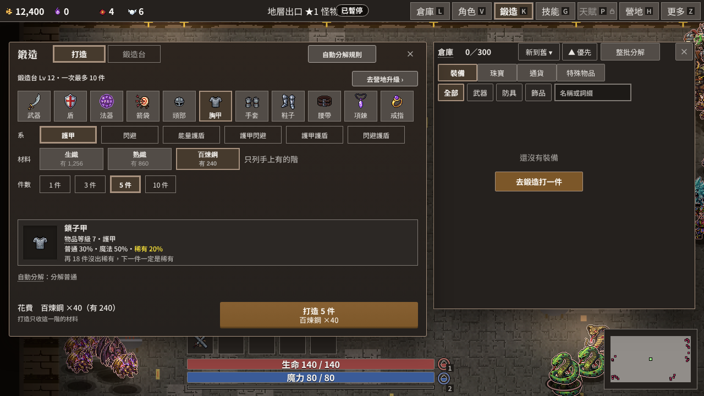　疊圖：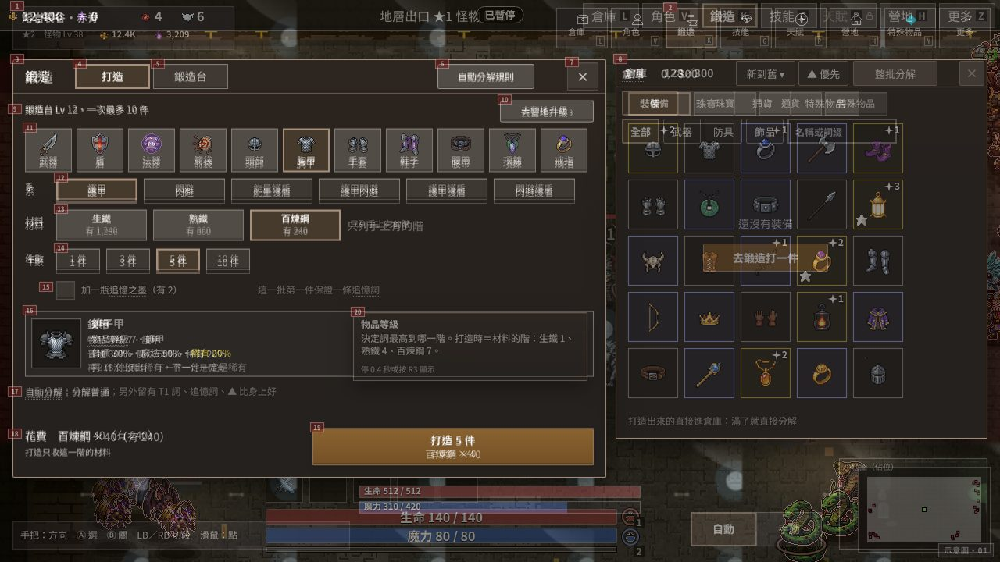

| 元件 | 規格 x,y w×h | 實機 x,y w×h | 差 Δx,Δy Δw,Δh | |
|---|---|---|---|---|
| 鍛造面板 | 16,76 760×536 | 16,76 760×536 | 0,0 0,0 | ✅ |
| 段：打造 | 96,82 96×32 | 96,82 96×32 | 0,0 0,0 | ✅ |
| 段：鍛造台 | 196,82 96×32 | 196,82 96×32 | 0,0 0,0 | ✅ |
| 自動分解規則入口 | 560,82 124×32 | 560,82 124×32 | 0,0 0,0 | ✅ |
| 關閉 | 726,80 40×36 | 726,80 40×36 | 0,0 0,0 | ✅ |
| 倉庫面板 | 788,76 476×486 | 788,76 476×486 | 0,0 0,0 | ✅ |
| 鍛造台等級列 | 32,132 560×16 | 32,133 560×16 | 0,1 0,0 | ✅ |
| 去營地升級 | 640,128 120×28 | 640,129 120×28 | 0,1 0,0 | ✅ |
| 部位（11 種） | 32,164 720×56 | 32,165 720×56 | 0,1 0,0 | ✅ |
| 部位第 1 格 | 32,164 60×56 | 32,165 60×56 | 0,1 0,0 | ✅ |
| 系第 1 顆 | 72,228 104×32 | 72,229 104×32 | 0,1 0,0 | ✅ |
| 材料第 1 顆 | 72,268 116×40 | 72,269 116×40 | 0,1 0,0 | ✅ |
| 件數第 1 顆 | 72,318 56×32 | 72,319 56×32 | 0,1 0,0 | ✅ |
| 追憶之墨 | 72,360 252×24 | 找不到 | — | ❌ |
| 預覽 | 32,398 728×84 | 32,399 728×84 | 0,1 0,0 | ✅ |
| 自動分解摘要 | 32,494 728×16 | 32,495 728×16 | 0,1 0,0 | ✅ |
| 花費 | 32,548 360×20 | 32,549 360×20 | 0,1 0,0 | ✅ |
| 打造（主要按鈕） | 400,548 360×48 | 400,549 360×48 | 0,1 0,0 | ✅ |

## A02（02-make-lack.png）

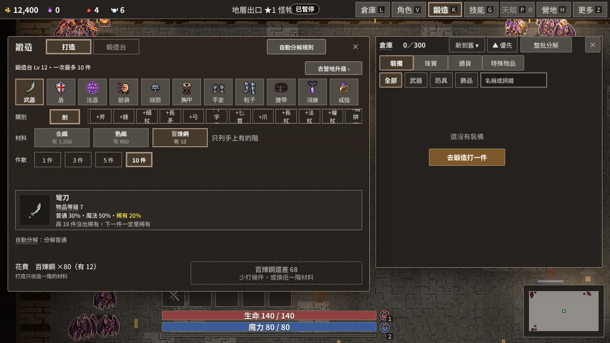　疊圖：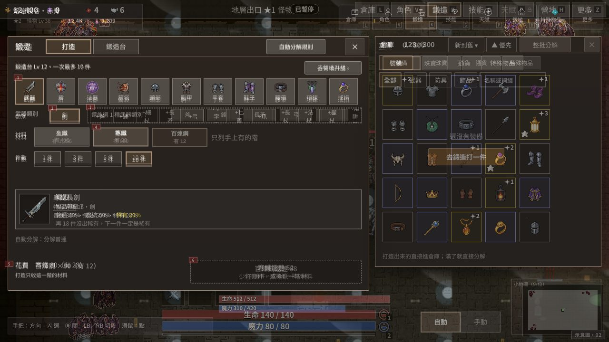

| 元件 | 規格 x,y w×h | 實機 x,y w×h | 差 Δx,Δy Δw,Δh | |
|---|---|---|---|---|
| 部位：武器 | 32,164 60×56 | 32,165 60×56 | 0,1 0,0 | ✅ |
| 武器類別（已開） | 104,228 64×32 | 104,229 64×32 | 0,1 0,0 | ✅ |
| 選新武器類別 | 184,226 576×32 | 184,228 576×32 | 0,2 0,0 | ✅ |
| 花費（不夠） | 32,548 300×20 | 32,549 360×20 | 0,1 60,0 | ❌ |
| 打造（不能按） | 400,548 360×48 | 400,549 360×48 | 0,1 0,0 | ✅ |

## A03（03-make-reveal.png）

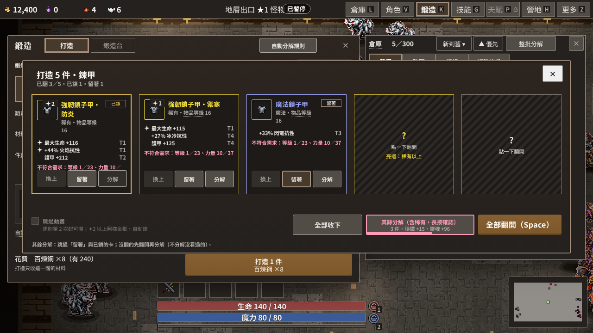　疊圖：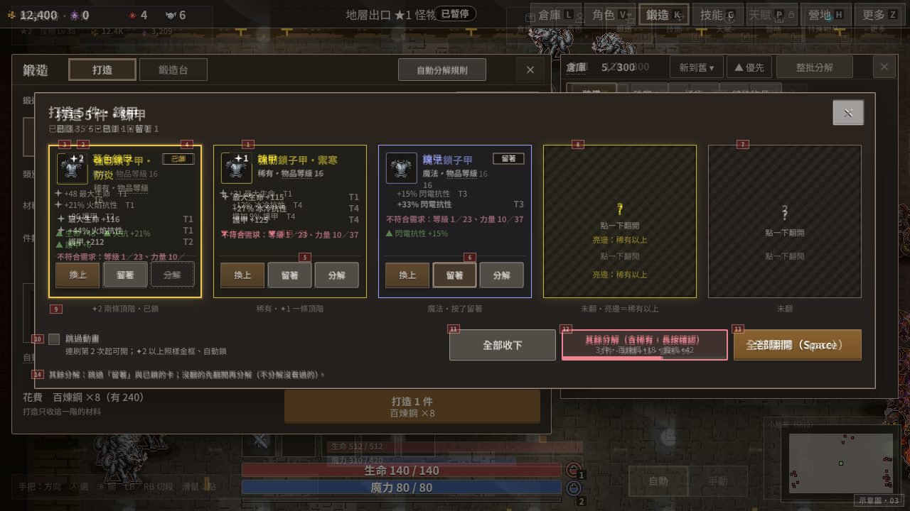

| 元件 | 規格 x,y w×h | 實機 x,y w×h | 差 Δx,Δy Δw,Δh | |
|---|---|---|---|---|
| 卡 1（✦2 金框） | 68,204 216×216 | 68,204 216×216 | 0,0 0,0 | ✅ |
| 卡 2 | 300,204 216×216 | 300,204 216×216 | 0,0 0,0 | ✅ |
| 卡 4（卡背・亮邊） | 764,204 216×216 | 764,204 216×216 | 0,0 0,0 | ✅ |
| 卡 5（卡背） | 996,204 216×216 | 996,204 216×216 | 0,0 0,0 | ✅ |
| 卡 2 單卡按鈕 | 310,370 194×36 | 311,369 194×36 | 1,-1 0,0 | ✅ |
| 卡 1 ✦n | 90,215 32×16 | 92,216 32×16 | 2,1 0,0 | ✅ |
| 卡 1 已鎖標 | 230,216 44×16 | 228,216 44×16 | -2,0 0,0 | ✅ |
| 跳過動畫勾選 | 68,470 16×16 | 68,470 16×16 | 0,0 0,0 | ✅ |
| 全部收下 | 632,464 150×44 | 632,464 150×44 | 0,0 0,0 | ✅ |
| 其餘分解 | 790,464 234×44 | 790,464 234×44 | 0,0 0,0 | ✅ |
| 全部翻開 | 1032,464 180×44 | 1032,464 180×44 | 0,0 0,0 | ✅ |

## A03b（03b-make-reveal-jackpot.png）

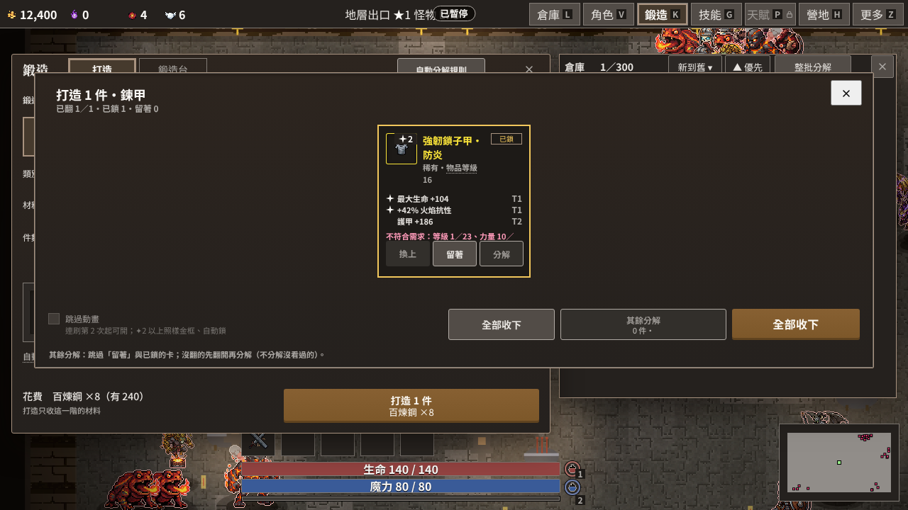　疊圖：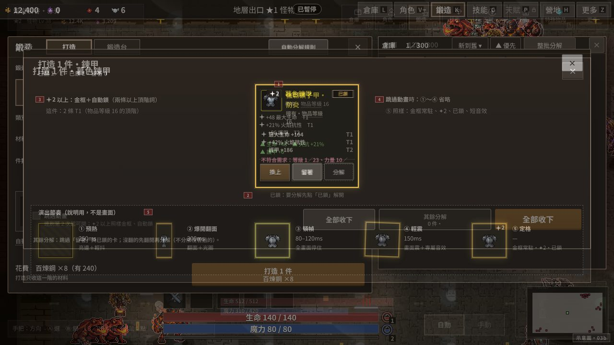

| 元件 | 規格 x,y w×h | 實機 x,y w×h | 差 Δx,Δy Δw,Δh | |
|---|---|---|---|---|
| ✦2 卡（置中） | 532,176 216×216 | 532,176 216×216 | 0,0 0,0 | ✅ |

## A03c（03c-make-reveal-20.png）

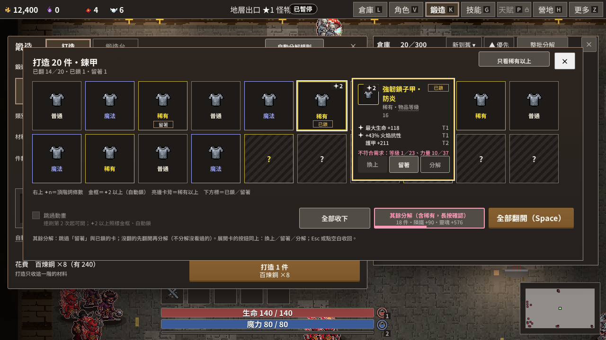　疊圖：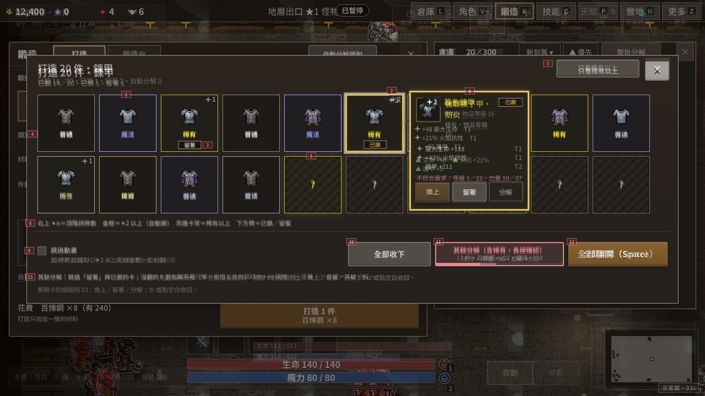

| 元件 | 規格 x,y w×h | 實機 x,y w×h | 差 Δx,Δy Δw,Δh | |
|---|---|---|---|---|
| 小方卡 1 | 68,172 104×104 | 68,172 104×104 | 0,0 0,0 | ✅ |
| 小方卡 2 | 180,172 104×104 | 180,172 104×104 | 0,0 0,0 | ✅ |
| 小方卡 11（第 2 排） | 68,284 104×104 | 68,284 104×104 | 0,0 0,0 | ✅ |
| 展開詳細卡 | 744,166 216×216 | 744,166 216×216 | 0,0 0,0 | ✅ |
| 只看稀有以上 | 1010,108 150×32 | 1011,109 150×32 | 1,1 0,0 | ✅ |
| 跳過動畫勾選 | 68,448 16×16 | 68,448 16×16 | 0,0 0,0 | ✅ |
| 全部收下 | 632,440 150×44 | 632,440 150×44 | 0,0 0,0 | ✅ |
| 其餘分解 | 790,440 234×44 | 790,440 234×44 | 0,0 0,0 | ✅ |
| 全部翻開 | 1032,440 180×44 | 1032,440 180×44 | 0,0 0,0 | ✅ |

## A04（04-auto-salvage.png）

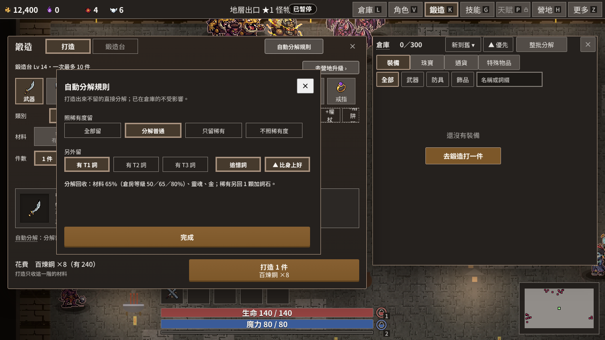　疊圖：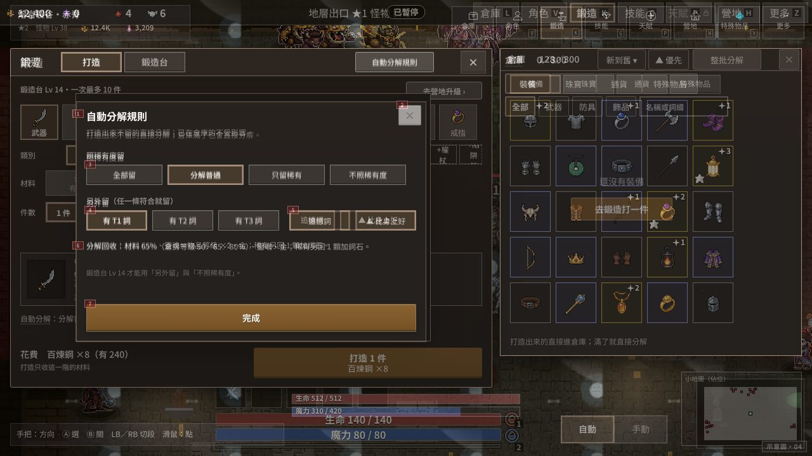

| 元件 | 規格 x,y w×h | 實機 x,y w×h | 差 Δx,Δy Δw,Δh | |
|---|---|---|---|---|
| 標題 | 136,172 300×22 | 136,172 300×22 | 0,0 0,0 | ✅ |
| 關閉 | 628,166 36×32 | 628,166 36×32 | 0,0 0,0 | ✅ |
| 照稀有度留第 1 顆 | 136,260 120×32 | 136,260 120×32 | 0,0 0,0 | ✅ |
| 另外留：詞階第 1 顆 | 136,332 96×32 | 136,332 96×32 | 0,0 0,0 | ✅ |
| 另外留：追憶詞、▲ | 456,332 200×32 | 456,332 200×32 | 0,0 0,0 | ✅ |
| 回收說明 | 136,380 520×34 | 136,380 520×34 | 0,0 0,0 | ✅ |
| 完成 | 136,480 520×44 | 136,480 520×44 | 0,0 0,0 | ✅ |

## A05（05-bench-empty.png）

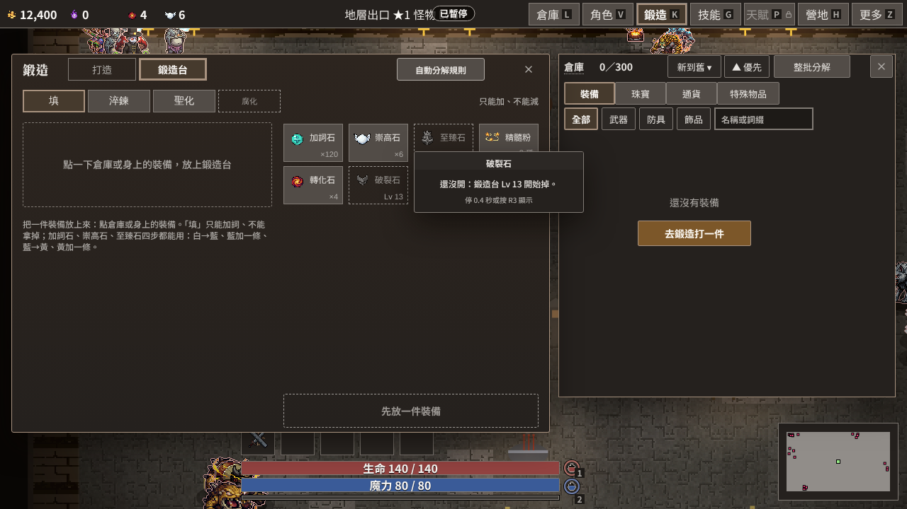　疊圖：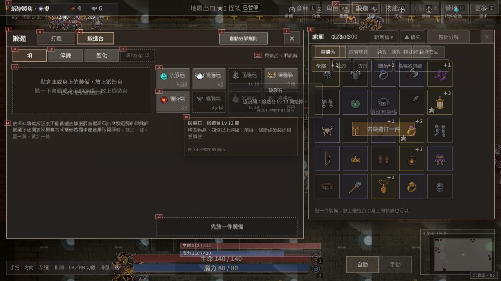

| 元件 | 規格 x,y w×h | 實機 x,y w×h | 差 Δx,Δy Δw,Δh | |
|---|---|---|---|---|
| 鍛造面板 | 16,76 760×536 | 16,76 760×536 | 0,0 0,0 | ✅ |
| 段：打造 | 96,82 96×32 | 96,82 96×32 | 0,0 0,0 | ✅ |
| 段：鍛造台 | 196,82 96×32 | 196,82 96×32 | 0,0 0,0 | ✅ |
| 自動分解規則入口 | 560,82 124×32 | 560,82 124×32 | 0,0 0,0 | ✅ |
| 關閉 | 726,80 40×36 | 726,80 40×36 | 0,0 0,0 | ✅ |
| 子分頁：填 | 32,126 88×32 | 32,127 88×32 | 0,1 0,0 | ✅ |
| 右上提醒 | 500,134 260×16 | 500,135 260×16 | 0,1 0,0 | ✅ |
| 通貨格第 1 格 | 400,174 84×54 | 400,175 84×54 | 0,1 0,0 | ✅ |
| 通貨格第 2 排第 1 格 | 400,234 84×54 | 400,235 84×54 | 0,1 0,0 | ✅ |
| 子分頁：沒開的下一個 | 308,126 88×32 | 308,127 88×32 | 0,1 0,0 | ✅ |
| 放置槽（空） | 32,172 352×120 | 32,173 352×120 | 0,1 0,0 | ✅ |
| 起始說明 | 32,308 352×50 | 32,309 352×48 | 0,1 0,-2 | ✅ |
| 主要按鈕 | 400,556 360×48 | 400,557 360×48 | 0,1 0,0 | ✅ |

## A06（06-fill.png）

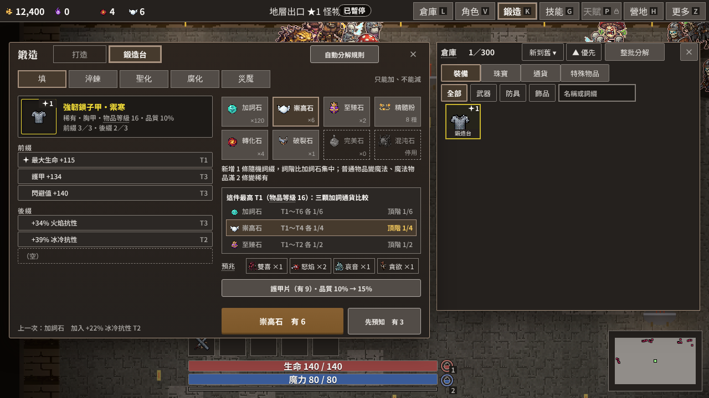　疊圖：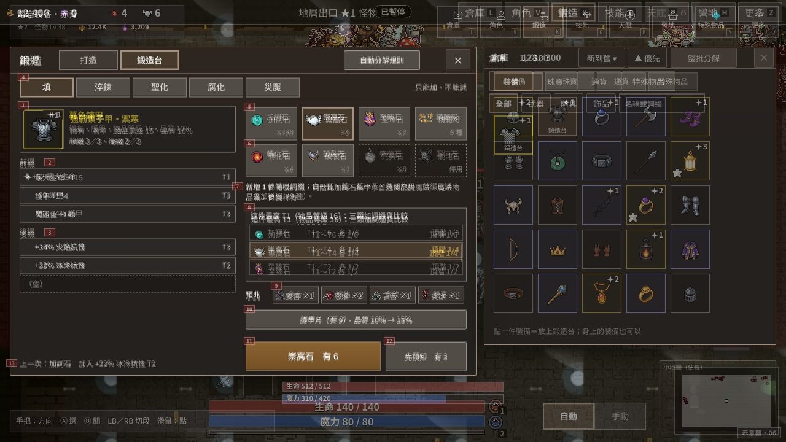

| 元件 | 規格 x,y w×h | 實機 x,y w×h | 差 Δx,Δy Δw,Δh | |
|---|---|---|---|---|
| 子分頁：填 | 32,126 88×32 | 32,127 88×32 | 0,1 0,0 | ✅ |
| 右上提醒 | 500,134 260×16 | 500,135 260×16 | 0,1 0,0 | ✅ |
| 通貨格第 1 格 | 400,174 84×54 | 400,175 84×54 | 0,1 0,0 | ✅ |
| 通貨格第 2 排第 1 格 | 400,234 84×54 | 400,235 84×54 | 0,1 0,0 | ✅ |
| 裝備卡 | 32,172 352×76 | 32,173 352×76 | 0,1 0,0 | ✅ |
| 前綴第 1 列 | 32,274 352×28 | 32,275 352×28 | 0,1 0,0 | ✅ |
| 後綴第 1 列 | 32,388 352×28 | 32,389 352×28 | 0,1 0,0 | ✅ |
| 說明 | 400,296 360×32 | 400,297 360×32 | 0,1 0,0 | ✅ |
| 預覽：三顆比較 | 400,338 360×120 | 400,339 360×120 | 0,1 0,0 | ✅ |
| 預兆第 1 顆 | 444,466 75×28 | 444,467 75×28 | 0,1 0,0 | ✅ |
| 品質 | 400,504 360×32 | 400,505 360×32 | 0,1 0,0 | ✅ |
| 主要按鈕 | 400,556 220×48 | 400,557 220×48 | 0,1 0,0 | ✅ |
| 次要按鈕 | 628,556 132×48 | 628,557 132×48 | 0,1 0,0 | ✅ |
| 結果紀錄 | 32,584 352×16 | 32,585 352×16 | 0,1 0,0 | ✅ |

## A07（07-fill-dust.png）

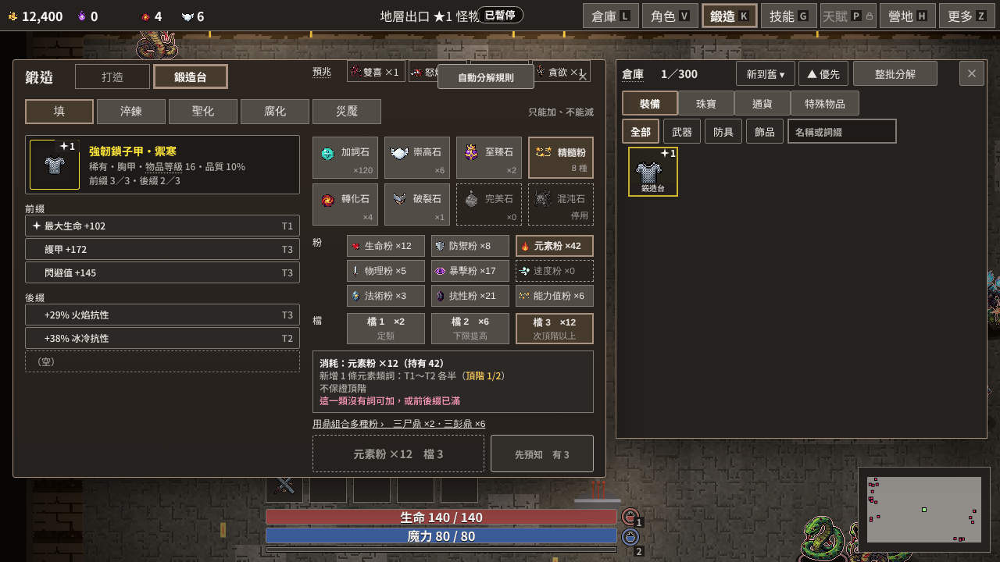　疊圖：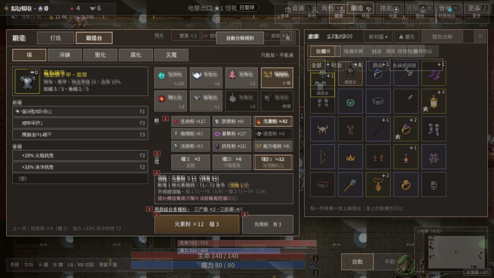

| 元件 | 規格 x,y w×h | 實機 x,y w×h | 差 Δx,Δy Δw,Δh | |
|---|---|---|---|---|
| 精髓粉第 1 顆 | 444,300 100×28 | 444,301 100×28 | 0,1 0,0 | ✅ |
| 檔第 1 顆 | 444,400 100×40 | 444,401 100×40 | 0,1 0,0 | ✅ |
| 預覽：消耗＋詞階範圍 | 400,448 360×80 | 400,449 360×80 | 0,1 0,0 | ✅ |
| 去鼎 | 400,534 360×16 | 400,535 360×17 | 0,1 0,1 | ✅ |
| 主要按鈕 | 400,556 220×48 | 400,557 220×48 | 0,1 0,0 | ✅ |
| 次要按鈕 | 628,556 132×48 | 628,557 132×48 | 0,1 0,0 | ✅ |

## A07b（07b-fill-cauldron.png）

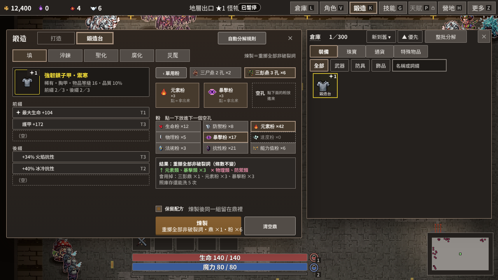　疊圖：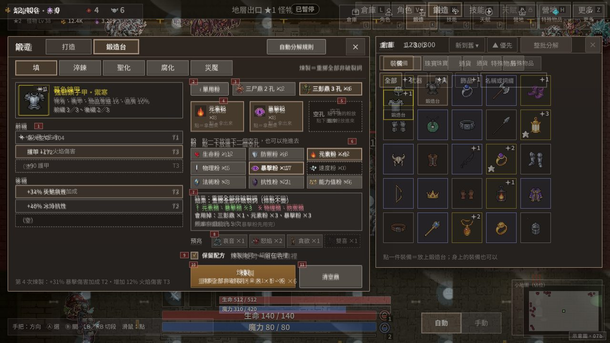

| 元件 | 規格 x,y w×h | 實機 x,y w×h | 差 Δx,Δy Δw,Δh | |
|---|---|---|---|---|
| 回單用粉 | 400,172 80×28 | 400,173 80×28 | 0,1 0,0 | ✅ |
| 選鼎第 1 顆 | 488,172 132×28 | 488,173 132×28 | 0,1 0,0 | ✅ |
| 鼎孔（已放）第 1 孔 | 400,212 112×64 | 400,213 112×64 | 0,1 0,0 | ✅ |
| 鼎孔（空） | 648,212 112×64 | 648,213 112×64 | 0,1 0,0 | ✅ |
| 粉選盤第 1 顆 | 400,310 116×28 | 400,311 116×28 | 0,1 0,0 | ✅ |
| 即時預覽 | 400,404 360×80 | 400,405 360×80 | 0,1 0,0 | ✅ |
| 保留配方 | 400,528 360×16 | 400,529 360×16 | 0,1 0,0 | ✅ |
| 主要按鈕 | 400,556 220×48 | 400,557 220×48 | 0,1 0,0 | ✅ |
| 次要按鈕 | 628,556 132×48 | 628,557 132×48 | 0,1 0,0 | ✅ |

## A08（08-fill-conv.png）

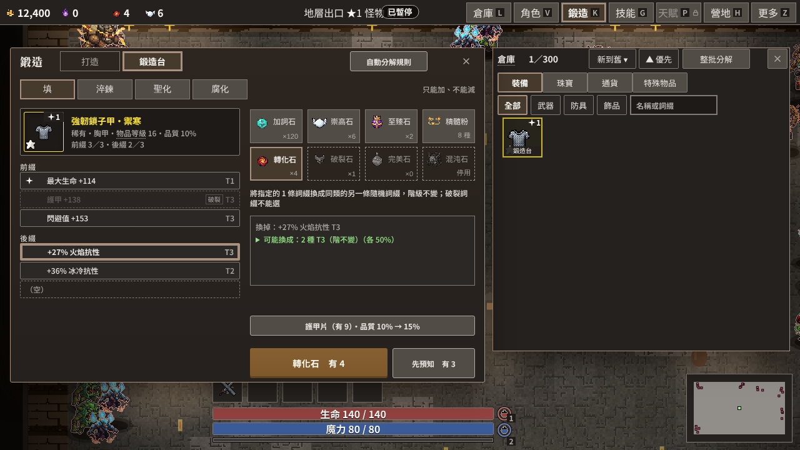　疊圖：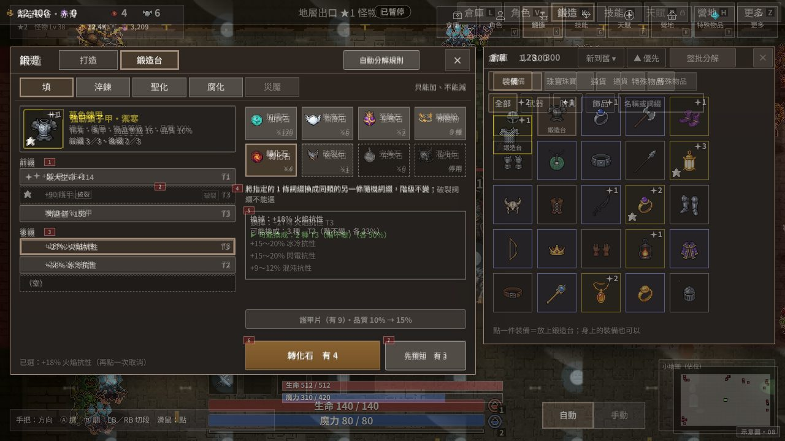

| 元件 | 規格 x,y w×h | 實機 x,y w×h | 差 Δx,Δy Δw,Δh | |
|---|---|---|---|---|
| 可選的詞（第 1 列） | 32,274 352×28 | 32,275 352×28 | 0,1 0,0 | ✅ |
| 說明 | 400,300 360×32 | 400,301 360×32 | 0,1 0,0 | ✅ |
| 預覽：換掉與可能換成 | 400,344 360×112 | 400,345 360×112 | 0,1 0,0 | ✅ |
| 主要按鈕 | 400,556 220×48 | 400,557 220×48 | 0,1 0,0 | ✅ |
| 次要按鈕 | 628,556 132×48 | 628,557 132×48 | 0,1 0,0 | ✅ |

## A09（09-fill-foresight.png）

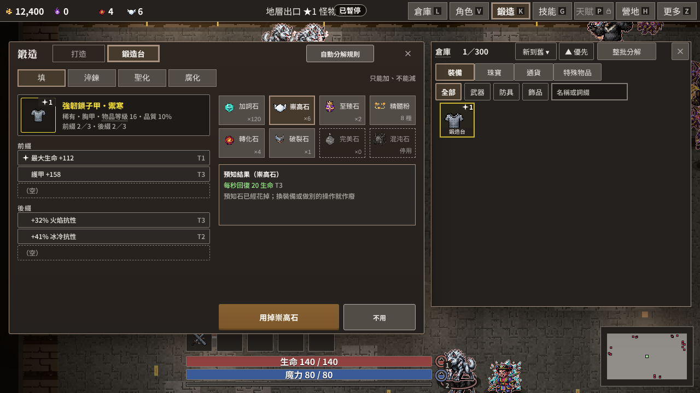　疊圖：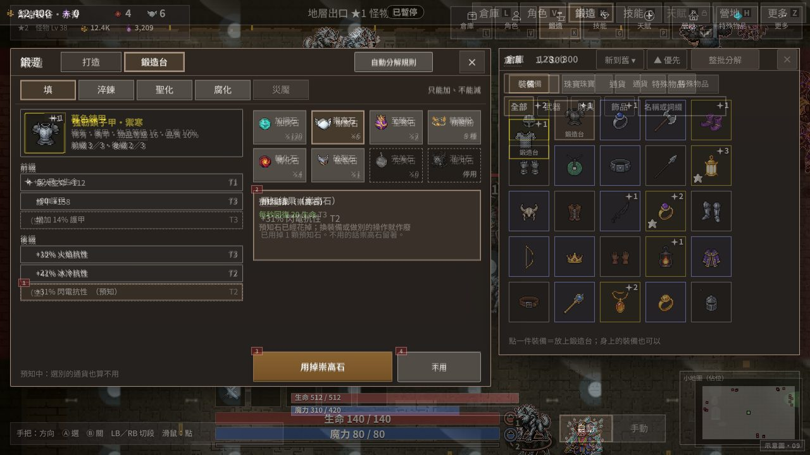

| 元件 | 規格 x,y w×h | 實機 x,y w×h | 差 Δx,Δy Δw,Δh | |
|---|---|---|---|---|
| 預知結果 | 400,300 360×112 | 400,301 360×112 | 0,1 0,0 | ✅ |
| 主要按鈕 | 400,556 220×48 | 400,557 220×48 | 0,1 0,0 | ✅ |
| 次要按鈕 | 628,556 132×48 | 628,557 132×48 | 0,1 0,0 | ✅ |

## A10（10-fill-joy-pick.png）

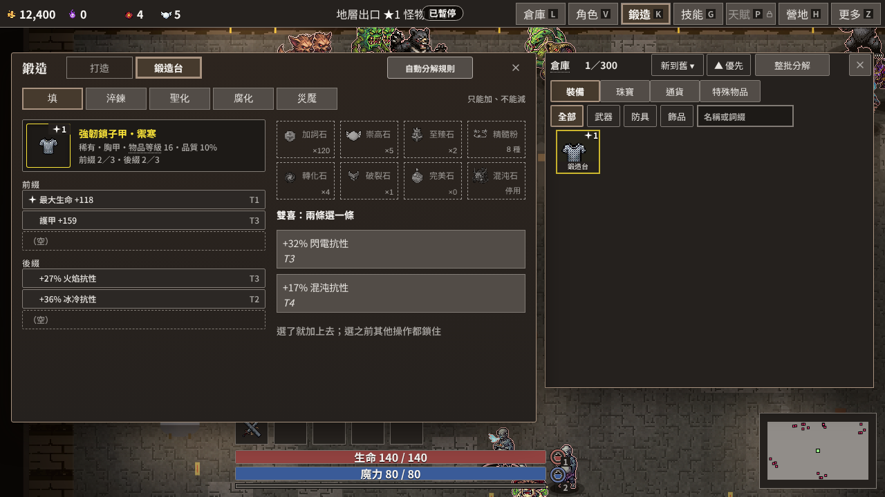　疊圖：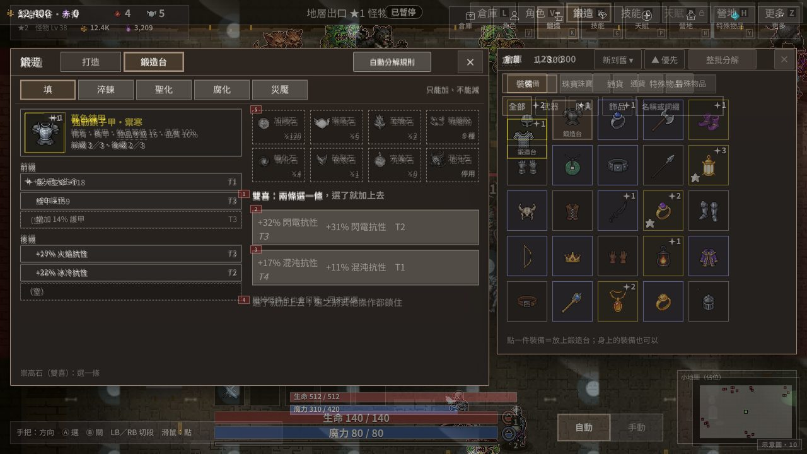

| 元件 | 規格 x,y w×h | 實機 x,y w×h | 差 Δx,Δy Δw,Δh | |
|---|---|---|---|---|
| 標題 | 400,300 360×20 | 400,301 360×20 | 0,1 0,0 | ✅ |
| 選項 1 | 400,332 360×56 | 400,333 360×56 | 0,1 0,0 | ✅ |
| 選項 2 | 400,396 360×56 | 400,397 360×56 | 0,1 0,0 | ✅ |
| 提醒 | 400,468 360×16 | 400,469 360×16 | 0,1 0,0 | ✅ |
| 通貨格（鎖住） | 400,174 360×114 | 400,175 360×114 | 0,1 0,0 | ✅ |

## A11（11-fill-lack.png）

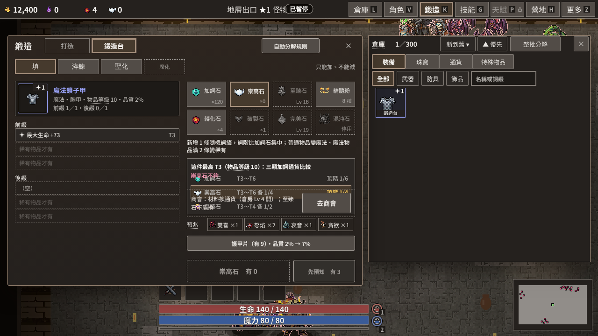　疊圖：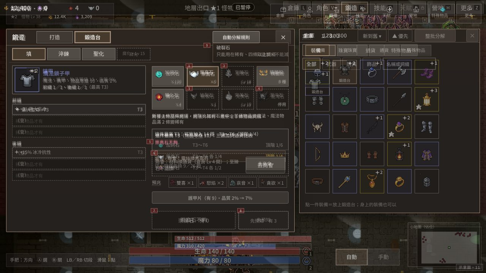

| 元件 | 規格 x,y w×h | 實機 x,y w×h | 差 Δx,Δy Δw,Δh | |
|---|---|---|---|---|
| 選中但數量 0（崇高石） | 492,174 84×54 | 492,175 84×54 | 0,1 0,0 | ✅ |
| 還沒開（至臻石） | 584,174 84×54 | 584,175 84×54 | 0,1 0,0 | ✅ |
| 不能用在這件（破裂石） | 492,234 84×54 | 492,235 84×54 | 0,1 0,0 | ✅ |
| 停用（混沌石） | 676,234 84×54 | 676,235 84×54 | 0,1 0,0 | ✅ |
| 不夠的原因 | 408,366 200×16 | 408,367 200×16 | 0,1 0,0 | ✅ |
| 去商會 | 400,404 360×60 | 400,405 360×60 | 0,1 0,0 | ✅ |
| 主要按鈕 | 400,556 220×48 | 400,557 220×48 | 0,1 0,0 | ✅ |
| 次要按鈕 | 628,556 132×48 | 628,557 132×48 | 0,1 0,0 | ✅ |

## A12（12-temper.png）

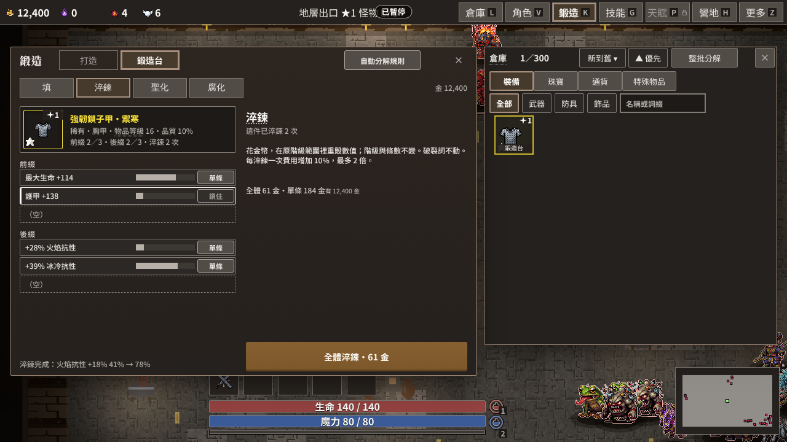　疊圖：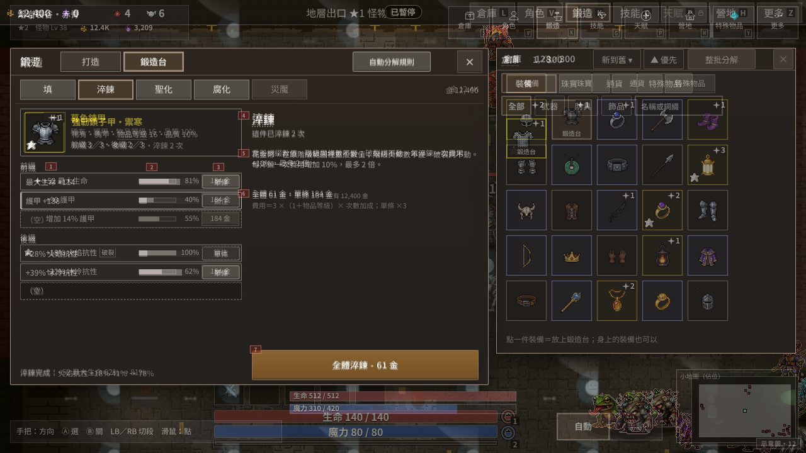

| 元件 | 規格 x,y w×h | 實機 x,y w×h | 差 Δx,Δy Δw,Δh | |
|---|---|---|---|---|
| 詞列（淬鍊模式） | 32,274 188×28 | 33,276 188×26 | 1,2 0,-2 | ✅ |
| 百分位條 | 220,284 96×10 | 221,284 96×10 | 1,0 0,0 | ✅ |
| 單條淬鍊 | 320,277 60×22 | 321,278 60×22 | 1,1 0,0 | ✅ |
| 標題＋次數 | 400,176 160×24 | 400,177 160×24 | 0,1 0,0 | ✅ |
| 說明 | 400,236 360×50 | 400,237 360×50 | 0,1 0,0 | ✅ |
| 費用列 | 400,300 360×36 | 400,301 360×36 | 0,1 0,0 | ✅ |
| 主要按鈕 | 400,556 360×48 | 400,557 360×48 | 0,1 0,0 | ✅ |

## A13（13-holy.png）

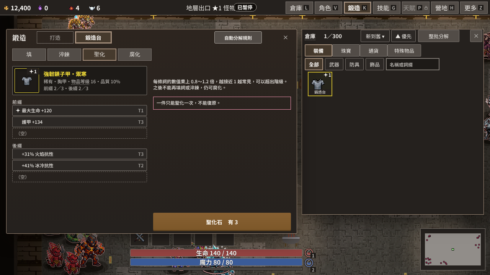　疊圖：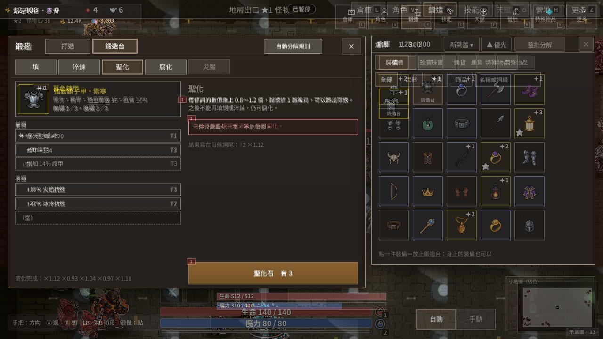

| 元件 | 規格 x,y w×h | 實機 x,y w×h | 差 Δx,Δy Δw,Δh | |
|---|---|---|---|---|
| 說明 | 400,204 360×34 | 400,205 360×34 | 0,1 0,0 | ✅ |
| 不可逆提醒 | 400,252 360×34 | 400,253 360×34 | 0,1 0,0 | ✅ |
| 主要按鈕 | 400,556 360×48 | 400,557 360×48 | 0,1 0,0 | ✅ |

## A14（14-corrupt.png）

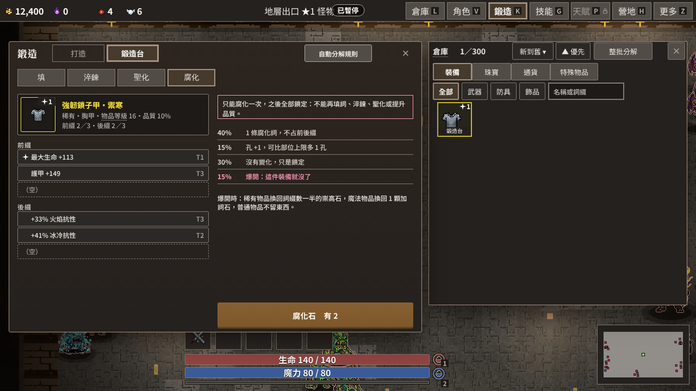　疊圖：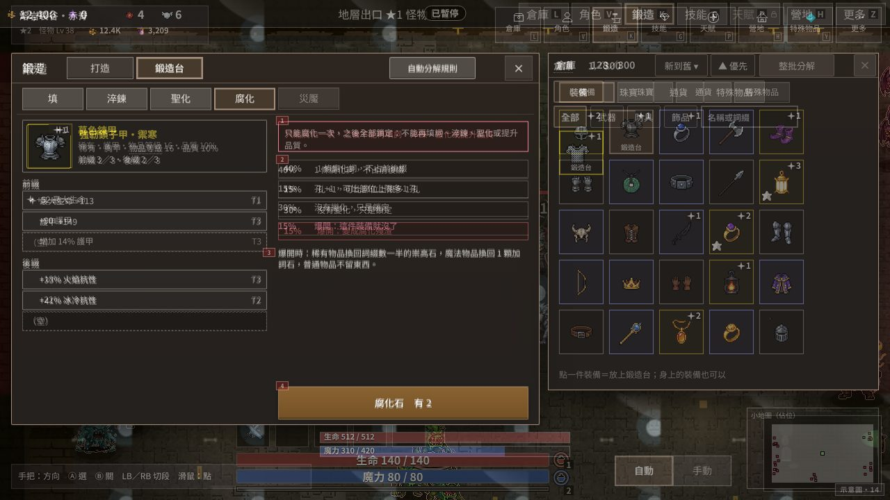

| 元件 | 規格 x,y w×h | 實機 x,y w×h | 差 Δx,Δy Δw,Δh | |
|---|---|---|---|---|
| 不可逆提醒 | 400,174 360×44 | 400,175 360×44 | 0,1 0,0 | ✅ |
| 結果機率 | 400,230 360×116 | 400,231 360×116 | 0,1 0,0 | ✅ |
| 爆開補償 | 400,356 360×50 | 400,357 360×50 | 0,1 0,0 | ✅ |
| 主要按鈕 | 400,556 360×48 | 400,557 360×48 | 0,1 0,0 | ✅ |

## A15（15-corrupt-confirm.png）

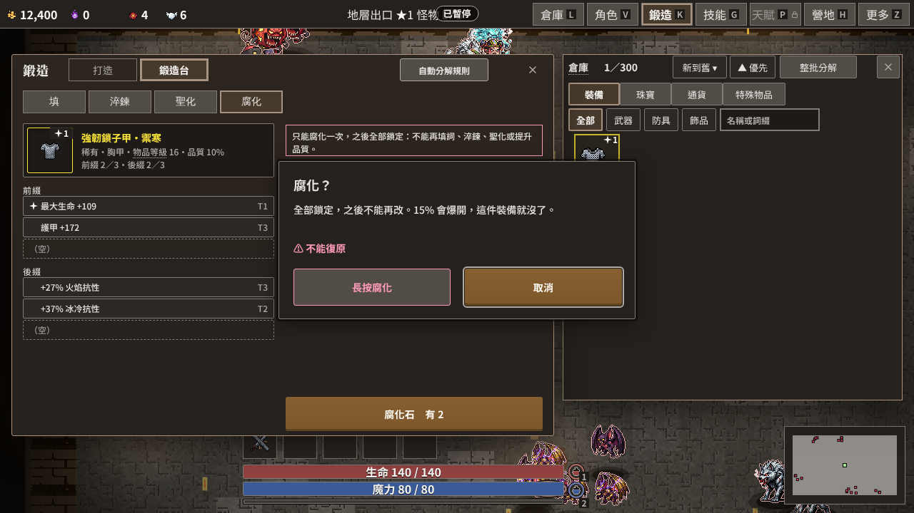　疊圖：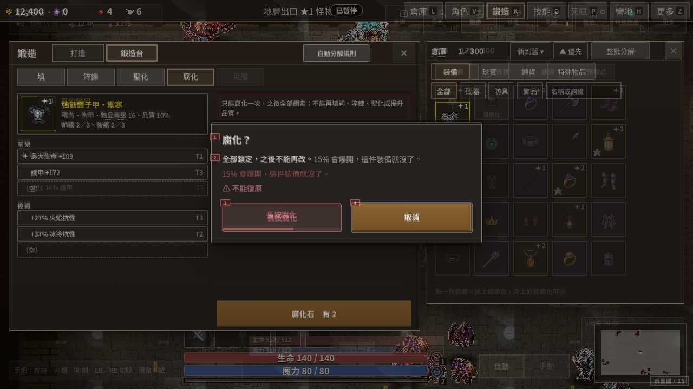

| 元件 | 規格 x,y w×h | 實機 x,y w×h | 差 Δx,Δy Δw,Δh | |
|---|---|---|---|---|
| 標題 | 410,246 460×24 | 411,247 458×24 | 1,1 -2,0 | ✅ |
| 長按腐化 | 410,376 220×52 | 411,377 220×52 | 1,1 0,0 | ✅ |
| 取消（預設焦點） | 650,376 220×52 | 651,377 220×52 | 1,1 0,0 | ✅ |

## A16（16-calamity.png）

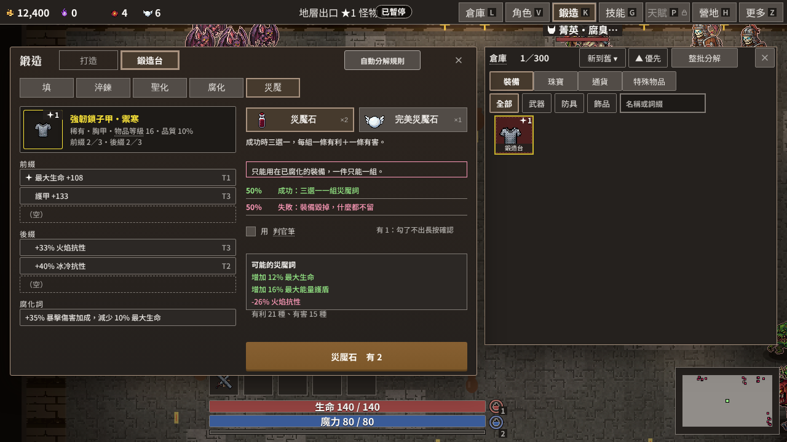　疊圖：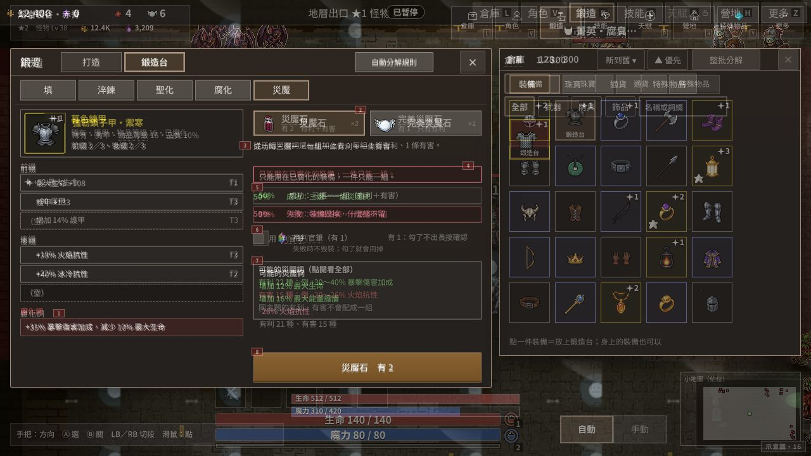

| 元件 | 規格 x,y w×h | 實機 x,y w×h | 差 Δx,Δy Δw,Δh | |
|---|---|---|---|---|
| 災魘石／完美災魘石 | 400,174 176×40 | 400,175 176×40 | 0,1 0,0 | ✅ |
| 說明 | 400,222 360×34 | 400,223 360×34 | 0,1 0,0 | ✅ |
| 條件提醒 | 400,262 360×26 | 400,263 360×26 | 0,1 0,0 | ✅ |
| 結果機率 | 400,296 360×56 | 400,297 360×56 | 0,1 0,0 | ✅ |
| 判官筆 | 400,364 200×24 | 400,365 200×24 | 0,1 0,0 | ✅ |
| 預覽：可能的災魘詞 | 400,412 360×92 | 400,413 360×92 | 0,1 0,0 | ✅ |
| 主要按鈕 | 400,556 360×48 | 400,557 360×48 | 0,1 0,0 | ✅ |

## A17（17-calamity-pick.png）

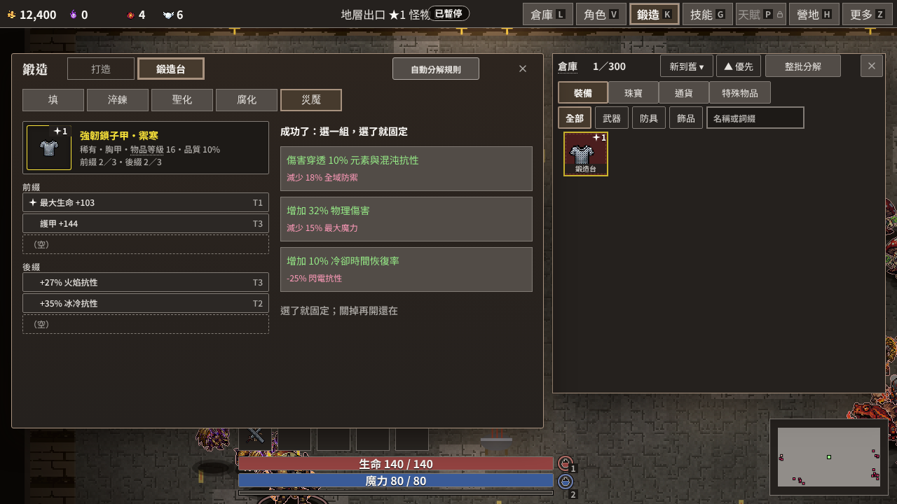　疊圖：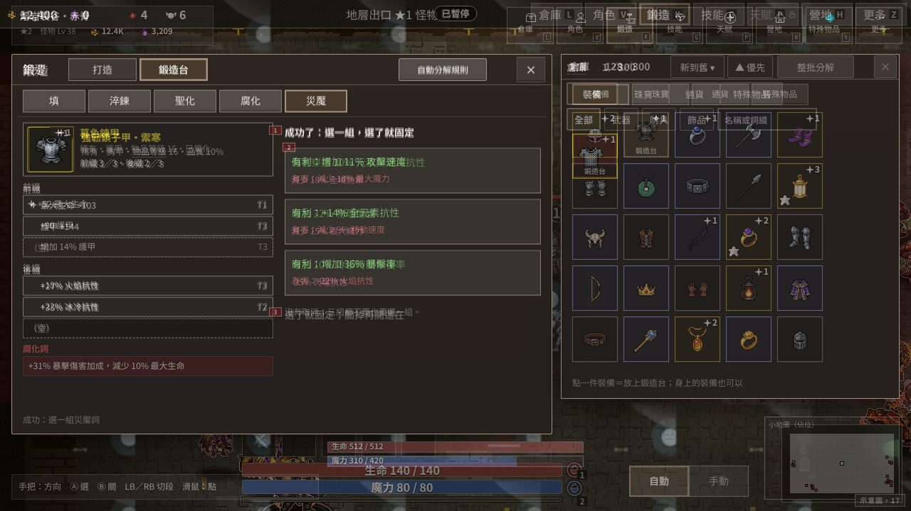

| 元件 | 規格 x,y w×h | 實機 x,y w×h | 差 Δx,Δy Δw,Δh | |
|---|---|---|---|---|
| 標題 | 400,176 360×20 | 400,177 360×20 | 0,1 0,0 | ✅ |
| 選項 1 | 400,208 360×64 | 400,209 360×64 | 0,1 0,0 | ✅ |
| 提醒 | 400,432 360×16 | 400,433 360×16 | 0,1 0,0 | ✅ |
