# 技能面板 1280×720 疊圖：規格座標 vs 實機（px）

紅框＝規格（`S/skills-panel.md` 元件表）座標，綠框＝實機（`tools/skill_check.js` 量 DOM）。差值＝實機 − 規格；`—`＝實機沒有這個元素。每張左半是示意圖遊戲區與實機各 50% 疊圖，右半是實機原圖。

## 01-overview

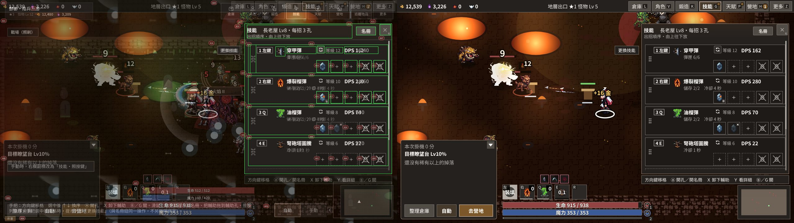

| 元件 | 規格 x,y w×h | 實機 x,y w×h | 差 Δx,Δy Δw,Δh | 符合 |
|---|---|---|---|---|
| 右欄 | 788,76 476×486 | 788,76 476×486 | +0,+0 +0,+0 | ✅ |
| 標題＋設施句 | 796,80 340×44 | 796,80 340×44 | +0,+0 +0,+0 | ✅ |
| 名冊鈕 | 1148,86 64×28 | 1148,86 64×28 | +0,+0 +0,+0 | ✅ |
| 關閉 × | 1224,78 36×36 | 1224,78 36×36 | +0,+0 +0,+0 | ✅ |
| 技能列 1 | 800,144 452×92 | 800,144 452×92 | +0,+0 +0,+0 | ✅ |
| 技能列 2 | 800,244 452×92 | 800,244 452×92 | +0,+0 +0,+0 | ✅ |
| 技能列 3 | 800,344 452×92 | 800,344 452×92 | +0,+0 +0,+0 | ✅ |
| 技能列 4 | 800,444 452×92 | 800,444 452×92 | +0,+0 +0,+0 | ✅ |
| 換序把手 | 806,144 20×92 | 806,144 20×92 | +0,+0 +0,+0 | ✅ |
| 技能圖 | 888,150 32×32 | 888,150 32×32 | +0,+0 +0,+0 | ✅ |
| 技能名 | 924,150 96×24 | 924,150 96×24 | +0,+0 +0,+0 | ✅ |
| 更換圖示熱區 | 1022,148 24×24 | 1022,148 24×24 | +0,+0 +0,+0 | ✅ |
| 等級 | 1050,152 56×20 | 1050,152 56×20 | +0,+0 +0,+0 | ✅ |
| DPS | 1110,150 110×24 | 1110,150 110×24 | +0,+0 +0,+0 | ✅ |
| 列 1 孔 1 | 1020,194 40×40 | 1020,194 40×40 | +0,+0 +0,+0 | ✅ |
| 列 1 孔 2 | 1066,194 40×40 | 1066,194 40×40 | +0,+0 +0,+0 | ✅ |
| 列 1 孔 3 | 1112,194 40×40 | 1112,194 40×40 | +0,+0 +0,+0 | ✅ |
| 列 1 孔 4 | 1158,194 40×40 | 1158,194 40×40 | +0,+0 +0,+0 | ✅ |
| 列 1 孔 5 | 1204,194 40×40 | 1204,194 40×40 | +0,+0 +0,+0 | ✅ |
| 列 2 孔 1 | 1020,294 40×40 | 1020,294 40×40 | +0,+0 +0,+0 | ✅ |
| 列 2 孔 2 | 1066,294 40×40 | 1066,294 40×40 | +0,+0 +0,+0 | ✅ |
| 列 2 孔 3 | 1112,294 40×40 | 1112,294 40×40 | +0,+0 +0,+0 | ✅ |
| 列 2 孔 4 | 1158,294 40×40 | 1158,294 40×40 | +0,+0 +0,+0 | ✅ |
| 列 2 孔 5 | 1204,294 40×40 | 1204,294 40×40 | +0,+0 +0,+0 | ✅ |

## 03-skill-hover

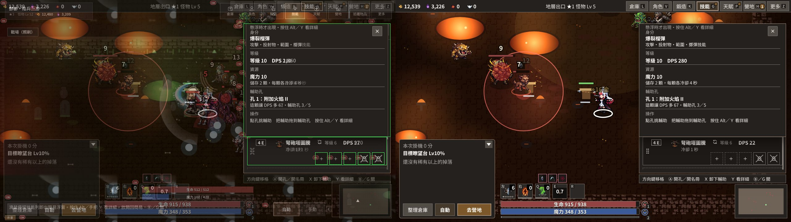

| 元件 | 規格 x,y w×h | 實機 x,y w×h | 差 Δx,Δy Δw,Δh | 符合 |
|---|---|---|---|---|
| 懸停浮窗 | 788,76 476×368 | 788,76 476×368 | +0,+0 +0,+0 | ✅ |
| 技能列 4 | 800,444 452×92 | 800,444 452×92 | +0,+0 +0,+0 | ✅ |
| 列 4 孔 1 | 1020,494 40×40 | 1020,494 40×40 | +0,+0 +0,+0 | ✅ |
| 列 4 孔 2 | 1066,494 40×40 | 1066,494 40×40 | +0,+0 +0,+0 | ✅ |
| 列 4 孔 3 | 1112,494 40×40 | 1112,494 40×40 | +0,+0 +0,+0 | ✅ |
| 列 4 孔 4 | 1158,494 40×40 | 1158,494 40×40 | +0,+0 +0,+0 | ✅ |
| 列 4 孔 5 | 1204,494 40×40 | 1204,494 40×40 | +0,+0 +0,+0 | ✅ |

## 04-skill-hover-detail

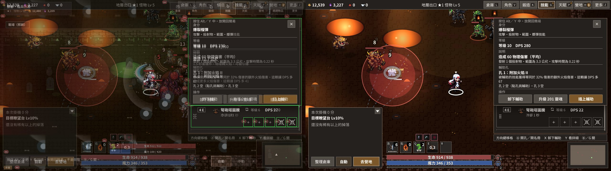

| 元件 | 規格 x,y w×h | 實機 x,y w×h | 差 Δx,Δy Δw,Δh | 符合 |
|---|---|---|---|---|
| 懸停浮窗 | 788,76 476×368 | 788,76 476×368 | +0,+0 +0,+0 | ✅ |
| 技能列 4 | 800,444 452×92 | 800,444 452×92 | +0,+0 +0,+0 | ✅ |
| 列 4 孔 1 | 1020,494 40×40 | 1020,494 40×40 | +0,+0 +0,+0 | ✅ |
| 列 4 孔 2 | 1066,494 40×40 | 1066,494 40×40 | +0,+0 +0,+0 | ✅ |
| 列 4 孔 3 | 1112,494 40×40 | 1112,494 40×40 | +0,+0 +0,+0 | ✅ |
| 列 4 孔 4 | 1158,494 40×40 | 1158,494 40×40 | +0,+0 +0,+0 | ✅ |
| 列 4 孔 5 | 1204,494 40×40 | 1204,494 40×40 | +0,+0 +0,+0 | ✅ |

## 05-support-hover

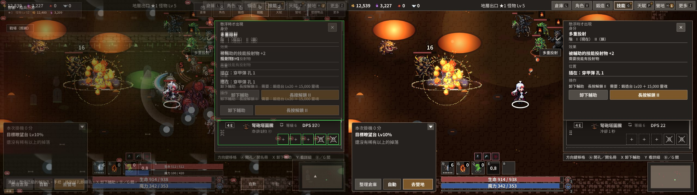

| 元件 | 規格 x,y w×h | 實機 x,y w×h | 差 Δx,Δy Δw,Δh | 符合 |
|---|---|---|---|---|
| 懸停浮窗 | 788,76 476×368 | 788,76 476×368 | +0,+0 +0,+0 | ✅ |
| 技能列 4 | 800,444 452×92 | 800,444 452×92 | +0,+0 +0,+0 | ✅ |
| 列 4 孔 1 | 1020,494 40×40 | 1020,494 40×40 | +0,+0 +0,+0 | ✅ |
| 列 4 孔 2 | 1066,494 40×40 | 1066,494 40×40 | +0,+0 +0,+0 | ✅ |
| 列 4 孔 3 | 1112,494 40×40 | 1112,494 40×40 | +0,+0 +0,+0 | ✅ |
| 列 4 孔 4 | 1158,494 40×40 | 1158,494 40×40 | +0,+0 +0,+0 | ✅ |
| 列 4 孔 5 | 1204,494 40×40 | 1204,494 40×40 | +0,+0 +0,+0 | ✅ |

## 15-unlock-ii

| 元件 | 規格 x,y w×h | 實機 x,y w×h | 差 Δx,Δy Δw,Δh | 符合 |
|---|---|---|---|---|
| 懸停浮窗 | 788,76 476×368 | 788,76 476×368 | +0,+0 +0,+0 | ✅ |
| 技能列 4 | 800,444 452×92 | 800,444 452×92 | +0,+0 +0,+0 | ✅ |
| 列 4 孔 1 | 1020,494 40×40 | 1020,494 40×40 | +0,+0 +0,+0 | ✅ |
| 列 4 孔 2 | 1066,494 40×40 | 1066,494 40×40 | +0,+0 +0,+0 | ✅ |
| 列 4 孔 3 | 1112,494 40×40 | 1112,494 40×40 | +0,+0 +0,+0 | ✅ |
| 列 4 孔 4 | 1158,494 40×40 | 1158,494 40×40 | +0,+0 +0,+0 | ✅ |
| 列 4 孔 5 | 1204,494 40×40 | 1204,494 40×40 | +0,+0 +0,+0 | ✅ |

## 09-socket-empty

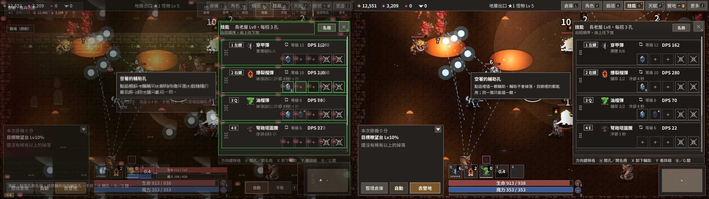

| 元件 | 規格 x,y w×h | 實機 x,y w×h | 差 Δx,Δy Δw,Δh | 符合 |
|---|---|---|---|---|
| 右欄 | 788,76 476×486 | 788,76 476×486 | +0,+0 +0,+0 | ✅ |
| 標題＋設施句 | 796,80 340×44 | 796,80 340×44 | +0,+0 +0,+0 | ✅ |
| 名冊鈕 | 1148,86 64×28 | 1148,86 64×28 | +0,+0 +0,+0 | ✅ |
| 關閉 × | 1224,78 36×36 | 1224,78 36×36 | +0,+0 +0,+0 | ✅ |
| 技能列 1 | 800,144 452×92 | 800,144 452×92 | +0,+0 +0,+0 | ✅ |
| 技能列 2 | 800,244 452×92 | 800,244 452×92 | +0,+0 +0,+0 | ✅ |
| 技能列 3 | 800,344 452×92 | 800,344 452×92 | +0,+0 +0,+0 | ✅ |
| 技能列 4 | 800,444 452×92 | 800,444 452×92 | +0,+0 +0,+0 | ✅ |
| 列 2 孔 1 | 1020,294 40×40 | 1020,294 40×40 | +0,+0 +0,+0 | ✅ |
| 列 2 孔 2 | 1066,294 40×40 | 1066,294 40×40 | +0,+0 +0,+0 | ✅ |
| 列 2 孔 3 | 1112,294 40×40 | 1112,294 40×40 | +0,+0 +0,+0 | ✅ |
| 列 2 孔 4 | 1158,294 40×40 | 1158,294 40×40 | +0,+0 +0,+0 | ✅ |
| 列 2 孔 5 | 1204,294 40×40 | 1204,294 40×40 | +0,+0 +0,+0 | ✅ |

## 10-socket-locked

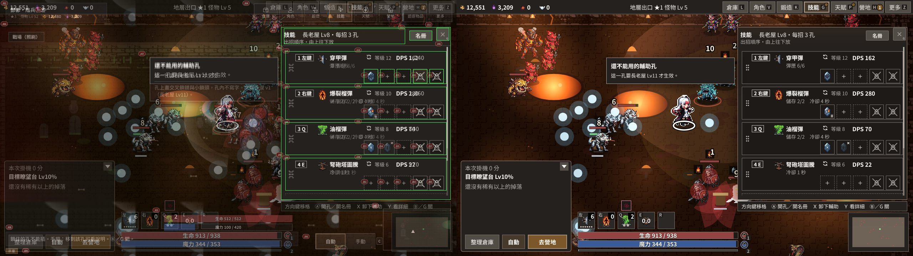

| 元件 | 規格 x,y w×h | 實機 x,y w×h | 差 Δx,Δy Δw,Δh | 符合 |
|---|---|---|---|---|
| 右欄 | 788,76 476×486 | 788,76 476×486 | +0,+0 +0,+0 | ✅ |
| 標題＋設施句 | 796,80 340×44 | 796,80 340×44 | +0,+0 +0,+0 | ✅ |
| 名冊鈕 | 1148,86 64×28 | 1148,86 64×28 | +0,+0 +0,+0 | ✅ |
| 關閉 × | 1224,78 36×36 | 1224,78 36×36 | +0,+0 +0,+0 | ✅ |
| 技能列 1 | 800,144 452×92 | 800,144 452×92 | +0,+0 +0,+0 | ✅ |
| 技能列 2 | 800,244 452×92 | 800,244 452×92 | +0,+0 +0,+0 | ✅ |
| 技能列 3 | 800,344 452×92 | 800,344 452×92 | +0,+0 +0,+0 | ✅ |
| 技能列 4 | 800,444 452×92 | 800,444 452×92 | +0,+0 +0,+0 | ✅ |
| 列 1 孔 1 | 1020,194 40×40 | 1020,194 40×40 | +0,+0 +0,+0 | ✅ |
| 列 1 孔 2 | 1066,194 40×40 | 1066,194 40×40 | +0,+0 +0,+0 | ✅ |
| 列 1 孔 3 | 1112,194 40×40 | 1112,194 40×40 | +0,+0 +0,+0 | ✅ |
| 列 1 孔 4 | 1158,194 40×40 | 1158,194 40×40 | +0,+0 +0,+0 | ✅ |
| 列 1 孔 5 | 1204,194 40×40 | 1204,194 40×40 | +0,+0 +0,+0 | ✅ |

## 11-socket-incompat

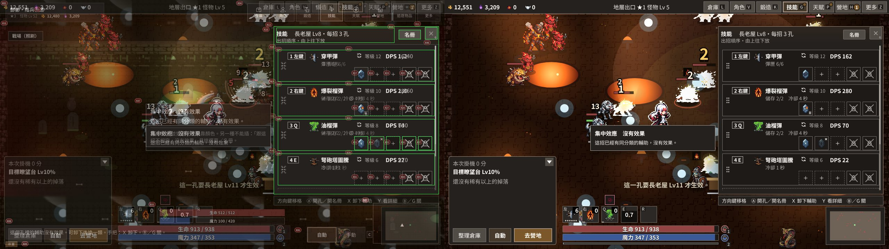

| 元件 | 規格 x,y w×h | 實機 x,y w×h | 差 Δx,Δy Δw,Δh | 符合 |
|---|---|---|---|---|
| 右欄 | 788,76 476×486 | 788,76 476×486 | +0,+0 +0,+0 | ✅ |
| 標題＋設施句 | 796,80 340×44 | 796,80 340×44 | +0,+0 +0,+0 | ✅ |
| 名冊鈕 | 1148,86 64×28 | 1148,86 64×28 | +0,+0 +0,+0 | ✅ |
| 關閉 × | 1224,78 36×36 | 1224,78 36×36 | +0,+0 +0,+0 | ✅ |
| 技能列 1 | 800,144 452×92 | 800,144 452×92 | +0,+0 +0,+0 | ✅ |
| 技能列 2 | 800,244 452×92 | 800,244 452×92 | +0,+0 +0,+0 | ✅ |
| 技能列 3 | 800,344 452×92 | 800,344 452×92 | +0,+0 +0,+0 | ✅ |
| 技能列 4 | 800,444 452×92 | 800,444 452×92 | +0,+0 +0,+0 | ✅ |
| 列 3 孔 1 | 1020,394 40×40 | 1020,394 40×40 | +0,+0 +0,+0 | ✅ |
| 列 3 孔 2 | 1066,394 40×40 | 1066,394 40×40 | +0,+0 +0,+0 | ✅ |
| 列 3 孔 3 | 1112,394 40×40 | 1112,394 40×40 | +0,+0 +0,+0 | ✅ |
| 列 3 孔 4 | 1158,394 40×40 | 1158,394 40×40 | +0,+0 +0,+0 | ✅ |
| 列 3 孔 5 | 1204,394 40×40 | 1204,394 40×40 | +0,+0 +0,+0 | ✅ |

## 07-insert-pick

| 元件 | 規格 x,y w×h | 實機 x,y w×h | 差 Δx,Δy Δw,Δh | 符合 |
|---|---|---|---|---|
| 名冊抽屜 | 16,76 476×486 | 16,76 476×486 | +0,+0 +0,+0 | ✅ |
| 名冊分頁 技能 | 100,86 72×28 | 100,86 72×28 | +0,+0 +0,+0 | ✅ |
| 名冊分頁 輔助 | 176,86 72×28 | 176,86 72×28 | +0,+0 +0,+0 | ✅ |
| 右欄 | 788,76 476×486 | 788,76 476×486 | +0,+0 +0,+0 | ✅ |
| 主鈕（高約 44） | 28,508 448×44 | 28,508 448×44 | +0,+0 +0,+0 | ✅ |
| 技能列 1 | 800,144 452×92 | 800,144 452×92 | +0,+0 +0,+0 | ✅ |
| 技能列 2 | 800,244 452×92 | 800,244 452×92 | +0,+0 +0,+0 | ✅ |
| 技能列 3 | 800,344 452×92 | 800,344 452×92 | +0,+0 +0,+0 | ✅ |
| 技能列 4 | 800,444 452×92 | 800,444 452×92 | +0,+0 +0,+0 | ✅ |

## 08-remove

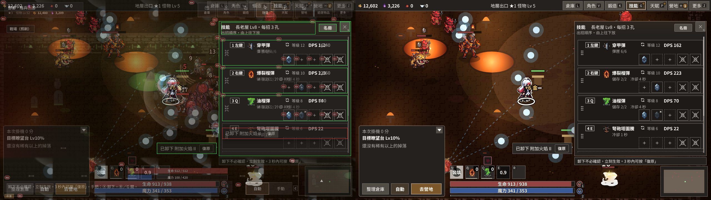

| 元件 | 規格 x,y w×h | 實機 x,y w×h | 差 Δx,Δy Δw,Δh | 符合 |
|---|---|---|---|---|
| 右欄 | 788,76 476×486 | 788,76 476×486 | +0,+0 +0,+0 | ✅ |
| 標題＋設施句 | 796,80 340×44 | 796,80 340×44 | +0,+0 +0,+0 | ✅ |
| 名冊鈕 | 1148,86 64×28 | 1148,86 64×28 | +0,+0 +0,+0 | ✅ |
| 關閉 × | 1224,78 36×36 | 1224,78 36×36 | +0,+0 +0,+0 | ✅ |
| 技能列 1 | 800,144 452×92 | 800,144 452×92 | +0,+0 +0,+0 | ✅ |
| 技能列 2 | 800,244 452×92 | 800,244 452×92 | +0,+0 +0,+0 | ✅ |
| 技能列 3 | 800,344 452×92 | 800,344 452×92 | +0,+0 +0,+0 | ✅ |
| 復原列（示意 H38，3 列情境） | 800,460 452×40 | 565,514 215×40 | -235,+54 -237,+0 | ❌ |

## 16-reorder

| 元件 | 規格 x,y w×h | 實機 x,y w×h | 差 Δx,Δy Δw,Δh | 符合 |
|---|---|---|---|---|
| 右欄 | 788,76 476×486 | 788,76 476×486 | +0,+0 +0,+0 | ✅ |
| 標題＋設施句 | 796,80 340×44 | 796,80 340×44 | +0,+0 +0,+0 | ✅ |
| 名冊鈕 | 1148,86 64×28 | 1148,86 64×28 | +0,+0 +0,+0 | ✅ |
| 關閉 × | 1224,78 36×36 | 1224,78 36×36 | +0,+0 +0,+0 | ✅ |
| 技能列 1 | 800,144 452×92 | 800,144 452×92 | +0,+0 +0,+0 | ✅ |
| 技能列 4 | 800,444 452×92 | 800,444 452×92 | +0,+0 +0,+0 | ✅ |
| 插入線（示意 P22） | 800,242 452×2 | 800,242 452×2 | +0,+0 +0,+0 | ✅ |
| 提起列 油榴彈（示意 P23） | 812,248 452×92 | 800,248 452×92 | -12,+0 +0,+0 | ❌ |
| 讓位的第 2 列 爆裂榴彈（示意 P31） | 800,360 452×92 | 800,344 452×92 | +0,-16 +0,+0 | ❌ |

## 17-roster-skills

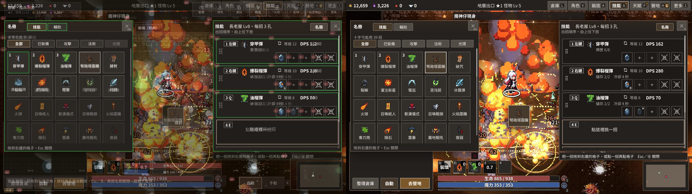

| 元件 | 規格 x,y w×h | 實機 x,y w×h | 差 Δx,Δy Δw,Δh | 符合 |
|---|---|---|---|---|
| 名冊抽屜 | 16,76 476×486 | 16,76 476×486 | +0,+0 +0,+0 | ✅ |
| 名冊分頁 技能 | 100,86 72×28 | 100,86 72×28 | +0,+0 +0,+0 | ✅ |
| 名冊分頁 輔助 | 176,86 72×28 | 176,86 72×28 | +0,+0 +0,+0 | ✅ |
| 右欄 | 788,76 476×486 | 788,76 476×486 | +0,+0 +0,+0 | ✅ |
| 名冊格 1 | 28,192 80×80 | 28,192 80×80 | +0,+0 +0,+0 | ✅ |
| 技能列 1 | 800,144 452×92 | 800,144 452×92 | +0,+0 +0,+0 | ✅ |
| 技能列 2 | 800,244 452×92 | 800,244 452×92 | +0,+0 +0,+0 | ✅ |
| 技能列 3 | 800,344 452×92 | 800,344 452×92 | +0,+0 +0,+0 | ✅ |

## 18-roster-supports

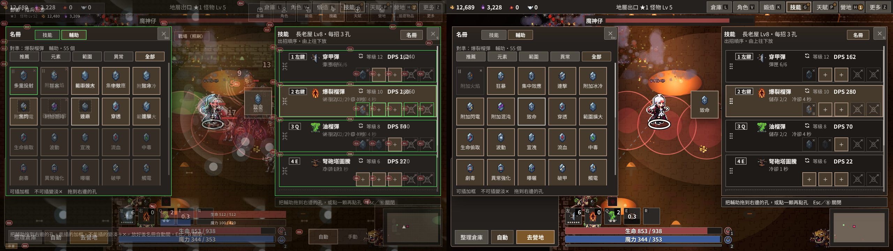

| 元件 | 規格 x,y w×h | 實機 x,y w×h | 差 Δx,Δy Δw,Δh | 符合 |
|---|---|---|---|---|
| 名冊抽屜 | 16,76 476×486 | 16,76 476×486 | +0,+0 +0,+0 | ✅ |
| 名冊分頁 技能 | 100,86 72×28 | 100,86 72×28 | +0,+0 +0,+0 | ✅ |
| 名冊分頁 輔助 | 176,86 72×28 | 176,86 72×28 | +0,+0 +0,+0 | ✅ |
| 右欄 | 788,76 476×486 | 788,76 476×486 | +0,+0 +0,+0 | ✅ |
| 名冊格 1 | 28,192 80×80 | 28,192 80×80 | +0,+0 +0,+0 | ✅ |
| 技能列 1 | 800,144 452×92 | 800,144 452×92 | +0,+0 +0,+0 | ✅ |
| 技能列 2 | 800,244 452×92 | 800,244 452×92 | +0,+0 +0,+0 | ✅ |
| 技能列 3 | 800,344 452×92 | 800,344 452×92 | +0,+0 +0,+0 | ✅ |
| 技能列 4 | 800,444 452×92 | 800,444 452×92 | +0,+0 +0,+0 | ✅ |
| 列 2 孔 1 | 1020,294 40×40 | 1020,294 40×40 | +0,+0 +0,+0 | ✅ |
| 列 2 孔 2 | 1066,294 40×40 | 1066,294 40×40 | +0,+0 +0,+0 | ✅ |
| 列 2 孔 3 | 1112,294 40×40 | 1112,294 40×40 | +0,+0 +0,+0 | ✅ |
| 列 2 孔 4 | 1158,294 40×40 | 1158,294 40×40 | +0,+0 +0,+0 | ✅ |
| 列 2 孔 5 | 1204,294 40×40 | 1204,294 40×40 | +0,+0 +0,+0 | ✅ |

## 13-skill-pick

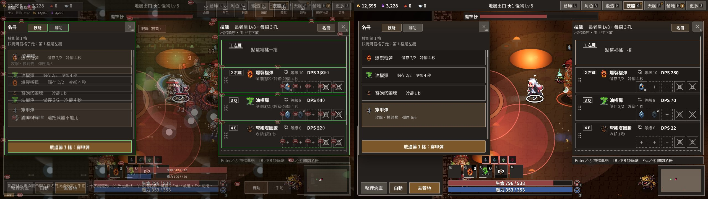

| 元件 | 規格 x,y w×h | 實機 x,y w×h | 差 Δx,Δy Δw,Δh | 符合 |
|---|---|---|---|---|
| 名冊抽屜 | 16,76 476×486 | 16,76 476×486 | +0,+0 +0,+0 | ✅ |
| 名冊分頁 技能 | 100,86 72×28 | 100,86 72×28 | +0,+0 +0,+0 | ✅ |
| 名冊分頁 輔助 | 176,86 72×28 | 176,86 72×28 | +0,+0 +0,+0 | ✅ |
| 右欄 | 788,76 476×486 | 788,76 476×486 | +0,+0 +0,+0 | ✅ |
| 主鈕（高約 44） | 28,508 448×44 | 28,508 448×44 | +0,+0 +0,+0 | ✅ |
| 空技能格 | 800,144 452×92 | 800,144 452×92 | +0,+0 +0,+0 | ✅ |
| 技能列 2 | 800,244 452×92 | 800,244 452×92 | +0,+0 +0,+0 | ✅ |
| 技能列 3 | 800,344 452×92 | 800,344 452×92 | +0,+0 +0,+0 | ✅ |
| 技能列 4 | 800,444 452×92 | 800,444 452×92 | +0,+0 +0,+0 | ✅ |

## 14-noun-tip

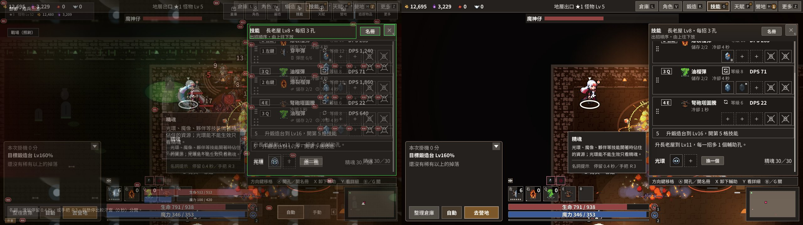

| 元件 | 規格 x,y w×h | 實機 x,y w×h | 差 Δx,Δy Δw,Δh | 符合 |
|---|---|---|---|---|
| 右欄 | 788,76 476×486 | 788,76 476×486 | +0,+0 +0,+0 | ✅ |
| 標題＋設施句 | 796,80 340×44 | 796,80 340×44 | +0,+0 +0,+0 | ✅ |
| 名冊鈕 | 1148,86 64×28 | 1148,86 64×28 | +0,+0 +0,+0 | ✅ |
| 關閉 × | 1224,78 36×36 | 1224,78 36×36 | +0,+0 +0,+0 | ✅ |

## 12-skill-empty

| 元件 | 規格 x,y w×h | 實機 x,y w×h | 差 Δx,Δy Δw,Δh | 符合 |
|---|---|---|---|---|
| 右欄 | 788,76 476×486 | 788,76 476×486 | +0,+0 +0,+0 | ✅ |
| 標題＋設施句 | 796,80 340×44 | 796,80 340×44 | +0,+0 +0,+0 | ✅ |
| 名冊鈕 | 1148,86 64×28 | 1148,86 64×28 | +0,+0 +0,+0 | ✅ |
| 關閉 × | 1224,78 36×36 | 1224,78 36×36 | +0,+0 +0,+0 | ✅ |

