# 天賦樹 1280×720 疊圖：規格座標 vs 實機（px）

紅框＝規格（`S/talent-tree.md` 殼與元件表、示意圖圖例）座標，綠框＝實機（`tools/tree_check.js` 量 DOM）。差值＝實機 − 規格；`—`＝實機沒有這個元素或規格沒給。每張左半是示意圖遊戲區與實機各 50% 疊圖，右半是實機原圖。容差 ±1 px。

不符 6 項（明細見各表 ❌）。
## 01-overview

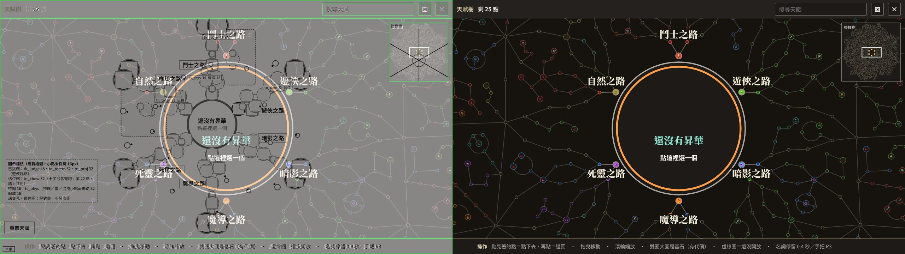

| 元件 | 規格 x,y w×h | 實機 x,y w×h | 差 Δx,Δy Δw,Δh | 符合 |
|---|---|---|---|---|
| 頂欄 | 0,0 1280×52 | 0,0 1280×52 | +0,+0 +0,+0 | ✅ |
| 搜尋天賦 | 912,8 260×36 | 912,8 260×36 | +0,+0 +0,+0 | ✅ |
| 回 | 1184,8 36×36 | 1184,8 36×36 | +0,+0 +0,+0 | ✅ |
| 關閉 | 1232,8 36×36 | 1232,8 36×36 | +0,+0 +0,+0 | ✅ |
| 樹視圖 | 0,52 1280×624 | 0,52 1280×624 | +0,+0 +0,+0 | ✅ |
| 底欄操作說明 | 0,676 1280×44 | 0,676 1280×44 | +0,+0 +0,+0 | ✅ |
| 小地圖 | 1100,64 168×168 | 1100,64 168×168 | +0,+0 +0,+0 | ✅ |

## 19-jewel-map

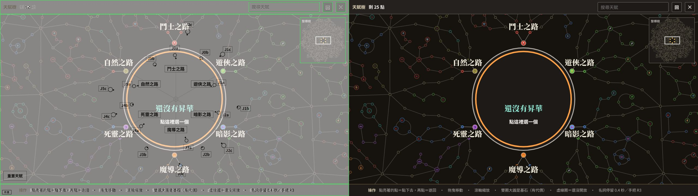

| 元件 | 規格 x,y w×h | 實機 x,y w×h | 差 Δx,Δy Δw,Δh | 符合 |
|---|---|---|---|---|
| 頂欄 | 0,0 1280×52 | 0,0 1280×52 | +0,+0 +0,+0 | ✅ |
| 搜尋天賦 | 912,8 260×36 | 912,8 260×36 | +0,+0 +0,+0 | ✅ |
| 回 | 1184,8 36×36 | 1184,8 36×36 | +0,+0 +0,+0 | ✅ |
| 關閉 | 1232,8 36×36 | 1232,8 36×36 | +0,+0 +0,+0 | ✅ |
| 樹視圖 | 0,52 1280×624 | 0,52 1280×624 | +0,+0 +0,+0 | ✅ |
| 底欄操作說明 | 0,676 1280×44 | 0,676 1280×44 | +0,+0 +0,+0 | ✅ |
| 小地圖 | 1100,64 168×168 | 1100,64 168×168 | +0,+0 +0,+0 | ✅ |

## 08-hover-small

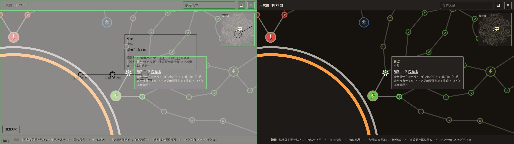

| 元件 | 規格 x,y w×h | 實機 x,y w×h | 差 Δx,Δy Δw,Δh | 符合 |
|---|---|---|---|---|
| 頂欄 | 0,0 1280×52 | 0,0 1280×52 | +0,+0 +0,+0 | ✅ |
| 搜尋天賦 | 912,8 260×36 | 912,8 260×36 | +0,+0 +0,+0 | ✅ |
| 回 | 1184,8 36×36 | 1184,8 36×36 | +0,+0 +0,+0 | ✅ |
| 關閉 | 1232,8 36×36 | 1232,8 36×36 | +0,+0 +0,+0 | ✅ |
| 樹視圖 | 0,52 1280×624 | 0,52 1280×624 | +0,+0 +0,+0 | ✅ |
| 底欄操作說明 | 0,676 1280×44 | 0,676 1280×44 | +0,+0 +0,+0 | ✅ |
| 小地圖 | 1100,64 168×168 | 1100,64 168×168 | +0,+0 +0,+0 | ✅ |
| 小點懸浮 | 寬 360（位置跟著點） | 669,282 360×164 | —,— +0,— | ✅ |

## 09-hover-notable

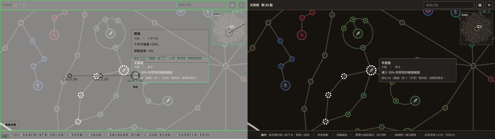

| 元件 | 規格 x,y w×h | 實機 x,y w×h | 差 Δx,Δy Δw,Δh | 符合 |
|---|---|---|---|---|
| 頂欄 | 0,0 1280×52 | 0,0 1280×52 | +0,+0 +0,+0 | ✅ |
| 搜尋天賦 | 912,8 260×36 | 912,8 260×36 | +0,+0 +0,+0 | ✅ |
| 回 | 1184,8 36×36 | 1184,8 36×36 | +0,+0 +0,+0 | ✅ |
| 關閉 | 1232,8 36×36 | 1232,8 36×36 | +0,+0 +0,+0 | ✅ |
| 樹視圖 | 0,52 1280×624 | 0,52 1280×624 | +0,+0 +0,+0 | ✅ |
| 底欄操作說明 | 0,676 1280×44 | 0,676 1280×44 | +0,+0 +0,+0 | ✅ |
| 小地圖 | 1100,64 168×168 | 1100,64 168×168 | +0,+0 +0,+0 | ✅ |
| 大點懸浮 | 寬 400（位置跟著點） | 680,302 400×125 | —,— +0,— | ✅ |

## 10-hover-notable-detail

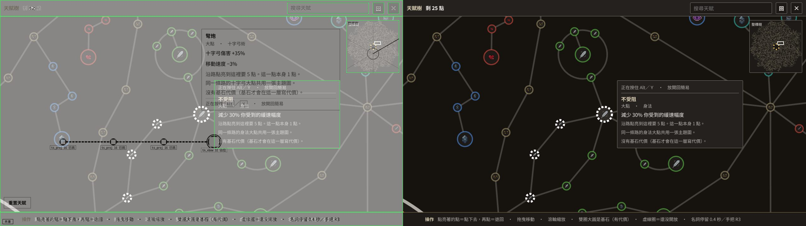

| 元件 | 規格 x,y w×h | 實機 x,y w×h | 差 Δx,Δy Δw,Δh | 符合 |
|---|---|---|---|---|
| 頂欄 | 0,0 1280×52 | 0,0 1280×52 | +0,+0 +0,+0 | ✅ |
| 搜尋天賦 | 912,8 260×36 | 912,8 260×36 | +0,+0 +0,+0 | ✅ |
| 回 | 1184,8 36×36 | 1184,8 36×36 | +0,+0 +0,+0 | ✅ |
| 關閉 | 1232,8 36×36 | 1232,8 36×36 | +0,+0 +0,+0 | ✅ |
| 樹視圖 | 0,52 1280×624 | 0,52 1280×624 | +0,+0 +0,+0 | ✅ |
| 底欄操作說明 | 0,676 1280×44 | 0,676 1280×44 | +0,+0 +0,+0 | ✅ |
| 小地圖 | 1100,64 168×168 | 1100,64 168×168 | +0,+0 +0,+0 | ✅ |
| 大點懸浮（詳細） | 寬 400（位置跟著點） | 680,256 400×217 | —,— +0,— | ✅ |

## 11-not-enough-points

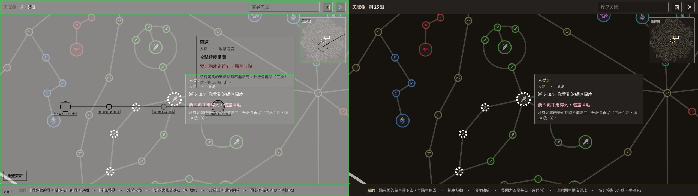

| 元件 | 規格 x,y w×h | 實機 x,y w×h | 差 Δx,Δy Δw,Δh | 符合 |
|---|---|---|---|---|
| 頂欄 | 0,0 1280×52 | 0,0 1280×52 | +0,+0 +0,+0 | ✅ |
| 搜尋天賦 | 912,8 260×36 | 912,8 260×36 | +0,+0 +0,+0 | ✅ |
| 回 | 1184,8 36×36 | 1184,8 36×36 | +0,+0 +0,+0 | ✅ |
| 關閉 | 1232,8 36×36 | 1232,8 36×36 | +0,+0 +0,+0 | ✅ |
| 樹視圖 | 0,52 1280×624 | 0,52 1280×624 | +0,+0 +0,+0 | ✅ |
| 底欄操作說明 | 0,676 1280×44 | 0,676 1280×44 | +0,+0 +0,+0 | ✅ |
| 小地圖 | 1100,64 168×168 | 1100,64 168×168 | +0,+0 +0,+0 | ✅ |
| 大點懸浮（點數不夠） | 寬 400（位置跟著點） | 680,272 400×184 | —,— +0,— | ✅ |

## 13-noun-tip

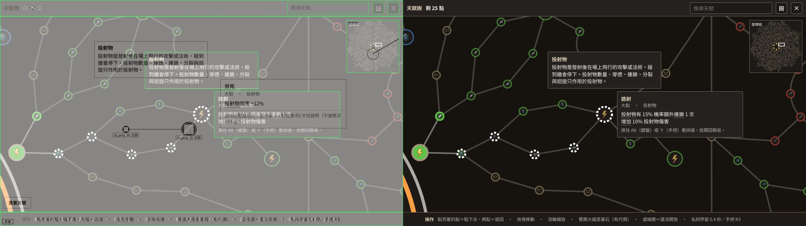

| 元件 | 規格 x,y w×h | 實機 x,y w×h | 差 Δx,Δy Δw,Δh | 符合 |
|---|---|---|---|---|
| 頂欄 | 0,0 1280×52 | 0,0 1280×52 | +0,+0 +0,+0 | ✅ |
| 搜尋天賦 | 912,8 260×36 | 912,8 260×36 | +0,+0 +0,+0 | ✅ |
| 回 | 1184,8 36×36 | 1184,8 36×36 | +0,+0 +0,+0 | ✅ |
| 關閉 | 1232,8 36×36 | 1232,8 36×36 | +0,+0 +0,+0 | ✅ |
| 樹視圖 | 0,52 1280×624 | 0,52 1280×624 | +0,+0 +0,+0 | ✅ |
| 底欄操作說明 | 0,676 1280×44 | 0,676 1280×44 | +0,+0 +0,+0 | ✅ |
| 小地圖 | 1100,64 168×168 | 1100,64 168×168 | +0,+0 +0,+0 | ✅ |
| 名詞提示 | 寬 360（位置跟著點） | 460,165 360×118 | —,— +0,— | ✅ |
| 懸浮窗 | 寬 400（位置跟著點） | 680,291 400×147 | —,— +0,— | ✅ |

## 17-attr-hover

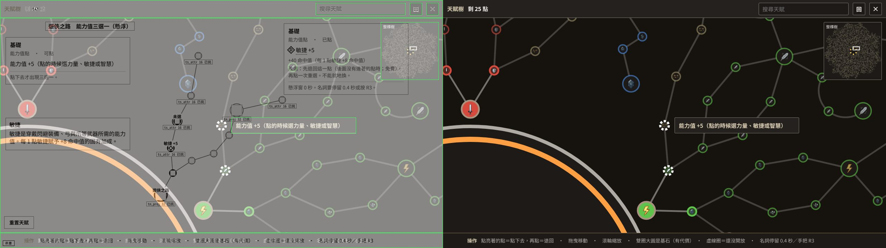

| 元件 | 規格 x,y w×h | 實機 x,y w×h | 差 Δx,Δy Δw,Δh | 符合 |
|---|---|---|---|---|
| 頂欄 | 0,0 1280×52 | 0,0 1280×52 | +0,+0 +0,+0 | ✅ |
| 搜尋天賦 | 912,8 260×36 | 912,8 260×36 | +0,+0 +0,+0 | ✅ |
| 回 | 1184,8 36×36 | 1184,8 36×36 | +0,+0 +0,+0 | ✅ |
| 關閉 | 1232,8 36×36 | 1232,8 36×36 | +0,+0 +0,+0 | ✅ |
| 樹視圖 | 0,52 1280×624 | 0,52 1280×624 | +0,+0 +0,+0 | ✅ |
| 底欄操作說明 | 0,676 1280×44 | 0,676 1280×44 | +0,+0 +0,+0 | ✅ |
| 小地圖 | 1100,64 168×168 | 1100,64 168×168 | +0,+0 +0,+0 | ✅ |
| 能力值懸浮 | 寬 360（位置跟著點） | 669,341 360×47 | —,— +0,— | ✅ |

## 15-attr-pick

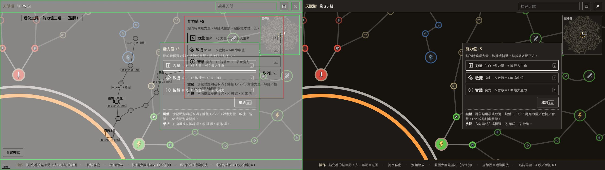

| 元件 | 規格 x,y w×h | 實機 x,y w×h | 差 Δx,Δy Δw,Δh | 符合 |
|---|---|---|---|---|
| 頂欄 | 0,0 1280×52 | 0,0 1280×52 | +0,+0 +0,+0 | ✅ |
| 搜尋天賦 | 912,8 260×36 | 912,8 260×36 | +0,+0 +0,+0 | ✅ |
| 回 | 1184,8 36×36 | 1184,8 36×36 | +0,+0 +0,+0 | ✅ |
| 關閉 | 1232,8 36×36 | 1232,8 36×36 | +0,+0 +0,+0 | ✅ |
| 樹視圖 | 0,52 1280×624 | 0,52 1280×624 | +0,+0 +0,+0 | ✅ |
| 底欄操作說明 | 0,676 1280×44 | 0,676 1280×44 | +0,+0 +0,+0 | ✅ |
| 小地圖 | 1100,64 168×168 | 1100,64 168×168 | +0,+0 +0,+0 | ✅ |
| 能力值三選一 | 780,68 420×348 | 677,181 420×367 | -103,+113 +0,+19 | ❌ |

## 16-attr-results

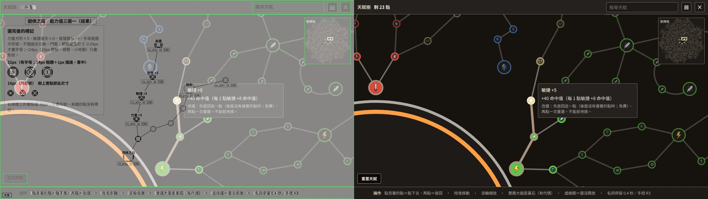

| 元件 | 規格 x,y w×h | 實機 x,y w×h | 差 Δx,Δy Δw,Δh | 符合 |
|---|---|---|---|---|
| 頂欄 | 0,0 1280×52 | 0,0 1280×52 | +0,+0 +0,+0 | ✅ |
| 搜尋天賦 | 912,8 260×36 | 912,8 260×36 | +0,+0 +0,+0 | ✅ |
| 回 | 1184,8 36×36 | 1184,8 36×36 | +0,+0 +0,+0 | ✅ |
| 關閉 | 1232,8 36×36 | 1232,8 36×36 | +0,+0 +0,+0 | ✅ |
| 樹視圖 | 0,52 1280×624 | 0,52 1280×624 | +0,+0 +0,+0 | ✅ |
| 底欄操作說明 | 0,676 1280×44 | 0,676 1280×44 | +0,+0 +0,+0 | ✅ |
| 小地圖 | 1100,64 168×168 | 1100,64 168×168 | +0,+0 +0,+0 | ✅ |
| 重置天賦 | 12,628 86×36 | 12,628 86×36 | +0,+0 +0,+0 | ✅ |

## 06-jewel-empty

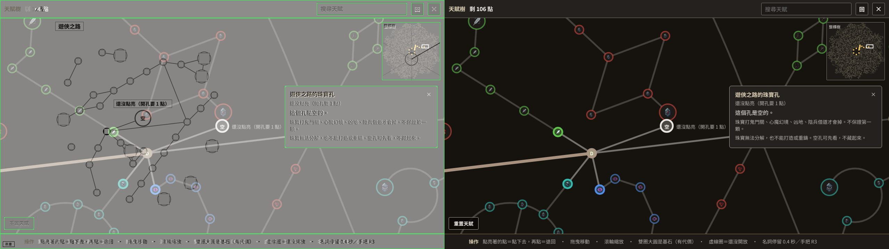

| 元件 | 規格 x,y w×h | 實機 x,y w×h | 差 Δx,Δy Δw,Δh | 符合 |
|---|---|---|---|---|
| 頂欄 | 0,0 1280×52 | 0,0 1280×52 | +0,+0 +0,+0 | ✅ |
| 搜尋天賦 | 912,8 260×36 | 912,8 260×36 | +0,+0 +0,+0 | ✅ |
| 回 | 1184,8 36×36 | 1184,8 36×36 | +0,+0 +0,+0 | ✅ |
| 關閉 | 1232,8 36×36 | 1232,8 36×36 | +0,+0 +0,+0 | ✅ |
| 樹視圖 | 0,52 1280×624 | 0,52 1280×624 | +0,+0 +0,+0 | ✅ |
| 底欄操作說明 | 0,676 1280×44 | 0,676 1280×44 | +0,+0 +0,+0 | ✅ |
| 小地圖 | 1100,64 168×168 | 1100,64 168×168 | +0,+0 +0,+0 | ✅ |
| 重置天賦 | 12,628 86×36 | 12,628 86×36 | +0,+0 +0,+0 | ✅ |
| 珠寶孔面板 | 820,248 440×180 | 820,248 440×180 | +0,+0 +0,+0 | ✅ |

## 07-jewel-socketed

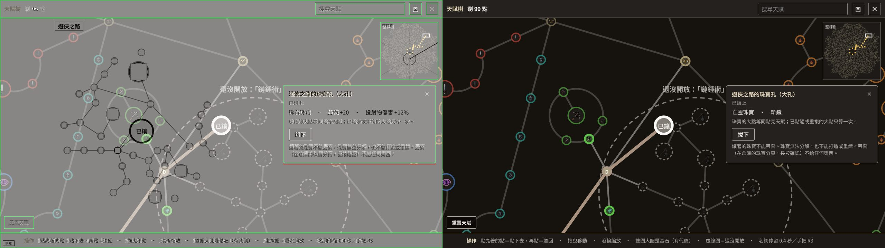

| 元件 | 規格 x,y w×h | 實機 x,y w×h | 差 Δx,Δy Δw,Δh | 符合 |
|---|---|---|---|---|
| 頂欄 | 0,0 1280×52 | 0,0 1280×52 | +0,+0 +0,+0 | ✅ |
| 搜尋天賦 | 912,8 260×36 | 912,8 260×36 | +0,+0 +0,+0 | ✅ |
| 回 | 1184,8 36×36 | 1184,8 36×36 | +0,+0 +0,+0 | ✅ |
| 關閉 | 1232,8 36×36 | 1232,8 36×36 | +0,+0 +0,+0 | ✅ |
| 樹視圖 | 0,52 1280×624 | 0,52 1280×624 | +0,+0 +0,+0 | ✅ |
| 底欄操作說明 | 0,676 1280×44 | 0,676 1280×44 | +0,+0 +0,+0 | ✅ |
| 小地圖 | 1100,64 168×168 | 1100,64 168×168 | +0,+0 +0,+0 | ✅ |
| 重置天賦 | 12,628 86×36 | 12,628 86×36 | +0,+0 +0,+0 | ✅ |
| 珠寶孔面板 | 820,248 440×230 | 820,248 440×226 | +0,+0 +0,-4 | ❌ |

## 04-locked

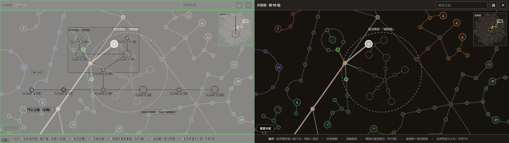

| 元件 | 規格 x,y w×h | 實機 x,y w×h | 差 Δx,Δy Δw,Δh | 符合 |
|---|---|---|---|---|
| 頂欄 | 0,0 1280×52 | 0,0 1280×52 | +0,+0 +0,+0 | ✅ |
| 搜尋天賦 | 912,8 260×36 | 912,8 260×36 | +0,+0 +0,+0 | ✅ |
| 回 | 1184,8 36×36 | 1184,8 36×36 | +0,+0 +0,+0 | ✅ |
| 關閉 | 1232,8 36×36 | 1232,8 36×36 | +0,+0 +0,+0 | ✅ |
| 樹視圖 | 0,52 1280×624 | 0,52 1280×624 | +0,+0 +0,+0 | ✅ |
| 底欄操作說明 | 0,676 1280×44 | 0,676 1280×44 | +0,+0 +0,+0 | ✅ |
| 小地圖 | 1100,64 168×168 | 1100,64 168×168 | +0,+0 +0,+0 | ✅ |
| 重置天賦 | 12,628 86×36 | 12,628 86×36 | +0,+0 +0,+0 | ✅ |

## 12-reset-confirm

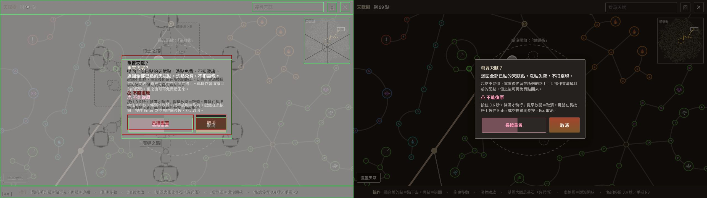

| 元件 | 規格 x,y w×h | 實機 x,y w×h | 差 Δx,Δy Δw,Δh | 符合 |
|---|---|---|---|---|
| 頂欄 | 0,0 1280×52 | 0,0 1280×52 | +0,+0 +0,+0 | ✅ |
| 搜尋天賦 | 912,8 260×36 | 912,8 260×36 | +0,+0 +0,+0 | ✅ |
| 回 | 1184,8 36×36 | 1184,8 36×36 | +0,+0 +0,+0 | ✅ |
| 關閉 | 1232,8 36×36 | 1232,8 36×36 | +0,+0 +0,+0 | ✅ |
| 樹視圖 | 0,52 1280×624 | 0,52 1280×624 | +0,+0 +0,+0 | ✅ |
| 底欄操作說明 | 0,676 1280×44 | 0,676 1280×44 | +0,+0 +0,+0 | ✅ |
| 小地圖 | 1100,64 168×168 | 1100,64 168×168 | +0,+0 +0,+0 | ✅ |
| 重置確認卡 | 440,200 400×290 | 440,216 400×288 | +0,+16 +0,-2 | ❌ |
| 長按重置 | 460,416 242×56 | 465,428 233×54 | +5,+12 -9,-2 | ❌ |
| 取消 | 710,416 110×56 | 709,427 110×56 | -1,+11 +0,+0 | ❌ |

## 18-attr-repick

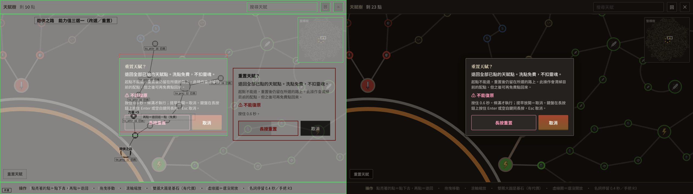

| 元件 | 規格 x,y w×h | 實機 x,y w×h | 差 Δx,Δy Δw,Δh | 符合 |
|---|---|---|---|---|
| 頂欄 | 0,0 1280×52 | 0,0 1280×52 | +0,+0 +0,+0 | ✅ |
| 搜尋天賦 | 912,8 260×36 | 912,8 260×36 | +0,+0 +0,+0 | ✅ |
| 回 | 1184,8 36×36 | 1184,8 36×36 | +0,+0 +0,+0 | ✅ |
| 關閉 | 1232,8 36×36 | 1232,8 36×36 | +0,+0 +0,+0 | ✅ |
| 樹視圖 | 0,52 1280×624 | 0,52 1280×624 | +0,+0 +0,+0 | ✅ |
| 底欄操作說明 | 0,676 1280×44 | 0,676 1280×44 | +0,+0 +0,+0 | ✅ |
| 小地圖 | 1100,64 168×168 | 1100,64 168×168 | +0,+0 +0,+0 | ✅ |
| 重置確認卡 | 440,200 400×290 | 440,216 400×288 | +0,+16 +0,-2 | ❌ |

## 02-zoom-start

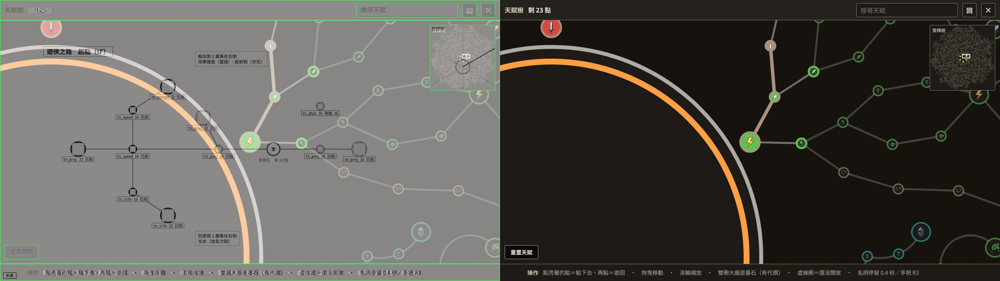

| 元件 | 規格 x,y w×h | 實機 x,y w×h | 差 Δx,Δy Δw,Δh | 符合 |
|---|---|---|---|---|
| 頂欄 | 0,0 1280×52 | 0,0 1280×52 | +0,+0 +0,+0 | ✅ |
| 搜尋天賦 | 912,8 260×36 | 912,8 260×36 | +0,+0 +0,+0 | ✅ |
| 回 | 1184,8 36×36 | 1184,8 36×36 | +0,+0 +0,+0 | ✅ |
| 關閉 | 1232,8 36×36 | 1232,8 36×36 | +0,+0 +0,+0 | ✅ |
| 樹視圖 | 0,52 1280×624 | 0,52 1280×624 | +0,+0 +0,+0 | ✅ |
| 底欄操作說明 | 0,676 1280×44 | 0,676 1280×44 | +0,+0 +0,+0 | ✅ |
| 小地圖 | 1100,64 168×168 | 1100,64 168×168 | +0,+0 +0,+0 | ✅ |
| 重置天賦 | 12,628 86×36 | 12,628 86×36 | +0,+0 +0,+0 | ✅ |

## 03-zoom-states

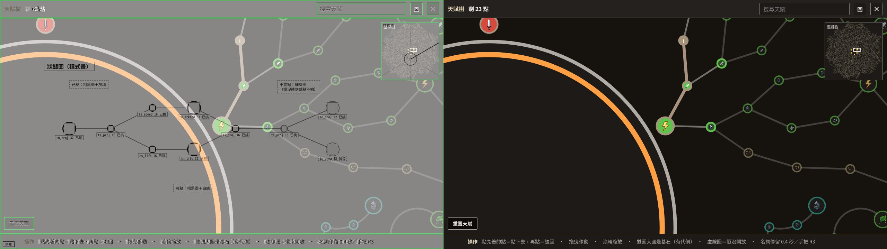

| 元件 | 規格 x,y w×h | 實機 x,y w×h | 差 Δx,Δy Δw,Δh | 符合 |
|---|---|---|---|---|
| 頂欄 | 0,0 1280×52 | 0,0 1280×52 | +0,+0 +0,+0 | ✅ |
| 搜尋天賦 | 912,8 260×36 | 912,8 260×36 | +0,+0 +0,+0 | ✅ |
| 回 | 1184,8 36×36 | 1184,8 36×36 | +0,+0 +0,+0 | ✅ |
| 關閉 | 1232,8 36×36 | 1232,8 36×36 | +0,+0 +0,+0 | ✅ |
| 樹視圖 | 0,52 1280×624 | 0,52 1280×624 | +0,+0 +0,+0 | ✅ |
| 底欄操作說明 | 0,676 1280×44 | 0,676 1280×44 | +0,+0 +0,+0 | ✅ |
| 小地圖 | 1100,64 168×168 | 1100,64 168×168 | +0,+0 +0,+0 | ✅ |
| 重置天賦 | 12,628 86×36 | 12,628 86×36 | +0,+0 +0,+0 | ✅ |

## 14-real-region

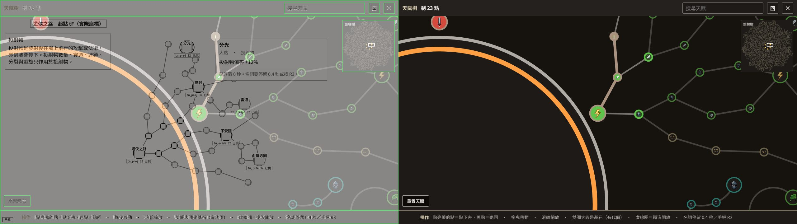

| 元件 | 規格 x,y w×h | 實機 x,y w×h | 差 Δx,Δy Δw,Δh | 符合 |
|---|---|---|---|---|
| 頂欄 | 0,0 1280×52 | 0,0 1280×52 | +0,+0 +0,+0 | ✅ |
| 搜尋天賦 | 912,8 260×36 | 912,8 260×36 | +0,+0 +0,+0 | ✅ |
| 回 | 1184,8 36×36 | 1184,8 36×36 | +0,+0 +0,+0 | ✅ |
| 關閉 | 1232,8 36×36 | 1232,8 36×36 | +0,+0 +0,+0 | ✅ |
| 樹視圖 | 0,52 1280×624 | 0,52 1280×624 | +0,+0 +0,+0 | ✅ |
| 底欄操作說明 | 0,676 1280×44 | 0,676 1280×44 | +0,+0 +0,+0 | ✅ |
| 小地圖 | 1100,64 168×168 | 1100,64 168×168 | +0,+0 +0,+0 | ✅ |
| 重置天賦 | 12,628 86×36 | 12,628 86×36 | +0,+0 +0,+0 | ✅ |

## 05-crossbow

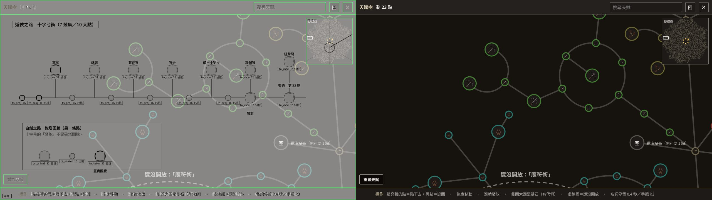

| 元件 | 規格 x,y w×h | 實機 x,y w×h | 差 Δx,Δy Δw,Δh | 符合 |
|---|---|---|---|---|
| 頂欄 | 0,0 1280×52 | 0,0 1280×52 | +0,+0 +0,+0 | ✅ |
| 搜尋天賦 | 912,8 260×36 | 912,8 260×36 | +0,+0 +0,+0 | ✅ |
| 回 | 1184,8 36×36 | 1184,8 36×36 | +0,+0 +0,+0 | ✅ |
| 關閉 | 1232,8 36×36 | 1232,8 36×36 | +0,+0 +0,+0 | ✅ |
| 樹視圖 | 0,52 1280×624 | 0,52 1280×624 | +0,+0 +0,+0 | ✅ |
| 底欄操作說明 | 0,676 1280×44 | 0,676 1280×44 | +0,+0 +0,+0 | ✅ |
| 小地圖 | 1100,64 168×168 | 1100,64 168×168 | +0,+0 +0,+0 | ✅ |
| 重置天賦 | 12,628 86×36 | 12,628 86×36 | +0,+0 +0,+0 | ✅ |

## 390×844

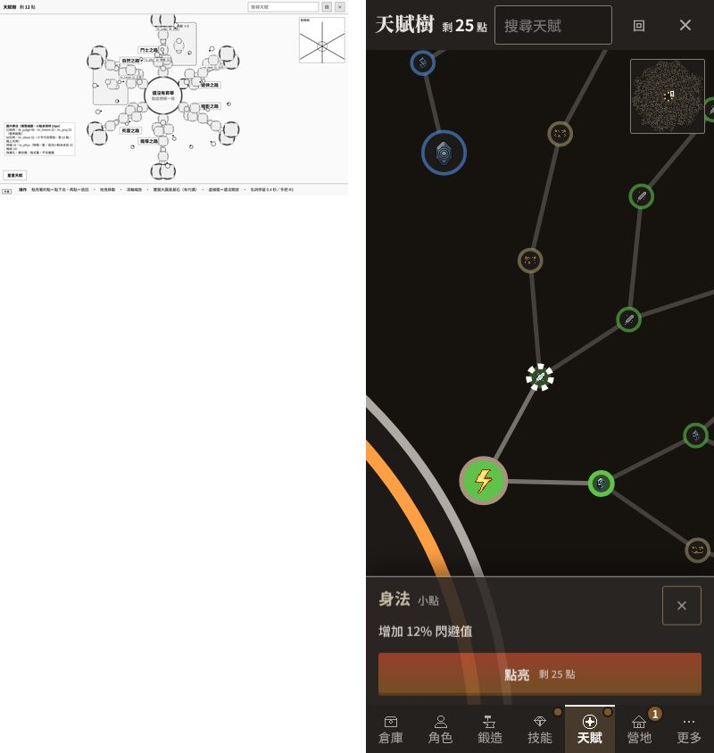

W5 沒有 390×844 的示意圖（規格範圍「不含 390（待下一版）」），沒有座標可比：左為 01 總覽縮到 390 寬、右為實機。行動版以自動測試（tools/tree_check.js 390×844 段、tools/touch_check.js）通過為完成標準。

