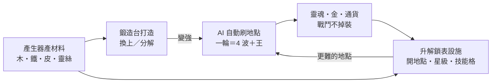

# dpoe 遊戲企劃書（GDD）

> 本檔由製作人從 Page 同步，來源：<https://cursor.com/canvas/store-82cf5215-7bf0-49e1-b610-9b76fbf158ee/a647bf26-aa82-4684-8c89-311e76640026>；同步日期：2026-11-16；請勿直接在 repo 修改，改動請經製作人

dungeonPOE（dpoe）的專案理解、方向與決策。同一份程式雙平台：Steam 買斷為主，網頁／PWA 免費導流（Q12 C）。平台優先順序分階段：M0–M1 手機直立優先；M2 起直立 390×844 與桌機 1280×720 同級。依 repo 0.5.4（commit a93c3fd（分析時）；M0 後 main 為 13ce9cd）整理。

里程碑、任務表、驗收判準與 M1-08／M1-13 定稿文案在 [`milestones.md`](milestones.md)。

## 目錄

- [平台優先順序（分階段）](#平台優先順序分階段)
- [證據標記怎麼讀](#證據標記怎麼讀)
- [方向與定位](#方向與定位)
- [商業模式](#商業模式)
- [核心玩法循環](#核心玩法循環)
- [已實作系統與完成度](#已實作系統與完成度)
- [決策紀錄](#決策紀錄)
- [待決事項](#待決事項)
- [缺口與風險](#缺口與風險)
- [來源](#來源)

## 平台優先順序（分階段）

mumi 2026-11-16 定；Q12 C 之後改成分階段。適用所有設計、審查、測試、開發，純文件任務除外。

| 階段 | 第一優先 | 第二優先 | 備註 |
| --- | --- | --- | --- |
| M0–M1 | 手機直立 390×844 | 375×667 → 橫向 → 桌機 1280×720／1440×900 | 原規則，已交辦的任務不改 |
| M2 起 | 手機直立 390×844 與桌機 1280×720 同級，兩個都驗過才算完成 | 375×667、橫向、1440×900 | 桌機以滑鼠＋鍵盤為主，也要可以只用滑鼠玩 |
| M4 Steam 線 | 桌機 1280×720 與 Steam Deck 1280×800 | 1440×900 | 另做 Canvas 效能實測 |

## 證據標記怎麼讀

| 標記 | 意思 |
| --- | --- |
| 程式碼證實 | 在原始碼、資料檔或測試裡找到，或製作人在本機跑過（`node tools/check.js` 696 項全過；線上版回 200、`version.json` 是 0.5.4、無頁面錯誤） |
| 文件記載 | 寫在 repo 的 docs、CHANGELOG 或 CLAUDE.md，製作人沒有逐行對程式碼 |
| 推測 | 製作人自己的推論，沒有直接證據 |

dpoe 是 dungeonPOE，起點是類 Path of Exile 的動作 ARPG（0.2），現在 0.5 已改成「PoE 式增量／掛機遊戲」：角色由 AI 自動戰鬥，玩家經營營地、打造裝備、配 build。

## 方向與定位

| 項目 | 內容 | 證據 |
| --- | --- | --- |
| 類型 | PoE 式增量遊戲：你配一套 build 讓 AI 自己打，營地產材料、鍛造台打裝、升設施解鎖更難的地點與更深的做裝 | 程式碼證實 |
| 一句話（作者定案） | 你設計一套 build 讓它自己去打，營地的林場、礦場替你產材料，你用材料打造裝備、升設施，設施再帶你去更難的地方、解鎖更深的做裝 | 文件記載 |
| 平台（現況） | 瀏覽器網頁＋PWA manifest，GitHub Pages 部署；手機直立為主，桌機與手機橫向也支援；沒有 service worker | 程式碼證實 |
| 平台（決定） | 同一份程式做雙平台（Q12 C）：網頁／PWA 先發、免費；Steam 桌機版付費；手機商店之後再議 | mumi 決定 |
| 商業模式 | Steam 買斷為主，網頁／PWA 免費導流（Q12 C） | mumi 決定 |
| 技術棧 | 原生 JavaScript、HTML5 Canvas，沒有建置與框架；28 支 `js/*.js` 全域腳本（約 3.2 萬行）；Supabase 匿名登入＋雲端存檔（有 RLS）；Node 檢查工具在 `tools/` | 程式碼證實 |
| 題材 | 山海經＋台灣民間信仰（酆都、十殿閻羅、陰兵借道、太歲、十二生肖） | 文件記載 |
| 目標玩家 | Melvor Idle 那群掛機／增量玩家；PoE 老手當第二層 | 文件記載 |
| 目標玩家（製作人的看法） | 實際最有感的會是「懂 PoE 但沒空手刷」的手機玩家 | 推測 |

## 商業模式

- **Q12 C（mumi 2026-11-16 決定）**：同一份程式做雙平台；Steam 買斷是主要收入，網頁／PWA 免費導流。
- Steam 商店頁在 M3 真人試玩通過後才開（M3-08～10）；Steam Direct 註冊與上架費需 mumi 本人的帳號與付款。
- 免費版與付費版的內容差異尚未決定（Q13，見[待決事項](#待決事項)）。
- 評估依據與來源見 [`platform-strategy.md`](platform-strategy.md)。

## 核心玩法循環

| 尺度 | 玩家在做什麼 | 證據 |
| --- | --- | --- |
| 每分鐘 | AI 在一個地點一輪接一輪刷；玩家按產生器升級（費用 ×1.12／級、里程碑翻倍）、打造一件裝並跟身上比，換上或分解 | 程式碼證實 |
| 每場（數十分鐘） | 存靈魂＋木升鍛造台、瞭望台、斥候營、民房、祭壇、倉房；瞭望台開地點、斥候營開星級、祭壇開技能格與輔助孔 | 程式碼證實 |
| 長期（數小時以上） | 22 個主幹地點＋5 條賽制線；填 → 淬鍊 → 破裂石 → 完美石 → 聖化 → 腐化；天賦樹、昇華、珠寶；離線結算 1／4／8／12 小時 | 程式碼證實 |

## 已實作系統與完成度

| 系統 | 完成度 | 檔案 | 證據 |
| --- | --- | --- | --- |
| 營地：4 座產生器＋6 座解鎖表、居民自動補位 | 做完 0.5.1、介面 0.5.4 | `data.js` `GEN`／`CAMP`；`craft.js` `genTick`、`popAssign`、`campCan`；`forge.js` `campHTML` | 程式碼證實 |
| 打造、分解、自動分解 | 做完 0.5.0 | `craft.js` `craftDo`、`salvageDo` | 程式碼證實 |
| 破裂石、完美石、追憶之墨、珠寶 | 做完 0.5.3 | `craft.js` `FORGE.frac`、`dropCur` | 程式碼證實 |
| 自動戰鬥 AI、連續刷、連死退回 | 可用 | `ai.js` `aiTick`；`game.js` `runNode`、`deadAgain` | 程式碼證實 |
| 地點清單 | 做完 0.5.2 | `hud.js` `nodeHTML`；`world.js` `TRUNK` | 程式碼證實 |
| 離線結算 | 可用 | `game.js` `offSettle` | 程式碼證實 |
| 戰鬥底層、技能 82 招、輔助 77 顆、昇華 15 個、天賦 3,917 點 | 內容量大 | `combat.js`、`mech.js`、`skills.js`、`tree.js` | 文件記載 |
| 雲端存檔 | 可用 | `cloud.js`、`supabase/migrations` | 程式碼證實 |
| 藏身處、練習區 | 可用，M2 併入營地（Q8 C） | `hideout.js`、`hideart.js`；`G.scene === 'hide'` 7 個檔案 23 處 | 程式碼證實 |
| 真人市集 | 程式還在但沒載入，M2 刪除 | `js/market.js` | 程式碼證實 |

| 項目 | 內容 |
| --- | --- |
| 版本 | 0.5.4（存檔版本 35） |
| Commit | 220 個，最早 2026-11-03，最新 2026-11-15；作者 Claude 129、MingWei 90 |
| 外部評估 | 測試報告 6.5／10（3 項必須修）；UI 審查（修訂版）P0-1～4、P1-1～8 |
| 整體判斷 | 系統完整、可玩；新手動線與手機版面要先修 |

## 決策紀錄

| 日期 | 決定了什麼 | 為什麼 | 還沒決定 |
| --- | --- | --- | --- |
| 2026-11-16 | Q1：繼續邊做邊改，不凍結 0.5 的定位 | mumi 決定，跟製作人的建議不同（建議凍結） | —（以 M2 版本守門控制） |
| 2026-11-16 | Q2：第一輪試玩只用 AI | mumi 決定，跟製作人的建議不同（建議找 5 位陌生人） | —（Q6、Q7 已補） |
| 2026-11-16 | Q3：保持技能結構，只寫清楚施放頻率 | mumi 決定，同製作人建議 | 面板上的放法等手機版 UI 審查 |
| 2026-11-16 | Q4：首發網頁 PWA | mumi 決定，同製作人建議 | 手機商店、Steam 要不要做（已由 Q12 C 回答） |
| 2026-11-16 | Q5：A，打造卡寫出 DPS 與生命的差值 | mumi 決定，同製作人建議 | 卡上的寫法等手機版 UI 審查 |
| 2026-11-16 | Q6：A，卡關 ≤5 分鐘、30 分鐘新東西 ≥10 | mumi 決定，同製作人建議 | 何時收緊到第一小時 ≥18 |
| 2026-11-16 | Q7：C，AI 試玩連兩版通過後找 3–5 位真人 | mumi 決定，同製作人建議 | 找誰、怎麼招募 |
| 2026-11-16 | Q8：C，藏身處整個併進營地（排 M2） | mumi 決定，跟製作人的建議不同（建議 B：只刪殘件，藏身處與練習區留著） | 營地場景的畫法（M2-11） |
| 2026-11-16 | Q9：B，自動模式照跑；手動模式開面板就暫停；確認卡、死亡卡、技能挑選、天賦樹一律暫停 | mumi 決定，同製作人建議 | — |
| 2026-11-16 | Q10：C，只顯示下一個要解鎖的項目 | mumi 決定，同製作人建議；調整了 2026-11-15「先藏起來」的決定 | 技能面板與營地裡的呈現等手機版 UI 審查 |
| 2026-11-16 | 新存檔開場後自動開刷 | 製作人先定，mumi 沒推翻 | — |
| 2026-11-16 | T 鍵按第二下＝確認回去 | 製作人先定，mumi 沒推翻 | M2 併入營地後改成「回營地」 |
| 2026-11-16 | 所有設計、審查、測試、開發一律手機直立優先，桌機其次（已被分階段規則取代（Q12 C）） | mumi 決定 | — |
| 2026-11-16 | 核准 M0、M1 全部開工；面板版面類任務等手機版 UI 審查 | mumi 核准；Art Director 改用 390×844 重審技能面板、技能挑選、營地 | —（規格已交，見任務清單） |
| 2026-11-16 | Q11：A，自動模式開技能詳情時不暫停，用半版顯示 | mumi 決定，同製作人建議（規格也照此寫） | — |
| 2026-11-16 | Q12：C，同一份程式做雙平台；Steam 買斷是主要收入，網頁／PWA 免費導流。評估 Page：<https://cursor.com/canvas/store-82cf5215-7bf0-49e1-b610-9b76fbf158ee/60da64d9-8faa-4f56-8a3b-1126a93c934b>（repo：[`platform-strategy.md`](platform-strategy.md)） | mumi 決定，同製作人建議 | 免費版與付費版的內容差異（Q13） |
| 2026-11-16 | 平台優先順序改成分階段：M0–M1 手機直立優先；M2 起直立 390×844 與桌機 1280×720 同級；M4 Steam 線加驗 Steam Deck 1280×800 | mumi 決定（隨 Q12 C） | — |
| 2026-11-16 | 掛機卡拿掉「升級」，改成「去營地」 | 製作人決定（介面） | — |
| 2026-11-16 | 戰鬥暫停時顯示「已暫停」膠囊（規格小節 M1-10） | 製作人決定（介面） | — |
| 2026-11-16 | 「卸下」不做二次確認 | 製作人決定（介面） | — |
| 2026-11-16 | 375×667 半版戰鬥區 253px 可接受，但要看得到角色、當前的怪和生命條 | 製作人決定（介面） | — |
| 2026-11-16 | 新增色票 `--bad-hi` #f06a50 | 製作人決定（介面） | — |
| 2026-11-16 | M1-15b 文案：「會讓這些招失效：｛名稱｝、｛名稱｝。」 | 製作人決定（介面） | — |
| 2026-11-16 | M1-20b 差值：「DPS +16」「生命 +20」「沒有變化」；變少寫「DPS −16」，用 `--bad-hi` | 製作人決定（介面） | — |
| 2026-11-16 | 技能挑選不做點列即換，保留底部確認鈕 | 製作人決定（介面） | — |
| 2026-11-16 | 輔助與空槽的確認鈕用「放上｛名｝」 | 製作人決定（介面） | — |
| 2026-11-16 | M1-12 完成標準：390×844 護符列不必捲動；375×667 允許捲動，但要有捲動提示 | 製作人決定（介面） | — |
| 2026-11-16 | PR 的合併和部署下放給開發工程師自行處理，不用問 mumi；測試員的驗收與試玩只在 mumi 明確說要測時才進行 | mumi 決定 | — |
| 2026-11-16 | 製作文件同步到 repo 的 `docs/production/`：雲端程式 agent 只讀 GitHub，所以 Page 更新後要同步到 repo，交辦時指向 repo 路徑 | mumi 規則 | — |

現行平台規則以[平台優先順序（分階段）](#平台優先順序分階段)為準。

### 和製作人建議不同的三個決定，帶來的風險

Q1 不凍結：方向可能繼續變動，規則、數值與文件要一再重寫。Q2 只用 AI：找不出看不懂、無聊、在第幾分鐘關掉這類只有真人才會發現的問題（Q7 在 M3 補上）。Q8 併入營地：藏身處的場景、輸入與存檔分支散在 7 個檔案 23 處，還有約 2,200 行專屬程式與工具（`hideout.js`、`hideart.js`、`hide_bake`、`hide_check`）要改寫，M2 範圍與時程會變大；測試員稱讚的藏身處美術也可能被打掉。降低方法：放在 M1 之後、沿用藏身處美術當營地底圖、靠 M2 的 AI 試玩回歸守住。

## 待決事項

| # | 問題 | 選項 | 狀態 |
| --- | --- | --- | --- |
| Q13 | 免費版（網頁／PWA）和 Steam 付費版的內容差異 | A 全內容一樣，付費版多 Steam 功能（雲端存檔、成就、桌機殼）　B 免費版有內容上限（例如到某個地點或設施等級），付費解鎖全部，類似 Melvor　C 免費版全內容，付費版另有獨占內容或之後的 DLC | 待 mumi 決定，M3 前決定即可（製作人先不提建議） |

Q1–Q12 已決定（見決策紀錄）。

## 缺口與風險

| # | 缺口或風險 | 證據 |
| --- | --- | --- |
| 1 | 方向一直在轉，約兩週換四次類型；mumi 決定不凍結定位（Q1），靠版本守門控制 | 文件記載 |
| 2 | 沒有真人驗證；第一輪只用 AI（Q2），AI 試玩連兩版通過後找 3–5 位真人（Q7） | 文件記載 |
| 3 | 新手動線：開場後不知道第一步、天賦樹標籤被蓋、手機橫向被蓋住、找不到怎麼插輔助 | 程式碼證實 |
| 4 | 戰鬥與介面搶權：開面板戰鬥不停，死亡卡沒有 z-index | 程式碼證實 |
| 5 | 手機直立版的技能面板、技能挑選、營地問題大；第二批規格已交（91bce2cc），已交辦，排在本批之後 | 文件記載 |
| 6 | 經濟數字全部暫定，1 小時以後的曲線沒量過 | 文件記載 |
| 7 | 藏身處併入營地（Q8 C）是大改動，牽動場景、輸入與存檔 | 程式碼證實 |
| 8 | PWA 只有 manifest，沒有 service worker | 程式碼證實 |
| 9 | 桌機 `ZOOM` 寫死 1.35（`main.js`），M2 起 1280×720 與直立同級，版面可能要調（M2-04、M2-16）；Steam 線還要多一套包殼、存檔與 Steam Deck 驗證 | 程式碼證實 |

> 註（同步時加）：第 4 項的死亡卡 z-index 已由 M0-01 修正並部署（PR #1）。第 5 項的規格見 [`ui-spec-m1.md`](ui-spec-m1.md)，審查見 [`ui-review.md`](ui-review.md)。

## 來源

- Repo：<https://github.com/Shiroyashatw/dpoe>（唯讀）
- 測試報告 v0.5.4：<https://cursor.com/canvas/store-82cf5215-7bf0-49e1-b610-9b76fbf158ee/6c7a71e8-8701-48bb-9b53-536999d79ef9>（repo：[`playtest-0.5.4.md`](playtest-0.5.4.md)）
- UI/UX 審查：<https://cursor.com/canvas/store-82cf5215-7bf0-49e1-b610-9b76fbf158ee/336b8159-f1b5-4c87-a395-5569d4890abf>（repo：[`ui-review.md`](ui-review.md)）
- 交辦單：製作人工作區的 `engineer.md`、`art.md`、`tester.md`（不在 repo）
- Repo 同步版：`docs/production/`（[`README.md`](README.md) 為索引）
