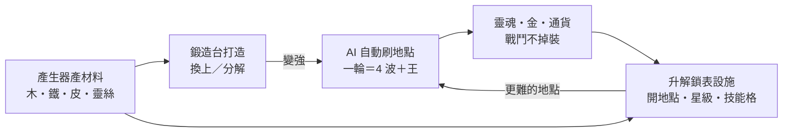

# dpoe 遊戲企劃書（GDD）

> 本檔由製作人從 Page 同步，來源：<https://cursor.com/canvas/store-82cf5215-7bf0-49e1-b610-9b76fbf158ee/a647bf26-aa82-4684-8c89-311e76640026>；同步日期：2026-11-16；請勿直接在 repo 修改，改動請經製作人

dungeonPOE（dpoe）的專案理解、方向與決策。同一份程式雙平台：Steam 買斷為主，網頁／PWA 免費導流（Q12 C）。平台優先順序分階段：M0–M1 手機直立優先；M2 起直立 390×844 與桌機 1280×720 同級。依 repo 0.5.4（commit a93c3fd（分析時）；M0 後 main 為 13ce9cd）整理。

里程碑、任務表、驗收判準與 M1-08／M1-13 定稿文案在 [`milestones.md`](milestones.md)。

## 目錄

- [平台優先順序（分階段）](#平台優先順序分階段)
- [證據標記怎麼讀](#證據標記怎麼讀)
- [方向與定位](#方向與定位)
- [商業模式](#商業模式)
- [核心玩法循環](#核心玩法循環)
- [已實作系統與完成度](#已實作系統與完成度)
- [決策紀錄](#決策紀錄)
- [待決事項](#待決事項)
- [缺口與風險](#缺口與風險)
- [來源](#來源)

## 平台優先順序（分階段）

mumi 2026-11-16 定；Q12 C 之後改成分階段。適用所有設計、審查、測試、開發，純文件任務除外。

| 階段 | 第一優先 | 第二優先 | 備註 |
| --- | --- | --- | --- |
| M0–M1 | 手機直立 390×844 | 375×667 → 橫向 → 桌機 1280×720／1440×900 | 原規則，已交辦的任務不改 |
| M2 起 | 手機直立 390×844 與桌機 1280×720 同級，兩個都驗過才算完成 | 375×667、橫向、1440×900 | 桌機以滑鼠＋鍵盤為主，也要可以只用滑鼠玩 |
| M4 Steam 線 | 桌機 1280×720 與 Steam Deck 1280×800 | 1440×900 | 另做 Canvas 效能實測 |

## 證據標記怎麼讀

| 標記 | 意思 |
| --- | --- |
| 程式碼證實 | 在原始碼、資料檔或測試裡找到，或製作人在本機跑過（`node tools/check.js` 696 項全過；線上版回 200、`version.json` 是 0.5.4、無頁面錯誤） |
| 文件記載 | 寫在 repo 的 docs、CHANGELOG 或 CLAUDE.md，製作人沒有逐行對程式碼 |
| 推測 | 製作人自己的推論，沒有直接證據 |

dpoe 是 dungeonPOE，起點是類 Path of Exile 的動作 ARPG（0.2），現在 0.5 已改成「PoE 式增量／掛機遊戲」：角色由 AI 自動戰鬥，玩家經營營地、打造裝備、配 build。

## 方向與定位

| 項目 | 內容 | 證據 |
| --- | --- | --- |
| 類型 | PoE 式增量遊戲：你配一套 build 讓 AI 自己打，營地產材料、鍛造台打裝、升設施解鎖更難的地點與更深的做裝 | 程式碼證實 |
| 一句話（作者定案） | 你設計一套 build 讓它自己去打，營地的林場、礦場替你產材料，你用材料打造裝備、升設施，設施再帶你去更難的地方、解鎖更深的做裝 | 文件記載 |
| 平台（現況） | 瀏覽器網頁＋PWA manifest，GitHub Pages 部署；手機直立為主，桌機與手機橫向也支援；沒有 service worker | 程式碼證實 |
| 平台（決定） | 同一份程式做雙平台（Q12 C）：網頁／PWA 先發、免費；Steam 桌機版付費；手機商店之後再議 | mumi 決定 |
| 商業模式 | Steam 買斷為主，網頁／PWA 免費導流（Q12 C） | mumi 決定 |
| 技術棧 | 原生 JavaScript、HTML5 Canvas，沒有建置與框架；28 支 `js/*.js` 全域腳本（約 3.2 萬行）；Supabase 匿名登入＋雲端存檔（有 RLS）；Node 檢查工具在 `tools/` | 程式碼證實 |
| 題材 | 山海經＋台灣民間信仰（酆都、十殿閻羅、陰兵借道、太歲、十二生肖） | 文件記載 |
| Steam 主打（Q15 E） | 「PoE 的做裝深度，掛機也不會乾旱」：商店頁、膠囊圖、預告片前段都先講這句 | mumi 決定 |
| 題材包裝（Q15 F） | 台灣民俗暗黑題材（酆都、陰兵借道、四凶）當商店頁與美術的包裝；G 桌面常駐小視窗不當主打，M4S 可選評估 | mumi 決定 |
| 裝備取得（Q14 D） | 打造維持骨幹；加一層只能靠掉落的追逐物品，保底進度寫在掛機卡上（M2） | mumi 決定 |
| 語言（Q16 I） | Steam 上架前加簡體中文；英文不在範圍 | mumi 決定 |
| 目標玩家 | Melvor Idle 那群掛機／增量玩家；PoE 老手當第二層 | 文件記載 |
| 目標玩家（製作人的看法） | 實際最有感的會是「懂 PoE 但沒空手刷」的手機玩家 | 推測 |

## 商業模式

- **Q12 C（mumi 2026-11-16 決定）**：同一份程式做雙平台；Steam 買斷是主要收入，網頁／PWA 免費導流。
- Steam 商店頁在 M3 真人試玩通過後才開（M3-08～10）；Steam Direct 註冊與上架費需 mumi 本人的帳號與付款。
- **2026-11-16 21:56 mumi 指示**：Steam 相關項目（M3-08～11、M4S 全部）延後，先把網頁試玩版做到夠上癮；Steam 仍是最終收入方向（Q12 C 的時程改變），上癮度達標後重新評估。重排見 [`milestones.md`](milestones.md#重排網頁試玩版上癮度優先2026-11-16-2156)。
- 免費版與付費版的內容差異尚未決定（Q13，見[待決事項](#待決事項)）。
- 評估依據與來源見 [`platform-strategy.md`](platform-strategy.md)。
- Steam 主打與包裝（Q15）、簡體中文（Q16）的評估見 [`loot-and-steam-eval.md`](loot-and-steam-eval.md)。

## 核心玩法循環

| 尺度 | 玩家在做什麼 | 證據 |
| --- | --- | --- |
| 每分鐘 | AI 在一個地點一輪接一輪刷；玩家按產生器升級（費用 ×1.12／級、里程碑翻倍）、打造一件裝並跟身上比，換上或分解 | 程式碼證實 |
| 每場（數十分鐘） | 存靈魂＋木升鍛造台、瞭望台、斥候營、民房、祭壇、倉房；瞭望台開地點、斥候營開星級、祭壇開技能格與輔助孔 | 程式碼證實 |
| 長期（數小時以上） | 22 個主幹地點＋5 條賽制線；填 → 淬鍊 → 破裂石 → 完美石 → 聖化 → 腐化；天賦樹、昇華、珠寶；離線結算 1／4／8／12 小時 | 程式碼證實 |

## 已實作系統與完成度

| 系統 | 完成度 | 檔案 | 證據 |
| --- | --- | --- | --- |
| 營地：4 座產生器＋6 座解鎖表、居民自動補位 | 做完 0.5.1、介面 0.5.4 | `data.js` `GEN`／`CAMP`；`craft.js` `genTick`、`popAssign`、`campCan`；`forge.js` `campHTML` | 程式碼證實 |
| 打造、分解、自動分解 | 做完 0.5.0 | `craft.js` `craftDo`、`salvageDo` | 程式碼證實 |
| 破裂石、完美石、追憶之墨、珠寶 | 做完 0.5.3 | `craft.js` `FORGE.frac`、`dropCur` | 程式碼證實 |
| 自動戰鬥 AI、連續刷、連死退回 | 可用 | `ai.js` `aiTick`；`game.js` `runNode`、`deadAgain` | 程式碼證實 |
| 地點清單 | 做完 0.5.2 | `hud.js` `nodeHTML`；`world.js` `TRUNK` | 程式碼證實 |
| 離線結算 | 可用 | `game.js` `offSettle` | 程式碼證實 |
| 戰鬥底層、技能 82 招、輔助 77 顆、昇華 15 個、天賦 3,917 點 | 內容量大 | `combat.js`、`mech.js`、`skills.js`、`tree.js` | 文件記載 |
| 雲端存檔 | 可用 | `cloud.js`、`supabase/migrations` | 程式碼證實 |
| 藏身處、練習區 | 可用，M2 併入營地（Q8 C） | `hideout.js`、`hideart.js`；`G.scene === 'hide'` 7 個檔案 23 處 | 程式碼證實 |
| 真人市集 | 程式還在但沒載入，M2 刪除 | `js/market.js` | 程式碼證實 |

| 項目 | 內容 |
| --- | --- |
| 版本 | 0.5.4（存檔版本 35） |
| Commit | 220 個，最早 2026-11-03，最新 2026-11-15；作者 Claude 129、MingWei 90 |
| 外部評估 | 測試報告 6.5／10（3 項必須修）；UI 審查（修訂版）P0-1～4、P1-1～8 |
| 整體判斷 | 系統完整、可玩；新手動線與手機版面要先修 |

## 決策紀錄

| 日期 | 決定了什麼 | 為什麼 | 還沒決定 |
| --- | --- | --- | --- |
| 2026-11-16 | Q1：繼續邊做邊改，不凍結 0.5 的定位 | mumi 決定，跟製作人的建議不同（建議凍結） | —（以 M2 版本守門控制） |
| 2026-11-16 | Q2：第一輪試玩只用 AI | mumi 決定，跟製作人的建議不同（建議找 5 位陌生人） | —（Q6、Q7 已補） |
| 2026-11-16 | Q3：保持技能結構，只寫清楚施放頻率 | mumi 決定，同製作人建議 | 面板上的放法等手機版 UI 審查 |
| 2026-11-16 | Q4：首發網頁 PWA | mumi 決定，同製作人建議 | 手機商店、Steam 要不要做（已由 Q12 C 回答） |
| 2026-11-16 | Q5：A，打造卡寫出 DPS 與生命的差值 | mumi 決定，同製作人建議 | 卡上的寫法等手機版 UI 審查 |
| 2026-11-16 | Q6：A，卡關 ≤5 分鐘、30 分鐘新東西 ≥10 | mumi 決定，同製作人建議 | 何時收緊到第一小時 ≥18 |
| 2026-11-16 | Q7：C，AI 試玩連兩版通過後找 3–5 位真人 | mumi 決定，同製作人建議 | 找誰、怎麼招募 |
| 2026-11-16 | Q8：C，藏身處整個併進營地（排 M2） | mumi 決定，跟製作人的建議不同（建議 B：只刪殘件，藏身處與練習區留著） | 營地場景的畫法（M2-11） |
| 2026-11-16 | Q9：B，自動模式照跑；手動模式開面板就暫停；確認卡、死亡卡、技能挑選、天賦樹一律暫停 | mumi 決定，同製作人建議 | — |
| 2026-11-16 | Q10：C，只顯示下一個要解鎖的項目 | mumi 決定，同製作人建議；調整了 2026-11-15「先藏起來」的決定 | 技能面板與營地裡的呈現等手機版 UI 審查 |
| 2026-11-16 | 新存檔開場後自動開刷 | 製作人先定，mumi 沒推翻 | — |
| 2026-11-16 | T 鍵按第二下＝確認回去 | 製作人先定，mumi 沒推翻 | M2 併入營地後改成「回營地」 |
| 2026-11-16 | 所有設計、審查、測試、開發一律手機直立優先，桌機其次（已被分階段規則取代（Q12 C）） | mumi 決定 | — |
| 2026-11-16 | 核准 M0、M1 全部開工；面板版面類任務等手機版 UI 審查 | mumi 核准；Art Director 改用 390×844 重審技能面板、技能挑選、營地 | —（規格已交，見任務清單） |
| 2026-11-16 | Q11：A，自動模式開技能詳情時不暫停，用半版顯示 | mumi 決定，同製作人建議（規格也照此寫） | — |
| 2026-11-16 | Q12：C，同一份程式做雙平台；Steam 買斷是主要收入，網頁／PWA 免費導流。評估 Page：<https://cursor.com/canvas/store-82cf5215-7bf0-49e1-b610-9b76fbf158ee/60da64d9-8faa-4f56-8a3b-1126a93c934b>（repo：[`platform-strategy.md`](platform-strategy.md)） | mumi 決定，同製作人建議 | 免費版與付費版的內容差異（Q13） |
| 2026-11-16 | 平台優先順序改成分階段：M0–M1 手機直立優先；M2 起直立 390×844 與桌機 1280×720 同級；M4 Steam 線加驗 Steam Deck 1280×800 | mumi 決定（隨 Q12 C） | — |
| 2026-11-16 | 掛機卡拿掉「升級」，改成「去營地」 | 製作人決定（介面） | — |
| 2026-11-16 | 戰鬥暫停時顯示「已暫停」膠囊（規格小節 M1-10） | 製作人決定（介面） | — |
| 2026-11-16 | 「卸下」不做二次確認 | 製作人決定（介面） | — |
| 2026-11-16 | 375×667 半版戰鬥區 253px 可接受，但要看得到角色、當前的怪和生命條 | 製作人決定（介面） | — |
| 2026-11-16 | 新增色票 `--bad-hi` #f06a50 | 製作人決定（介面） | — |
| 2026-11-16 | M1-15b 文案：「會讓這些招失效：｛名稱｝、｛名稱｝。」 | 製作人決定（介面） | — |
| 2026-11-16 | M1-20b 差值：「DPS +16」「生命 +20」「沒有變化」；變少寫「DPS −16」，用 `--bad-hi` | 製作人決定（介面） | — |
| 2026-11-16 | 技能挑選不做點列即換，保留底部確認鈕 | 製作人決定（介面） | — |
| 2026-11-16 | 輔助與空槽的確認鈕用「放上｛名｝」 | 製作人決定（介面） | — |
| 2026-11-16 | M1-12 完成標準：390×844 護符列不必捲動；375×667 允許捲動，但要有捲動提示 | 製作人決定（介面） | — |
| 2026-11-16 | PR 的合併和部署下放給開發工程師自行處理，不用問 mumi；測試員的驗收與試玩只在 mumi 明確說要測時才進行 | mumi 決定 | — |
| 2026-11-16 | 製作文件同步到 repo 的 `docs/production/`：雲端程式 agent 只讀 GitHub，所以 Page 更新後要同步到 repo，交辦時指向 repo 路徑 | mumi 規則 | — |
| 2026-11-16 | Q14：D，打造維持骨幹，加一層只能靠掉落的追逐物品，保底進度顯示在掛機卡上；排 M2（M2-17～20）。評估 Page：https://cursor.com/canvas/store-82cf5215-7bf0-49e1-b610-9b76fbf158ee/167c56bb-e9cf-4954-b91f-3d39084385bd（repo：[`loot-and-steam-eval.md`](loot-and-steam-eval.md)） | mumi 決定，同製作人建議（D） | 追逐物品清單與保底數字（M2-17，草案見 [`milestones.md`](milestones.md#m2-17-草案追逐掉落規格)） |
| 2026-11-16 | Q15：E＋F，Steam 主打 E「PoE 的做裝深度，掛機也不會乾旱」；F 台灣民俗暗黑題材（酆都、陰兵借道、四凶）當包裝；G 桌面常駐小視窗不當主打，M4S 可選評估（M4S-06） | mumi 決定，同製作人建議（E 當主打、F 當包裝） | — |
| 2026-11-16 | Q16：I，Steam 上架前加簡體中文（M3-11～13）；英文不在範圍 | mumi 決定，同製作人建議（至少 I） | — |
| 2026-11-16 | 21:56 mumi 指示：「如果連引流版的網頁都不夠讓人上癮，更不用說 Steam 版本了」。Steam 相關項目（M3-08～11、M4S 全部）延後；優先把網頁試玩版做到夠上癮；進行中的 M1 不中斷。修改 Q12 C 的時程：Steam 仍是最終收入方向，但延後到上癮度達標後重新評估。影響 Q16 I（簡中時程改成 Q17 待決）與 Q13（不急，Steam 工作恢復前決定即可） | mumi 決定 | —（Q17～Q21 已於 22:23 決定）；重排見 [`milestones.md`](milestones.md#重排網頁試玩版上癮度優先2026-11-16-2156) |
| 2026-11-16 | Q17：B，簡體中文（M3-12、13）延到 Steam 階段，編號不變 | mumi 決定（2026-11-16 22:23），同製作人建議（B） | — |
| 2026-11-16 | Q18：B，網頁版只收最小匿名漏斗；不收任何個資、除了現有的之外不做帳號連結、只用匿名 ID；M2-27 同意可做（仍依賴 M2-26） | mumi 決定（2026-11-16 22:23），同製作人建議（B） | 事件清單（M2-26） |
| 2026-11-16 | Q19：C，真人試玩先觀察 3–5 位，再公開招募 20 位以上（M3-06） | mumi 決定（2026-11-16 22:23），同製作人建議（C） | 從哪個社群招募：尚未指定，要用時問 mumi |
| 2026-11-16 | Q20：A，「試玩版夠上癮」的 A、R 門檻照建議值當起點，可調；真人指標仍是內部提案、沒有公開基準（未查證） | mumi 決定（2026-11-16 22:23），同製作人建議（A） | 第一輪真人試玩後是否調整 |
| 2026-11-16 | Q21：A，藏身處併入營地（M2-11、12、13）照原排，跟上癮度任務一起做，不再排到後面 | mumi 決定（2026-11-16 22:23），跟製作人的建議不同（建議 B：排在上癮度任務之後） | — |
| 2026-11-16 | M1-06：山海寶盒維持開放；解鎖表沒有對應設施，M1 不加新門檻；其他未解鎖內容所有入口都擋，寶盒例外 | 製作人決定（2026-11-16 22:47，回開發工程師 M1 提問） | 寶盒要不要加門檻：M2-21 再評估 |
| 2026-11-16 | M1-17：自動模式死後保留 1.5 秒原地重來，掛機不停（跟 M2-25 一致）；死亡卡的升級鈕在手動模式驗 | 製作人決定（2026-11-16 22:47） | — |
| 2026-11-16 | M1-20：差值報實際的生命變化；`check.js`「武器只影響 DPS」用沒有生命與力量詞綴的武器；有力量詞綴時翻牌卡寫「生命 +n」 | 製作人決定（2026-11-16 22:47） | — |
| 2026-11-16 | M1-03：「一打開就看得到六條路線全名」適用於新存檔與總覽；舊存檔重開停在上次點的位置可以接受 | 製作人決定（2026-11-16 22:47） | — |
| 2026-11-16 | M1-09：程式裡沒有沒反應的寶石格，角色面板截圖就是證據；「腐化加一個孔」的規則不變，孔先不顯示 | 製作人決定（2026-11-16 22:47） | 符文回歸時腐化開孔的去留（M2-28） |
| 2026-11-16 | 前期節奏：第一個地點一輪 2–5 分鐘，前 5 分鐘不會有一輪打完；前期節奏看「每 30–60 秒一次小變強」，不看一輪有沒有打完；M1-21 報告要列第一輪打完的時間，給 M2-21 用 | 製作人決定（2026-11-16 22:47） | — |
| 2026-11-17 | 桌機技能面板關閉鈕 40×40 放大到至少 44×44，不對桌機豁免 44px（同一套程式跑 PWA 與桌機，觸控筆電、平板也用得到；規則一致）；順手掃其他面板的關閉鈕；記成 M1-25，已交辦，排進開發下一批 | 製作人決定（2026-11-17 00:43，回開發工程師） | — |
| 2026-11-17 | 第 2 個地點太晚開：M1-C 模擬 32 分鐘才開（目標表第 10 分鐘、0.5.1 實掛第 6 分鐘）；M1 內修，歸 M1-21：瞭望台 Lv1 在第 8～12 分鐘內升好，其他解鎖不往後推，只做最小改動，整條曲線留給 M2-22；報告附逐分鐘靈魂收入、靈魂花費、鐵 T1 產量與用量 | 製作人決定（2026-11-17 09:23，數值層級，幕僚長授權） | — |
| 2026-11-17 | 鐵 T1 30 分鐘堆到 19,000（0.5.1 是 4,600）：M1 不調，屬鐵沒有出路的設計問題；M2-21 定出路（製作人）、M2-22 實作，M2-22 完成標準加「30 分鐘時鐵 T1 庫存 ≤ 約 2,000」 | 製作人決定（2026-11-17 09:23，數值層級，幕僚長授權） | 鐵 T1 出路（M2-21） |
| 2026-11-17 | 新分工：新增數值設計師，負責 dpoe 全部用語與命名一致，以及數值設計（屬性、公式、成長曲線、經濟來源與出路、掉率、難度、節奏數字），含 M2-21 與之後的節奏數字；製作人不再做深度內容，保留方向、協調、里程碑、任務拆解、驗收與產品、UX 決定。改派數值設計師：M2-03、M2-17、M2-21、M3-01、M3-13（製作人驗收）；M2-18、M2-22、M3-02 仍由開發工程師做，數字照數值設計師的規格 | mumi 決定（2026-11-17 09:42，經幕僚長） | — |
| 2026-11-17 | 角色頁鎖住的護符／神格格：點了開一句說明（M1-26）；不拿掉神格（現行系統，拿掉屬方向決定，要問 mumi），也不跳到山海寶盒（會搞混） | 製作人決定（2026-11-17 10:12） | — |
| 2026-11-17 | `hide_check.js` 在 main 崩潰（`skillWhy`）排成 M1-27：測試工具壞了會削弱驗收 | 製作人決定（2026-11-17 10:12） | — |
| 2026-11-17 | 瞭望台 Lv1 費用改成 240 靈魂（原 550），與材料顯示名（M1-28）同一個 PR；M1-21 以 240 為基準整合，完成標準「瞭望台 Lv1 在第 8～12 分鐘升好」不變，仍用 `camp_run` 驗 | mumi 決定（經開發工程師轉達） | PR 連結：2026-11-17 10:18 查 GitHub 還沒有對應的 PR，開了再補 |
| 2026-11-17 | M2-05：傷害數字設定三段（全部／只暴擊與受傷／關閉）；預設 390×844 只暴擊與受傷、1280×720 全部；升級提示文案與手機撿金幣跳字移到 M2-23 | 製作人決定（2026-11-17 10:29，回 M2-05 規格「需製作人決定」） | — |
| 2026-11-17 | M2-11：主角不在營地走動；營地分頁是主入口，場景物件是同一批面板的捷徑，未解鎖的出 M1-06 那一句；拿掉「市集（之後開放）」牌子；地城上方不放營地場景（戰鬥要看得到） | 製作人決定（2026-11-17 10:29，回 M2-11 規格） | — |
| 2026-11-17 | M3-04：離線摘要用選項 A（卡片後面已在打，按鈕「收下」，跟 M2-25／A10 一致）；「全部升級」做次要按鈕；「裝備」第二行「換下 {舊件}，放進倉庫」可以 | 製作人決定（2026-11-17 10:29，回 M3-04 規格） | — |
| 2026-11-17 | M4P-03：主畫面名字維持 dungeonPOE、方向 any；不主動提示安裝，只放在「更多」與設定裡的說明頁 | 製作人決定（2026-11-17 10:29，回 M4P-03 規格） | M3 真人試玩數據出來後再看要不要主動提示 |
| 2026-11-17 | M1 規格更正：`--fr-o` 對 s1 的對比實測 1.55:1（不是 2.01:1）；Art Director 選符合的顏色（非文字 ≥3:1、文字 ≥4.5:1），再由開發換上（M1-29） | 製作人決定（2026-11-17 10:29） | — |
| 2026-11-17 | M1 剩下的項目做完就直接進 M2，不做 M1-22 驗收測試（M1-22 取消）；測試至少要等 M2 做完再討論。M1 出口改成開發任務合併並附證據、`check.js` 與 `touch_check` 全尺寸全過、M1-21 結果交給 M2-21；「第一小時新東西 ≥18」改成帶到 M2-21、M2-22 的量測目標 | mumi 決定（2026-11-17 10:31，經幕僚長） | 測試何時做：M2 做完再討論 |
| 2026-11-17 | M2-10 每版 AI 試玩報告改歸開發工程師：每版用 M2-01 的腳本在雲端跑、把 A1–A10 指標表附在 PR，製作人對門檻驗收；遊戲測試員在 M2 期間不參與（mumi 10:31：測試等 M2 做完再討論）；M2 出口「AI 檢查連兩版達標」看 M2-10 的結果 | 製作人決定（2026-11-17 10:39） | — |
| 2026-11-17 | `--line-ctl` #a08f78 保留，只用在要強調的框（M1 規格 BASE-02） | 製作人決定（2026-11-17 10:42） | — |
| 2026-11-17 | 傷害數字預設依裝置、不依方向：觸控手機（短邊 < 600）預設「只暴擊與受傷」，含橫向；其他裝置預設「全部」。M2-06 完成標準照改；M2-05 規格若仍寫依版面，以本決定為準 | 製作人決定（2026-11-17 10:42） | — |
| 2026-11-17 | 在營地點「試招場」直接跳過去（跟 M2-13 一致，不改） | 製作人決定（2026-11-17 10:42） | — |
| 2026-11-17 | M2-17 追逐掉落（回數值設計師候選版 https://cursor.com/canvas/store-82cf5215-7bf0-49e1-b610-9b76fbf158ee/d754e876-2975-4546-968e-86dd847f8111）：用基礎機率＋保底點數；王 1.4%、菁英 0.14%；保底 500 點（王 +5、菁英 +1）。另加「有感掉落保底」：獎勵由數值設計師選（傾向輪替），每小時多出約 1 件，併入 M2-21。A8 改成可量測：100 小時內有感掉落空窗 P95 ≤ 30 分鐘、最長 ≤ 45 分鐘，不含離線與暫停；「15～30 分鐘」是手感目標，不是門檻。規則線的池只放該線的 2 個基底，該線菁英以 0.14% 判定。接受星級／擊殺速度讓掉落加快，下限：5★、一分鐘一輪時平均間隔 ≥ 0.5 小時 | 製作人決定（2026-11-17 10:50） | M2-17 定稿（雲端覆核後） |

現行平台規則以[平台優先順序（分階段）](#平台優先順序分階段)為準。

### 和製作人建議不同的三個決定，帶來的風險

Q1 不凍結：方向可能繼續變動，規則、數值與文件要一再重寫。Q2 只用 AI：找不出看不懂、無聊、在第幾分鐘關掉這類只有真人才會發現的問題（Q7 在 M3 補上）。Q8 併入營地：藏身處的場景、輸入與存檔分支散在 7 個檔案 23 處，還有約 2,200 行專屬程式與工具（`hideout.js`、`hideart.js`、`hide_bake`、`hide_check`）要改寫，M2 範圍與時程會變大；測試員稱讚的藏身處美術也可能被打掉。降低方法：放在 M1 之後、沿用藏身處美術當營地底圖、靠 M2 的 AI 試玩回歸守住。

## 待決事項

| # | 問題 | 選項 | 狀態 |
| --- | --- | --- | --- |
| Q13 | 免費版（網頁／PWA）和 Steam 付費版的內容差異 | A 全內容一樣，付費版多 Steam 功能（雲端存檔、成就、桌機殼）　B 免費版有內容上限（例如到某個地點或設施等級），付費解鎖全部，類似 Melvor　C 免費版全內容，付費版另有獨占內容或之後的 DLC | 不急：Steam 工作恢復前決定即可（2026-11-16 21:56 起；製作人先不提建議） |

Q1–Q12、Q14–Q21 已決定（見決策紀錄）。

## 缺口與風險

| # | 缺口或風險 | 證據 |
| --- | --- | --- |
| 1 | 方向一直在轉，約兩週換四次類型；mumi 決定不凍結定位（Q1），靠版本守門控制 | 文件記載 |
| 2 | 沒有真人驗證；第一輪只用 AI（Q2），AI 試玩連兩版通過後找 3–5 位真人（Q7） | 文件記載 |
| 3 | 新手動線：開場後不知道第一步、天賦樹標籤被蓋、手機橫向被蓋住、找不到怎麼插輔助 | 程式碼證實 |
| 4 | 戰鬥與介面搶權：開面板戰鬥不停，死亡卡沒有 z-index | 程式碼證實 |
| 5 | 手機直立版的技能面板、技能挑選、營地問題大；第二批規格已交（91bce2cc），已交辦，排在本批之後 | 文件記載 |
| 6 | 經濟數字全部暫定，1 小時以後的曲線沒量過 | 文件記載 |
| 7 | 藏身處併入營地（Q8 C）是大改動，牽動場景、輸入與存檔 | 程式碼證實 |
| 8 | PWA 只有 manifest，沒有 service worker | 程式碼證實 |
| 9 | 桌機 `ZOOM` 寫死 1.35（`main.js`），M2 起 1280×720 與直立同級，版面可能要調（M2-04、M2-16）；Steam 線還要多一套包殼、存檔與 Steam Deck 驗證 | 程式碼證實 |

> 註（同步時加）：第 4 項的死亡卡 z-index 已由 M0-01 修正並部署（PR #1）。第 5 項的規格見 [`ui-spec-m1.md`](ui-spec-m1.md)，審查見 [`ui-review.md`](ui-review.md)。

## 來源

- Repo：<https://github.com/Shiroyashatw/dpoe>（唯讀）
- 測試報告 v0.5.4：<https://cursor.com/canvas/store-82cf5215-7bf0-49e1-b610-9b76fbf158ee/6c7a71e8-8701-48bb-9b53-536999d79ef9>（repo：[`playtest-0.5.4.md`](playtest-0.5.4.md)）
- UI/UX 審查：<https://cursor.com/canvas/store-82cf5215-7bf0-49e1-b610-9b76fbf158ee/336b8159-f1b5-4c87-a395-5569d4890abf>（repo：[`ui-review.md`](ui-review.md)）
- 交辦單：製作人工作區的 `engineer.md`、`art.md`、`tester.md`（不在 repo）
- Repo 同步版：`docs/production/`（[`README.md`](README.md) 為索引）
- 掉落與 Steam 定位評估：<https://cursor.com/canvas/store-82cf5215-7bf0-49e1-b610-9b76fbf158ee/167c56bb-e9cf-4954-b91f-3d39084385bd>（repo：[`loot-and-steam-eval.md`](loot-and-steam-eval.md)）
