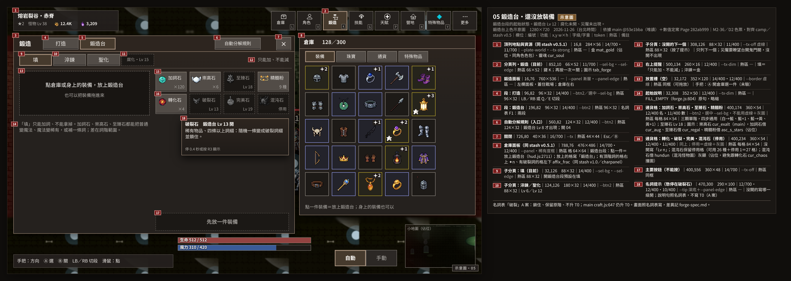
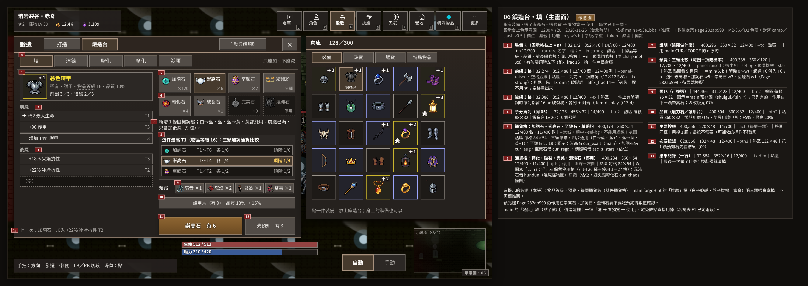
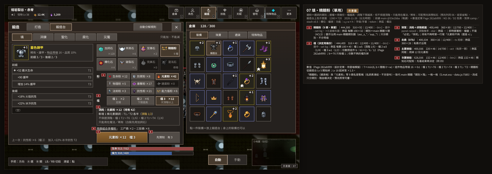
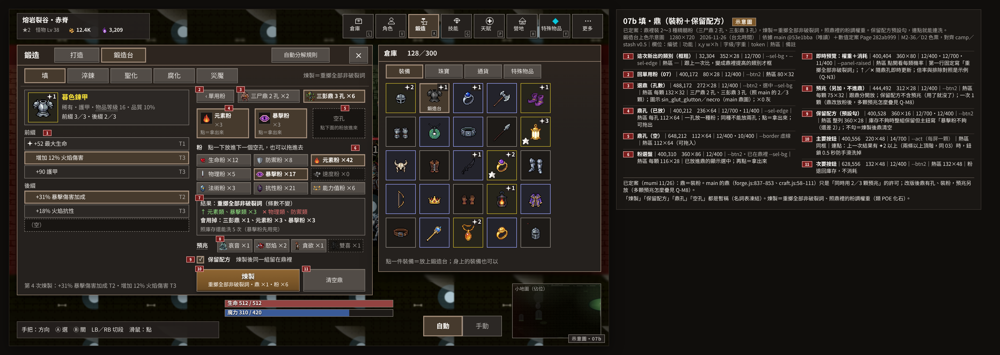

# 鍛造 v1.0・畫面 05–07b（鍛造台・填）

主檔：[forge-spec.md](forge-spec.md)（範圍、符號、機制、節奏、鍵位）。其他畫面：[01–04](forge-screens-make.md)、[08–17](forge-screens-mods.md)。交接：[forge-handoff.md](forge-handoff.md)。

座標＝1280×720 舞台 CSS px；「熱區」欄是點擊範圍；token 見主檔 §2；✦／破裂見主檔 §3。圖在 `docs/production/evidence/forge/`。

### 05 鍛造台・還沒放裝備

鍛造台段的起始狀態。鍛造台 Lv 12：腐化未開、災魘未出現。

| # | 元件 | x,y w×h | 字級/字重 | token | 熱區 | 備註 |
|---|---|---|---|---|---|---|
| 1 | 頂列地點與資源（同 stash v0.5.1） | 16,8　284×56 | 14/700・11/700 | --plate-world・--tx-strong | — | 金 mat_gold（佔位，同角色色包）、靈魂 cur_soul |
| 2 | 分頁列・鍛造（目前） | 852,10　66×52 | 11/700 | --sel-bg・--sel-edge | 66×52 | 鍵 K；再按一次＝關；圖示 tab_forge |
| 3 | 鍛造面板 | 16,76　760×536 | — | --panel 漸層・--panel-edge | — | 左欄面板，蓋住戰場；倉庫在右 |
| 4 | 段：打造 | 96,82　96×32 | 14/400 | --btn2／選中 --sel-bg | 96×32 | LB／RB 或 Q／E 切段 |
| 5 | 段：鍛造台 | 196,82　96×32 | 14/400 | --btn2 | 96×32 | 名詞表 F1：兩段 |
| 6 | 自動分解規則（入口） | 560,82　124×32 | 12/400 | --btn2 | 124×32 | 鍛造台 Lv 8 才出現；開 04 |
| 7 | 關閉 | 726,80　40×36 | 16/700 | --tx | 44×44 | Esc／Ⓑ |
| 8 | 倉庫面板（同 stash v0.5.1） | 788,76　476×486 | 14/700・12/400 | --panel・稀有度框 | 格 64×64 | 鍛造台段：點一件＝放上鍛造台（hud.js:2711）；放上的格寫「鍛造台」；有頂階詞的格右上 ✦n、有破裂詞的格左下 affix_frac（同 stash v1.0／charpanel） |
| 9 | 子分頁：填（目前） | 32,126　88×32 | 14/400 | --sel-bg・--sel-edge | 88×32 | 開鍛造台段預設在填 |
| 10 | 子分頁：淬鍊／聖化 | 124,126　180×32 | 14/400 | --btn2 | 88×32 | Lv 6／Lv 12 |
| 11 | 子分頁：沒開的下一個 | 308,126　88×32 | 11/400 | --tx-off 虛線 | 88×32（按了提示） | 只列下一個；災魘要瞭望台開鬼門關，沒開不出現 |
| 12 | 右上提醒 | 500,134　260×16 | 12/400 | --tx-dim | — | 填＝「只能加、不能減」；淬鍊＝金 |
| 13 | 放置槽（空） | 32,172　352×120 | 14/400・12/400 | --border 虛線 | 同框（可拖放） | 手把：Ⓐ 開倉庫選一件（未驗） |
| 14 | 起始說明 | 32,308　352×50 | 12/400 | --tx-dim | — | FILL_EMPTY（forge.js:804）原句，略縮 |
| 15 | 通貨格：加詞石・崇高石・至臻石・精髓粉 | 400,174　360×54 | 12/400 名・11/400 數 | --btn2・選中 --sel-bg・不能用虛線＋灰圖 | 每格 84×54 | 三顆單階，四步通用（白→藍、藍+1、藍→黃、黃+1）；至臻石 Lv 18；圖示：崇高石 cur_exalt（main），加詞石借 cur_aug、至臻石借 cur_regal、精髓粉借 asc_s_stars（佔位） |
| 16 | 通貨格：轉化・破裂・完美・混沌石（停用） | 400,234　360×54 | 12/400・11/400 | 同上；停用＝虛線＋灰圖 | 每格 84×54 | 沒開寫「Lv n」；混沌石保留停用格（可用 26 種＋停用 1＝27 格）；混沌石借 hundun（混沌怪物圖）灰顯（佔位，避免跟轉化石 cur_chaos 撞圖） |
| 17 | 主要按鈕（不能按） | 400,556　360×48 | 14/700 | --tx-off | 同框 |  |
| 18 | 名詞提示（懸停在破裂石） | 470,300　290×100 | 12/700・12/400・10/400 | --tip 深底＋--panel-edge | — | 沒開的寫哪一級開；說明句照名詞表，不寫 T0（A 案） |

- 名詞表「破裂」A 案：鎖住、保留原階、不升 T0；main craft.js:647 仍升 T0。畫面照名詞表寫，差異記 forge-spec.md。

### 06 鍛造台・填（主畫面）

稀有裝備，選了崇高石。選通貨 → 看預覽 → 使用。每次只用一顆。

| # | 元件 | x,y w×h | 字級/字重 | token | 熱區 | 備註 |
|---|---|---|---|---|---|---|
| 1 | 裝備卡（圖示格右上 ✦n） | 32,172　352×76 | 14/700・12/400；✦n 12/700 | --rar-rare 名字＋框；✦ --tx-strong | — | 物品等級、品質、前後綴條數；圖示格右上 ✦n＝頂階詞條數（同 charpanel .cs），有破裂詞時左下 affix_frac 16；換一件＝點倉庫 |
| 2 | 前綴 3 格 | 32,274　352×88 | 12/700 標・12/400 列 | --panel-raised・空格虛線 | — | 列前 ✦＝頂階詞（12×12 SVG，--tx-strong）；列尾 T 階 --tx-dim；破裂詞＝affix_frac 14＋「破裂」標，不用 ★；空格畫出來 |
| 3 | 後綴 3 格 | 32,388　352×88 | 12/400 | --tx | — | 件上有破裂詞時每列都留 16 px 破裂欄，各列 ✦ 對齊（item-display §13-4） |
| 4 | 子分頁列（同 05） | 32,126　456×32 | 14/400 | --btn2 | 每顆 88×32 | 鍛造台 Lv 20：五個都開 |
| 5 | 通貨格：加詞石・崇高石・至臻石・精髓粉 | 400,174　360×54 | 12/400 名・11/400 數 | --btn2・選中 --sel-bg・不能用虛線＋灰圖 | 每格 84×54 | 三顆單階，四步通用（白→藍、藍+1、藍→黃、黃+1）；至臻石 Lv 18；圖示：崇高石 cur_exalt（main），加詞石借 cur_aug、至臻石借 cur_regal、精髓粉借 asc_s_stars（佔位） |
| 6 | 通貨格：轉化・破裂・完美・混沌石（停用） | 400,234　360×54 | 12/400・11/400 | 同上；停用＝虛線＋灰圖 | 每格 84×54 | 沒開寫「Lv n」；混沌石保留停用格（可用 26 種＋停用 1＝27 格）；混沌石借 hundun（混沌怪物圖）灰顯（佔位，避免跟轉化石 cur_chaos 撞圖） |
| 7 | 說明（這顆做什麼） | 400,296　360×32 | 12/400 | --tx | — | 用 main CUR／FORGE 的 d 原句 |
| 8 | 預覽：三顆比較（範圍＋頂階機率） | 400,338　360×120 | 12/700・12/400 | --panel-raised；選中列 --sel-bg、頂階機率 --star | 點開看 9 種詞 | T＝min(6, b＋隨機 0～w)，超過 T6 併入 T6；b＝這件最高階。加詞石 w5、崇高石 w3、至臻石 w1（Page 282ab999，待雲端模擬） |
| 9 | 預兆（可複選） | 444,466　312×28 | 12/400 | --btn2 | 每顆 75×32 | 圖示＝main 預兆圖（shuigui／sin_*）；只列有的；作用在下一顆崇高石；鼎改版見 07b |
| 10 | 品質（磨刀石／護甲片） | 400,504　360×32 | 12/400 | --btn2 | 360×32 | 武器用磨刀石、防具用護甲片；+5%，最高 20% |
| 11 | 主要按鈕 | 400,556　220×48 | 14/700 | --act（每屏一顆） | 同框 | 用掉 1 顆；長按不需要（可補救的操作不確認） |
| 12 | 次要按鈕 | 628,556　132×48 | 12/400 | --btn2 | 132×48 | 花 1 顆預知石先看結果（09） |
| 13 | 結果紀錄（一行） | 32,584　352×16 | 12/400 | --tx-dim | — | 最後一次做了什麼；換裝備就清掉 |

- 有提示的名詞（本張）：物品等級、預兆、每顆通貨名（懸停通貨格）。main forgeHint 的「推薦」標（白→蛻變、藍→增幅／富豪）隨三顆通貨拿掉，不再標推薦。
- 預兆照 Page 282ab999 仍作用在崇高石；加詞石、至臻石要不要吃預兆待數值確認。
- main 的「通貨」段（點了就用）併進這裡：一律「選 → 看預覽 → 使用」，避免誤點直接用掉（名詞表 F1 已定兩段）。

### 07 填・精髓粉（單用）

選粉＝選詞的類別；選檔＝用幾份。檔越高，詞階下限越高，但不保證頂階。只能用在魔法／稀有；可配預兆與預知石（預兆列同 06，這張省略）。

| # | 元件 | x,y w×h | 字級/字重 | token | 熱區 | 備註 |
|---|---|---|---|---|---|---|
| 1 | 精髓粉（9 類，單選） | 444,300　316×92 | 12/400 | --btn2・選中 --sel-bg・×0 虛線灰圖 | 每顆 100×32 | 類別＝main 精髓 9 類（ACLS）；圖示沿用 main 精髓類別圖（asc_s_*／sup_*）；只分類別、不分等級 |
| 2 | 檔（決定用幾份） | 444,400　316×40 | 12/400・11/400 | --btn2・選中 --sel-bg | 每顆 100×40 | 檔 1 w5（頂階 1/6）、檔 2 w3（1/4）、檔 3 w1（1/2）；份數照這件 b：b1＝2／6／12（Page 282ab999）；b＝T6 只有檔 1；份數不夠的檔灰掉 |
| 3 | 預覽：消耗＋詞階範圍 | 400,448　360×80 | 12/700・12/400 | --panel-raised；頂階機率 --star | — | 即時跟著粉、檔變；不寫「必定」「保底」；持有不夠時第一行寫「元素粉不夠（還差 n）」 |
| 4 | 去鼎（07b） | 400,534　360×16 | 12/400 | --tx 底線 | 360×28 | 有鼎才出現 |
| 5 | 主要按鈕 | 400,556　220×48 | 14/700 | --act（每屏一顆） | 同框 | 用掉 12 份元素粉 |
| 6 | 次要按鈕 | 628,556　132×48 | 12/400 | --btn2 | 132×48 | 預知石可配粉：先看結果再決定（同 09） |

- 數值（Page 282ab999，設計定案、待雲端模擬）：T＝min(6, b＋隨機 0～w)。這件物品等級 16 → b1：檔 1 T1～T6、檔 2 T1～T4、檔 3 T1／T2。精髓粉從鍛造台 Lv 5 開始掉；Lv 18 起掉落 ×1.5。
- 「精髓粉」（通貨格）與「元素粉」等 9 類名是暫稱（名詞表凍結，不另發布）。取代 main 精髓「類別×階」一格一格（S.mat.ess，data.js:7585），改成只分類別、階由檔決定。預兆照常可疊。

### 07b 填・鼎（裝粉＋保留配方）

已定案：鼎裡裝 2～3 種精髓粉（三尸鼎 2 孔、三彭鼎 3 孔），煉製＝重擲全部非破裂詞，照鼎裡的粉調權重。保留配方預設勾，連點就能連洗。

| # | 元件 | x,y w×h | 字級/字重 | token | 熱區 | 備註 |
|---|---|---|---|---|---|---|
| 1 | 這次新出的類別（框粗） | 32,304　352×28 | 12/700 | --sel-bg・--sel-edge | — | 跟上一次比，變成鼎裡提高的類別才框 |
| 2 | 回單用粉（07） | 400,172　80×28 | 12/400 | --btn2 | 80×32 |  |
| 3 | 選鼎（孔數） | 488,172　272×28 | 12/400 | --btn2・選中 --sel-bg | 每顆 132×32 | 三尸鼎 2 孔、三彭鼎 3 孔（照 main 的 2／3 顆）；圖示 sin_glut_glutton／necro（main 鼎圖）；×0 灰 |
| 4 | 鼎孔（已放） | 400,212　236×64 | 12/700・11/400 | --sel-edge | 每孔 112×64 | 一孔放一種粉；同種不能放兩孔；點＝拿出來；可拖出 |
| 5 | 鼎孔（空） | 648,212　112×64 | 12/400・10/400 | --border 虛線 | 112×64（可拖入） |  |
| 6 | 粉選盤 | 400,310　360×86 | 12/400 | --btn2・已在鼎裡 --sel-bg | 每顆 116×28 | 已放進鼎的顯示選中；再點＝拿出來 |
| 7 | 即時預覽：權重＋消耗 | 400,404　360×80 | 12/400・12/700・11/400 | --panel-raised | 點開看每類機率 | 第一行固定寫「重擲全部非破裂詞」；↑／✕ 隨鼎孔即時更新；倍率與排除對照是示例（Q-N3） |
| 8 | 預兆（另加，不進鼎） | 444,492　312×28 | 12/400 | --btn2 | 每顆 75×32 | 跟鼎分開放；保留配方不含預兆（用了就沒了）；一次 1 顆（鼎改放粉後，多顆預兆怎麼疊見 Q-M8） |
| 9 | 保留配方（預設勾） | 400,528　360×16 | 12/700・12/400 | --btn2 | 整列 360×28 | 庫存不夠時整組保留但主鈕寫「暴擊粉不夠（還差 2）」；不勾＝煉製後鼎清空 |
| 10 | 主要按鈕 | 400,556　220×48 | 14/700 | --act（每屏一顆） | 同框 | 連點：上一次結果有 ✦2 以上（兩條以上頂階，同 03）時，鈕鎖 0.5 秒防手滑洗掉 |
| 11 | 次要按鈕 | 628,556　132×48 | 12/400 | --btn2 | 132×48 | 粉退回庫存，不消耗 |

- 已定案（mumi 11/26）：鼎＝裝粉。main 的鼎（forge.js:837–853、craft.js:58–111）只是「同時用 2／3 顆預兆」的許可；改版後鼎有孔、裝粉，預兆另放（多顆預兆怎麼疊見 Q-M8）。
- 「煉製」「保留配方」「鼎孔」「空孔」都是暫稱（名詞表凍結）。煉製＝重擲全部非破裂詞、照鼎裡的粉調權重（類 POE 化石）。

