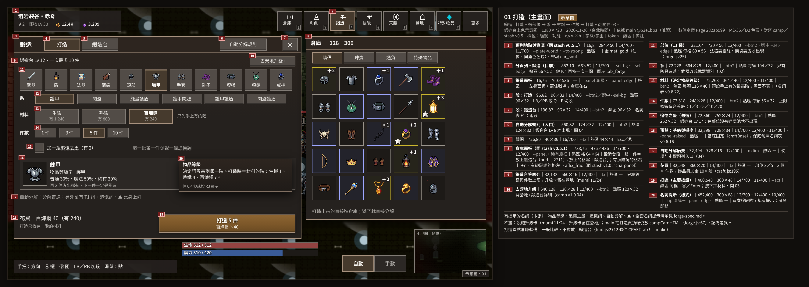
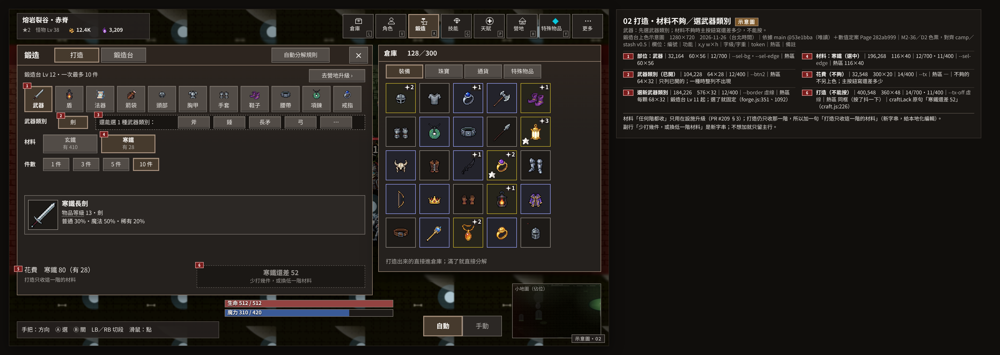
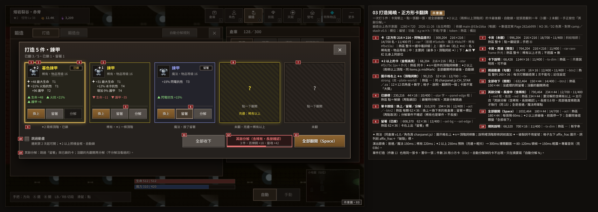
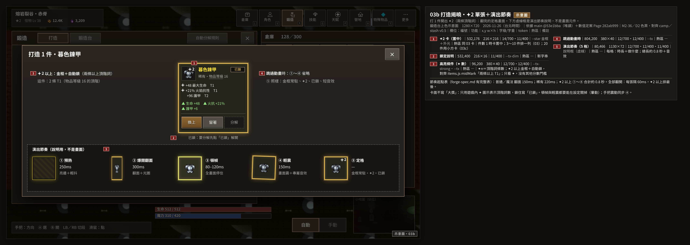
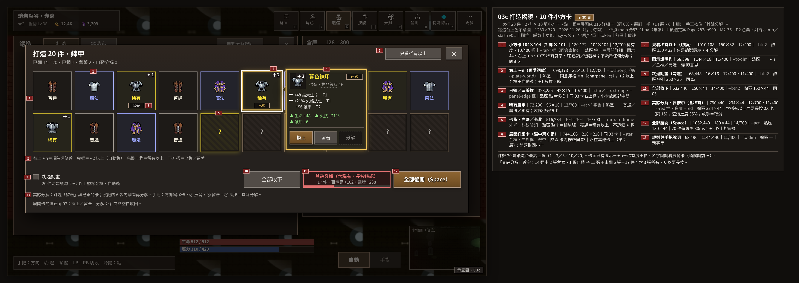
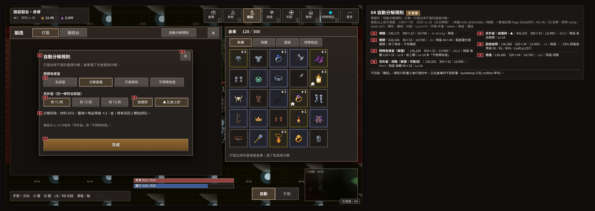

# 鍛造 v1.0・畫面 01–04（打造段）

主檔：[forge-spec.md](forge-spec.md)（範圍、符號、機制、節奏、鍵位）。其他畫面：[05–07b](forge-screens-bench.md)、[08–17](forge-screens-mods.md)。交接：[forge-handoff.md](forge-handoff.md)。

座標＝1280×720 舞台 CSS px；「熱區」欄是點擊範圍；token 見主檔 §2；✦／破裂見主檔 §3。圖在 `docs/production/evidence/forge/`。

### 01 打造（主畫面）

鍛造 › 打造。選部位 → 系 → 材料 → 件數 → 打造。翻開在 03。

| # | 元件 | x,y w×h | 字級/字重 | token | 熱區 | 備註 |
|---|---|---|---|---|---|---|
| 1 | 頂列地點與資源（同 stash v0.5.1） | 16,8　284×56 | 14/700・11/700 | --plate-world・--tx-strong | — | 金 mat_gold（佔位，同角色色包）、靈魂 cur_soul |
| 2 | 分頁列・鍛造（目前） | 852,10　66×52 | 11/700 | --sel-bg・--sel-edge | 66×52 | 鍵 K；再按一次＝關；圖示 tab_forge |
| 3 | 鍛造面板 | 16,76　760×536 | — | --panel 漸層・--panel-edge | — | 左欄面板，蓋住戰場；倉庫在右 |
| 4 | 段：打造 | 96,82　96×32 | 14/400 | --btn2／選中 --sel-bg | 96×32 | LB／RB 或 Q／E 切段 |
| 5 | 段：鍛造台 | 196,82　96×32 | 14/400 | --btn2 | 96×32 | 名詞表 F1：兩段 |
| 6 | 自動分解規則（入口） | 560,82　124×32 | 12/400 | --btn2 | 124×32 | 鍛造台 Lv 8 才出現；開 04 |
| 7 | 關閉 | 726,80　40×36 | 16/700 | --tx | 44×44 | Esc／Ⓑ |
| 8 | 倉庫面板（同 stash v0.5.1） | 788,76　476×486 | 14/700・12/400 | --panel・稀有度框 | 格 64×64 | 鍛造台段：點一件＝放上鍛造台（hud.js:2711）；放上的格寫「鍛造台」；有頂階詞的格右上 ✦n、有破裂詞的格左下 affix_frac（同 stash v1.0／charpanel） |
| 9 | 鍛造台等級列 | 32,132　560×16 | 12/400 | --tx | — | 只寫等級與件數上限；升級卡留在營地（mumi 11/24） |
| 10 | 去營地升級 | 640,128　120×28 | 12/400 | --btn2 | 120×32 | 開營地 › 鍛造台詳細（camp v1.0 04） |
| 11 | 部位（11 種） | 32,164　720×56 | 12/400 | --btn2・選中 --sel-edge | 每格 60×56 | 法器要靈絲、箭袋要皮才出現（forge.js:25） |
| 12 | 系 | 72,228　664×28 | 12/400 | --btn2 | 每顆 104×32 | 只有防具有系；武器改成武器類別（02） |
| 13 | 材料（決定物品等級） | 72,268　364×40 | 12/400・11/400 | --btn2 | 每顆 116×40 | 預設手上有的最高階；畫面不寫 T（名詞表 v0.6.22） |
| 14 | 件數 | 72,318　248×28 | 12/400 | --btn2 | 每顆 56×32 | 上限照鍛造台等級：1／3／5／10／20 |
| 15 | 追憶之墨（勾選） | 72,360　252×24 | 12/400 | --btn2 | 252×32 | 鍛造台 Lv 17；這部位沒有追憶池就不出現 |
| 16 | 預覽：基底與機率 | 32,398　728×84 | 14/700・12/400・11/400 | --panel-raised | — | 基底固定（craftBase）；保底句照名詞表 v0.6.16 |
| 17 | 自動分解摘要 | 32,494　728×16 | 12/400 | --tx-dim | — | 改規則走標題列入口（04） |
| 18 | 花費 | 32,548　360×20 | 14/400 | --tx | — | 部位 8／5／3 個 × 件數；飾品另加金 10×階（craft.js:195） |
| 19 | 打造（主要按鈕） | 400,548　360×48 | 14/700・11/400 | --act | 同框 | Ⓐ／Enter；按下扣材料、開 03 |
| 20 | 名詞提示（樣式） | 452,400　300×88 | 12/700・12/400・10/400 | --tip 深底＋--panel-edge | — | 有虛線底的字都有提示；滑開即關 |

- 有提示的名詞（本張）：物品等級、追憶之墨、追憶詞、自動分解、▲。全套名詞提示清單見 forge-spec.md。
- 不畫：設施升級卡（mumi 11/24：升級卡留在營地）；main 在打造頁頂端仍放 campCardHTML（forge.js:67），記為差異。
- 打造頁點倉庫裝備＝一般比較，不會放上鍛造台（hud.js:2712 條件 CRAFT.tab !== make）。

### 02 打造・材料不夠／選武器類別

武器：先選武器類別；材料不夠時主按鈕寫還差多少，不能按。

| # | 元件 | x,y w×h | 字級/字重 | token | 熱區 | 備註 |
|---|---|---|---|---|---|---|
| 1 | 部位：武器 | 32,164　60×56 | 12/700 | --sel-bg・--sel-edge | 60×56 |  |
| 2 | 武器類別（已開） | 104,228　64×28 | 12/400 | --btn2 | 64×32 | 只列已開的；一種時整列不出現 |
| 3 | 選新武器類別 | 184,226　576×32 | 12/400 | --border 虛線 | 每顆 68×32 | 鍛造台 Lv 11 起；選了就固定（forge.js:351、1092） |
| 4 | 材料：寒鐵（選中） | 196,268　116×40 | 12/700・11/400 | --sel-edge | 116×40 |  |
| 5 | 花費（不夠） | 32,548　300×20 | 14/400 | --tx | — | 不夠的不另上色；主按鈕寫還差多少 |
| 6 | 打造（不能按） | 400,548　360×48 | 14/700・11/400 | --tx-off 虛線 | 同框（按了抖一下） | craftLack 原句「寒鐵還差 52」（craft.js:226） |

- 材料「任何階都收」只用在設施升級（PR #209 §3）；打造仍只收那一階，所以加一句「打造只收這一階的材料」（新字串，給本地化編輯）。
- 副行「少打幾件，或換低一階材料」是新字串；不想加就只留主行。

### 03 打造揭曉・正方形卡翻牌

一次打 5 件：卡背朝上，點一張翻一張，或全部翻開。✦2 以上（兩條以上頂階詞）的卡最後翻、自動鎖。這張是翻到一半（3 翻、2 未翻），手正按住「其餘分解」。

| # | 元件 | x,y w×h | 字級/字重 | token | 熱區 | 備註 |
|---|---|---|---|---|---|---|
| 1 | 卡（正方形 216×216，同物品提示） | 300,204　216×216 | 14/700 名・11/400 行 | --rar-*（普通 #f1ebdb、魔法 #9da7ff、稀有 #fbe53a） | 整卡＝選中看詳細 | 上：圖示 44（右上 ✦n）、名、稀有度・物品等級；中：主要詞（最多 3，頂階詞前 ✦）；下：▲綠 ▼紅 比身上同部位 |
| 2 | ✦2 以上的卡（金框高亮） | 68,204　216×216 | 同上 | --star #f2c75c 2px＋外光 | 同卡 | ✦n＝這件的頂階詞條數；✦2 以上（兩條以上頂階，同 items.js midMark）全部翻開時排最後、自動鎖 |
| 3 | 圖示格右上 ✦n（頂階詞數） | 90,215　32×16 | 12/700 | --tx-strong（底 --plate-world） | — | 同 charpanel.js CH_STAR／.cs：12×12 四角星＋數字；格子、說明、翻牌同一個；卡面不寫「大獎」 |
| 4 | 已鎖標 | 230,216　44×16 | 10/400 | --star 字・--panel-edge 框 | 點＝解鎖（再點鎖回） | 鎖著時分解灰、其餘分解跳過 |
| 5 | 單卡按鈕：換上／留著／分解 | 310,370　194×36 | 12/400 | --act／--btn2 | 每顆 62×36 | 換上＝換下來的進倉庫；留著＝標記（再點取消）；分解單件不確認（稀有也是單件，不長按） |
| 6 | 留著（已按） | 608,370　62×36 | 12/400 | --sel-bg・--sel-edge | 62×36 | 卡右上出「留著」標 |
| 7 | 卡背（未翻） | 996,204　216×216 | 18/700・11/400 | 斜紋暗銅 | 整卡 | 點＝翻這張；手把 Ⓐ |
| 8 | 卡背・亮邊（預告） | 764,204　216×216 | 11/400 | --rar-rare-frame 外光 | 整卡 | 稀有以上才亮；不透露 ✦ 數 |
| 9 | 卡下說明 | 68,428　1144×16 | 11/400 | --tx-dim | — | 示意說明用，可不做 |
| 10 | 跳過動畫（勾選） | 68,470　16×16 | 12/400・11/400 | --btn2 | 整列 260×36 | 每次打開鍛造第 1 次不能勾；記住設定 |
| 11 | 全部收下（關閉） | 632,464　150×44 | 14/400 | --btn2 | 150×44 | 沒處理的照留著；沒翻的翻開再收 |
| 12 | 其餘分解・長按中（含稀有） | 790,464　234×44 | 12/700・11/400 | --red 框・進度 --red | 234×44 | 要分解的含稀有以上 → 主行改「其餘分解（含稀有，長按確認）」，長按 0.6 秒，底部進度條跑滿才執行（同 15）；全是普通／魔法時單點 |
| 13 | 全部翻開（Space） | 1032,464　180×44 | 14/700 | --act | 180×44 | 每張隔 60ms；✦2 以上排最後，前面停一下；全翻完後這顆變「全部收下」 |
| 14 | 規則說明 | 68,520　700×16 | 11/400 | --tx-dim | — | 新字串 |

- ✦ 用法（同倉庫 v1.0／角色頁 charpanel.js）：圖示格右上 ✦n＝頂階詞條數；說明裡頂階那條詞前面加 ✦。破裂詞不用星號：格子左下 affix_frac 圖示、詞列前 affix_frac＋「破裂」標。
- 演出節奏：普通／魔法 150ms；稀有 220ms；✦2 以上 250ms 預熱（亮邊＋輕抖）→ 300ms 爆開翻面 → 80–120ms 頓幀 → 150ms 輕震＋專屬音效（見 03b）。
- 單件打造（件數 1）也用同一張卡，置中一張；件數 20 用小方卡（03c）。自動分解掉的卡不出現，只在摘要寫「自動分解 N」。

### 03b 打造揭曉・✦2 單張＋演出節奏

打 1 件開出 ✦2（兩條頂階詞）：翻完的定格畫面。下方虛線框是演出節奏說明，不是畫面元件。

| # | 元件 | x,y w×h | 字級/字重 | token | 熱區 | 備註 |
|---|---|---|---|---|---|---|
| 1 | ✦2 卡（置中） | 532,176　216×216 | 14/700・11/400 | --star 金框＋外光 | 同 03 卡 | 件數 1 時卡置中；3～10 件排一列（03）；20 件用小方卡（03c） |
| 2 | 鎖定說明 | 532,400　216×16 | 11/400 | --tx-dim | — | 新字串 |
| 3 | 高亮條件（✦ 數） | 96,200　380×40 | 12/700・12/400 | --tx-strong・--tx | — | ✦n＝頂階詞條數；✦2 以上金框＋自動鎖，對齊 items.js midMark「兩條以上 T1」；只看 ✦，沒有其他分數門檻 |
| 4 | 跳過動畫時 | 804,200　380×40 | 12/700・12/400 | --tx | — |  |
| 5 | 演出節奏（5 格） | 80,466　1130×72 | 12/700・12/400・11/400 | 說明框（虛線） | — | 每格：時長＋做什麼；總長約 0.8 秒＋音效 |

- 節奏起點表（forge-spec.md 有完整表）：普通／魔法 翻面 150ms；稀有 220ms；✦2 以上 ①～④ 合計約 0.8 秒。全部翻開：每張隔 60ms，✦2 以上排最後。
- 卡面不寫「大獎」：只用遊戲內 ✦ 圖示表示頂階詞數，鎖住寫「已鎖」。頓幀與輕震都要能在設定關掉（暈動）；手把震動同步 ④。

### 03c 打造揭曉・20 件小方卡

一次打 20 件：2 排 × 10 張小方卡。點一張＝展開成 216 詳細卡（同 03）。翻到一半（14 翻、6 未翻），手正按住「其餘分解」。

| # | 元件 | x,y w×h | 字級/字重 | token | 熱區 | 備註 |
|---|---|---|---|---|---|---|
| 1 | 小方卡 104×104（2 排 × 10） | 180,172　104×104 | 12/700 稀有度・10/400 標 | --rar-* 框（同倉庫格） | 整卡＝展開詳細 | 圖示 44、右上 ✦n、中下 稀有度字、底 已鎖／留著標；不顯示任何分數；間距 8 |
| 2 | 右上 ✦n（頂階詞數） | 698,173　32×16 | 12/700 | --tx-strong（底 --plate-world） | — | 同倉庫格 ✦n（charpanel .cs）；✦2 以上金框＋自動鎖；✦1 只標不鎖 |
| 3 | 已鎖／留著標 | 323,256　42×15 | 10/400 | --star／--tx-strong・--panel-edge 框 | 點＝切換 | 同 03 卡右上標；小卡放底部中間 |
| 4 | 稀有度字 | 72,236　96×16 | 12/700 | --rar-* 字色 | — | 普通／魔法／稀有；灰階也分得出 |
| 5 | 卡背・亮邊／卡背 | 516,284　104×104 | 16/700 | --rar-rare-frame 外光／斜紋暗銅 | 整卡＝翻這張 | 亮邊＝稀有以上；不透露 ✦ 數 |
| 6 | 展開詳細卡（選中第 6 張） | 744,166　216×216 | 同 03 卡 | --star 金框・白外框＝選中 | 卡內按鈕同 03 | 浮在其他卡上（第 2 層）；箭頭指回小卡 |
| 7 | 只看稀有以上（切換） | 1010,108　150×32 | 12/400 | --btn2 | 150×32 | 只是篩選顯示，不分解 |
| 8 | 圖示說明列 | 68,398　1144×16 | 11/400 | --tx-dim | — | ✦n／金框／亮邊／標 的意思 |
| 9 | 跳過動畫（勾選） | 68,448　16×16 | 12/400・11/400 | --btn2 | 整列 260×36 | 同 03 |
| 10 | 全部收下 | 632,440　150×44 | 14/400 | --btn2 | 150×44 | 同 03 |
| 11 | 其餘分解・長按中（含稀有） | 790,440　234×44 | 12/700・11/400 | --red 框・進度 --red | 234×44 | 含稀有以上才要長按 0.6 秒（同 15）；這張進度 35%；放手＝取消 |
| 12 | 全部翻開（Space） | 1032,440　180×44 | 14/700 | --act | 180×44 | 20 件每張隔 30ms；✦2 以上排最後 |
| 13 | 規則與手把說明 | 68,496　1144×40 | 11/400 | --tx-dim | — | 新字串 |

- 件數 20 是鍛造台最高上限（1／3／5／10／20）。卡面只有圖示＋✦n＋稀有度＋標，名字與詞看展開卡（頂階詞前 ✦）。
- 「其餘分解」數字：14 翻中 2 張留著、1 張已鎖 → 11 張＋未翻 6 張＝17 件；含 3 張稀有，所以要長按。

### 04 自動分解規則

標題列「自動分解規則」打開。打造出來不留的直接分解。

| # | 元件 | x,y w×h | 字級/字重 | token | 熱區 | 備註 |
|---|---|---|---|---|---|---|
| 1 | 標題 | 136,172　300×22 | 16/700 | --tx-strong | — |  |
| 2 | 關閉 | 628,166　36×32 | 14/700 | --tx | 44×44 | 點遮罩也是關閉；改了就存，不另確認 |
| 3 | 照稀有度留（單選） | 136,260　504×32 | 12/400 | --btn2 | 每顆 120×32 | Lv 8：前三顆；Lv 14 多「不照稀有度」 |
| 4 | 另外留：詞階（單選，可取消） | 136,332　304×32 | 12/400 | --btn2 | 每顆 96×32 | Lv 14 |
| 5 | 另外留：追憶詞、▲ | 456,332　200×32 | 12/400 | --btn2 | 各自開關 | Lv 14 |
| 6 | 回收說明 | 136,380　520×34 | 12/400 | --tx | — | 65% 照倉房等級 50／65／80%（craft.js:257） |
| 7 | 完成 | 136,480　520×44 | 14/700 | --act | 同框 |  |

- 不另設「確認」：規則只影響之後打造的件；已在倉庫的不受影響（autoKeep 只在 craftDo 呼叫）。

