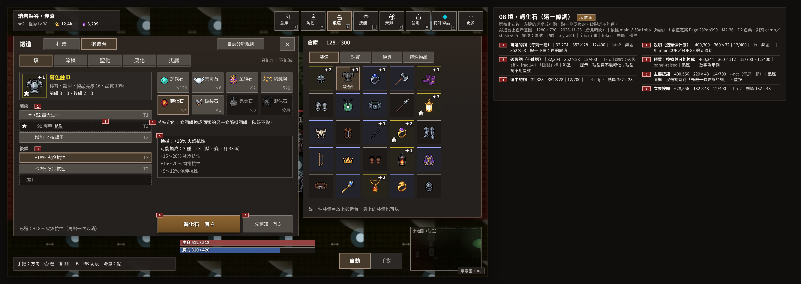
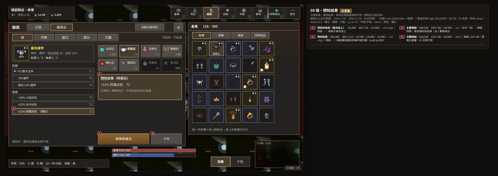
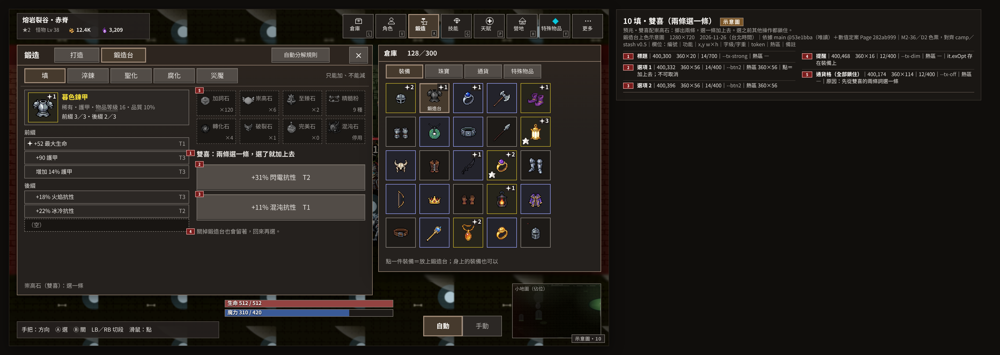
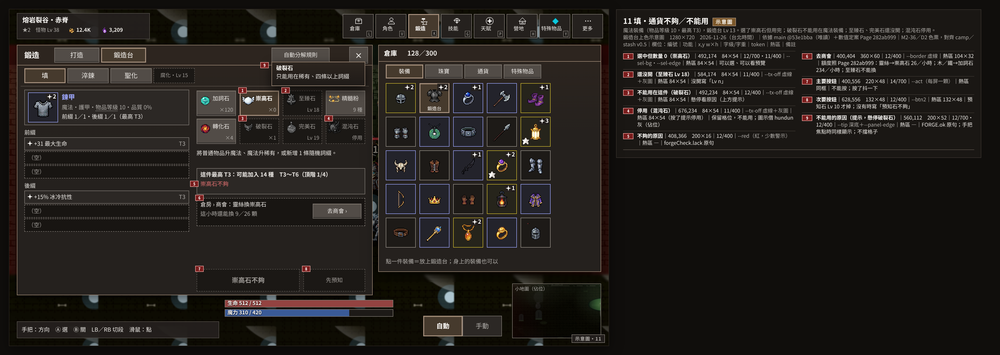
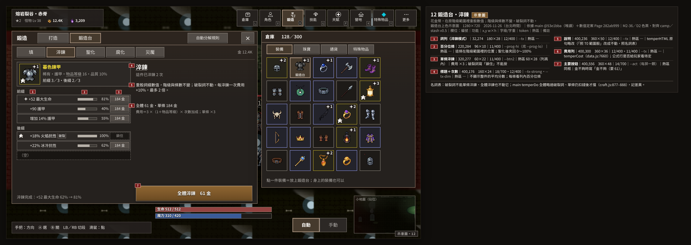
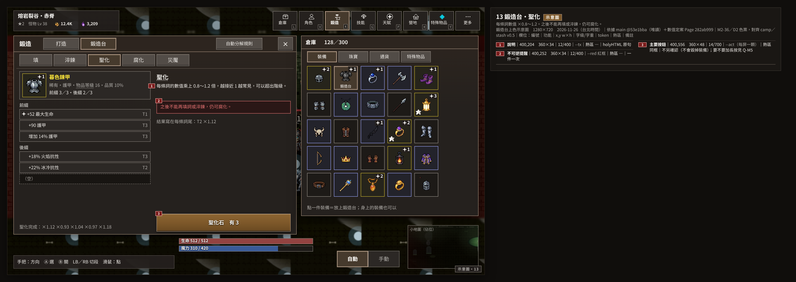
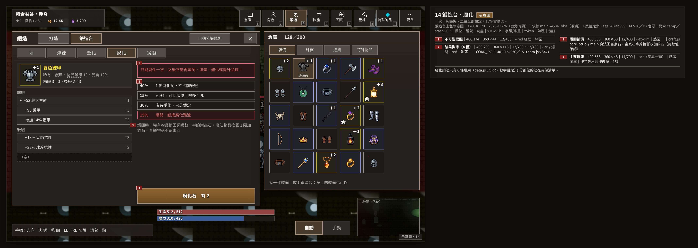
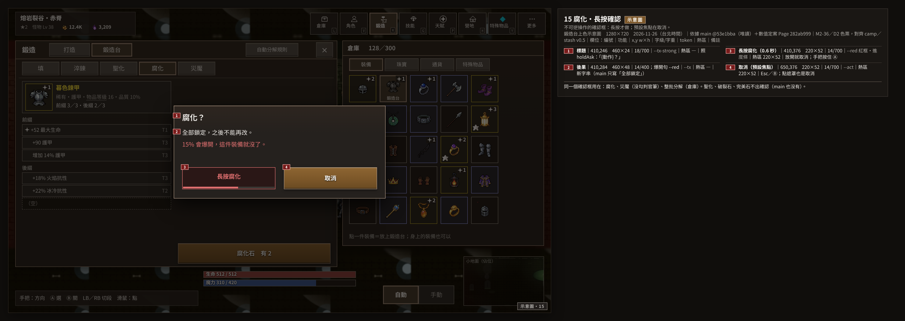
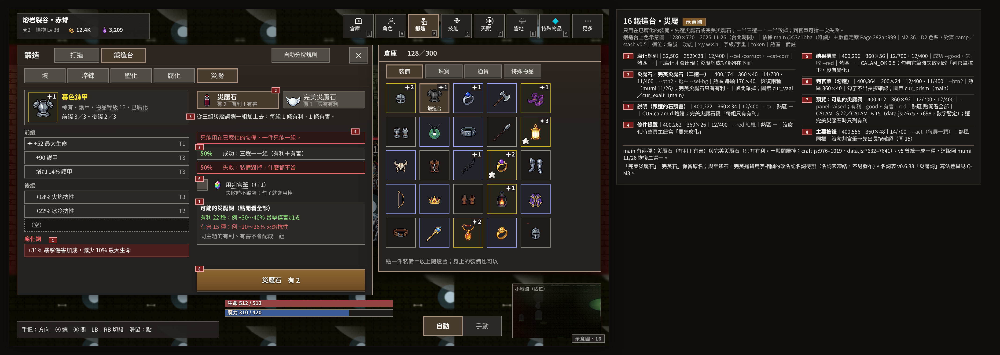
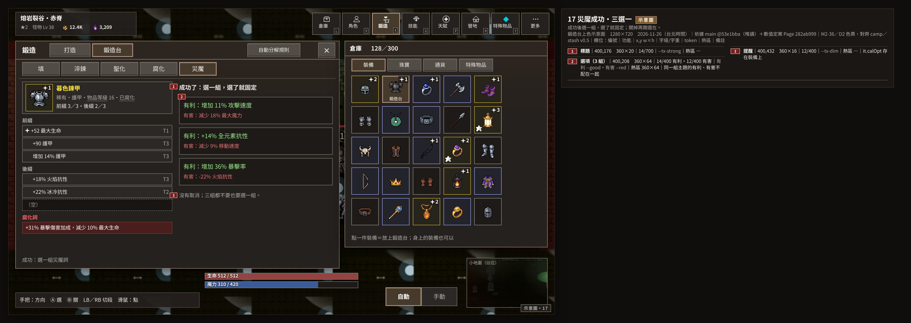

# 鍛造 v1.0・畫面 08–17（鍛造台・填的變化、淬鍊、聖化、腐化、災魘）

主檔：[forge-spec.md](forge-spec.md)（範圍、符號、機制、節奏、鍵位）。其他畫面：[01–04](forge-screens-make.md)、[05–07b](forge-screens-bench.md)。交接：[forge-handoff.md](forge-handoff.md)。

座標＝1280×720 舞台 CSS px；「熱區」欄是點擊範圍；token 見主檔 §2；✦／破裂見主檔 §3。圖在 `docs/production/evidence/forge/`。

### 08 填・轉化石（選一條詞）

選轉化石後，左邊的詞變成可點；點一條要換的。破裂詞不能選。

| # | 元件 | x,y w×h | 字級/字重 | token | 熱區 | 備註 |
|---|---|---|---|---|---|---|
| 1 | 可選的詞（每列一鈕） | 32,274　352×28 | 12/400 | --btn2 | 352×28 | 點一下選；再點取消 |
| 2 | 破裂詞（不能選） | 32,304　352×28 | 12/400 | --tx-off 虛線；破裂 affix_frac 14＋「破裂」標 | — | 提示：破裂詞不能轉化；破裂詞不用星號 |
| 3 | 選中的詞 | 32,388　352×28 | 12/700 | --sel-edge | 352×28 |  |
| 4 | 說明（這顆做什麼） | 400,300　360×32 | 12/400 | --tx | — | 用 main CUR／FORGE 的 d 原句 |
| 5 | 預覽：換掉與可能換成 | 400,344　360×112 | 12/700・12/400 | --panel-raised | — | 數字為示例 |
| 6 | 主要按鈕 | 400,556　220×48 | 14/700 | --act（每屏一顆） | 同框 | 沒選詞時寫「先選一條要換的詞」，不能按 |
| 7 | 次要按鈕 | 628,556　132×48 | 12/400 | --btn2 | 132×48 |  |

### 09 填・預知結果

先預知後：看到結果，再決定用掉通貨或不用。預知石已經花掉。

| # | 元件 | x,y w×h | 字級/字重 | token | 熱區 | 備註 |
|---|---|---|---|---|---|---|
| 1 | 預知的新詞（還沒加上） | 32,448　352×28 | 12/700 | --sel-edge | — | 用掉才真的加上 |
| 2 | 預知結果 | 400,300　360×112 | 14/700・14/400・12/400 | --sel-edge | — | 換裝備或做別的操作就作廢（craft.js:850） |
| 3 | 主要按鈕 | 400,556　220×48 | 14/700 | --act（每屏一顆） | 同框 | 套用預知的結果，扣 1 顆崇高石 |
| 4 | 次要按鈕 | 628,556　132×48 | 12/400 | --btn2 | 132×48 | 崇高石留著；Ⓑ 也是不用 |

### 10 填・雙喜（兩條選一條）

預兆・雙喜配崇高石：擲出兩條，選一條加上去。選之前其他操作都鎖住。

| # | 元件 | x,y w×h | 字級/字重 | token | 熱區 | 備註 |
|---|---|---|---|---|---|---|
| 1 | 標題 | 400,300　360×20 | 14/700 | --tx-strong | — |  |
| 2 | 選項 1 | 400,332　360×56 | 14/400 | --btn2 | 360×56 | 點＝加上去；不可取消 |
| 3 | 選項 2 | 400,396　360×56 | 14/400 | --btn2 | 360×56 |  |
| 4 | 提醒 | 400,468　360×16 | 12/400 | --tx-dim | — | it.exOpt 存在裝備上 |
| 5 | 通貨格（全部鎖住） | 400,174　360×114 | 12/400 | --tx-off | — | 原因：先從雙喜的兩條詞選一條 |

### 11 填・通貨不夠／不能用

魔法裝備（物品等級 10，最高 T3），鍛造台 Lv 13。選了崇高石但用完；破裂石不能用在魔法裝備；至臻石、完美石還沒開；混沌石停用。

| # | 元件 | x,y w×h | 字級/字重 | token | 熱區 | 備註 |
|---|---|---|---|---|---|---|
| 1 | 選中但數量 0（崇高石） | 492,174　84×54 | 12/700・11/400 | --sel-bg・--sel-edge | 84×54 | 可以選、可以看預覽 |
| 2 | 還沒開（至臻石 Lv 18） | 584,174　84×54 | 11/400 | --tx-off 虛線＋灰圖 | 84×54 | 沒開寫「Lv n」 |
| 3 | 不能用在這件（破裂石） | 492,234　84×54 | 12/400 | --tx-off 虛線＋灰圖 | 84×54 | 懸停看原因（上方提示） |
| 4 | 停用（混沌石） | 676,234　84×54 | 11/400 | --tx-off 虛線＋灰圖 | 84×54（按了提示停用） | 保留格位，不能用；圖示借 hundun 灰（佔位） |
| 5 | 不夠的原因 | 408,366　200×16 | 12/400 | --red（紅，少數警示） | — | forgeCheck.lack 原句 |
| 6 | 去商會 | 400,404　360×60 | 12/400 | --border 虛線 | 104×32 | 額度照 Page 282ab999：靈絲→崇高石 26／小時；木／鐵→加詞石 234／小時；至臻石不能換 |
| 7 | 主要按鈕 | 400,556　220×48 | 14/700 | --act（每屏一顆） | 同框 | 不能按；按了抖一下 |
| 8 | 次要按鈕 | 628,556　132×48 | 12/400 | --btn2 | 132×48 | 預知石 Lv 10 才掉；沒有時寫「預知石不夠」 |
| 9 | 不能用的原因（提示，懸停破裂石） | 560,112　200×52 | 12/700・12/400 | --tip 深底＋--panel-edge | — | FORGE.ok 原句；手把焦點時同樣顯示；不擋格子 |

### 12 鍛造台・淬鍊

花金幣，在原階級範圍裡重骰數值；階級與條數不變。破裂詞不動。

| # | 元件 | x,y w×h | 字級/字重 | token | 熱區 | 備註 |
|---|---|---|---|---|---|---|
| 1 | 詞列（淬鍊模式） | 32,274　180×28 | 12/400 | --tx | — |  |
| 2 | 百分位條 | 220,284　96×10 | 11/400 | --prog-hi（底 --prog-lo） | — | 這條在階級範圍裡的位置；聖化後夾回 0～100% |
| 3 | 單條淬鍊 | 320,277　60×22 | 11/400 | --btn2 | 60×28（列高內） | 費用 ×3；破裂詞寫「鎖住」不能按 |
| 4 | 標題＋次數 | 400,176　160×24 | 18/700・12/400 | --tx-strong・--tx-dim | — | 不顯示整件的平均分數；每條看列內百分位條 |
| 5 | 說明 | 400,236　360×50 | 12/400 | --tx | — | temperHTML 原句略改（「照 T0 範圍骰」改成不動，照名詞表） |
| 6 | 費用列 | 400,300　360×36 | 12/400・11/400 | --tx | — | temperCost（data.js:7660）；公式行是否給玩家看待定 |
| 7 | 主要按鈕 | 400,556　360×48 | 14/700 | --act（每屏一顆） | 同框 | 金不夠時寫「金不夠（要 61）」 |

- 名詞表：破裂詞不能單條淬鍊、全體淬鍊也不動它；main temperDo 全體略過破裂詞、單條仍扣錢後才擋（craft.js:877–888），記差異。

### 13 鍛造台・聖化

每條詞數值 ×0.8～1.2。之後不能再填或淬鍊，仍可腐化。

| # | 元件 | x,y w×h | 字級/字重 | token | 熱區 | 備註 |
|---|---|---|---|---|---|---|
| 1 | 說明 | 400,204　360×34 | 12/400 | --tx | — | holyHTML 原句 |
| 2 | 不可逆提醒 | 400,252　360×34 | 12/400 | --red 紅框 | — | 一件一次 |
| 3 | 主要按鈕 | 400,556　360×48 | 14/700 | --act（每屏一顆） | 同框 | 不另確認（不會毀掉裝備）；要不要加長按見 Q-M5 |

### 14 鍛造台・腐化

一次、純隨機、之後全部鎖定。15% 會爆開。

| # | 元件 | x,y w×h | 字級/字重 | token | 熱區 | 備註 |
|---|---|---|---|---|---|---|
| 1 | 不可逆提醒 | 400,174　360×44 | 12/400 | --red 紅框 | — |  |
| 2 | 結果機率（4 種） | 400,230　360×116 | 12/700・12/400 | --tx；爆開 --red | — | CORR_ROLL 40／15／30／15（data.js:7847） |
| 3 | 爆開補償 | 400,356　360×50 | 12/400 | --tx-dim | — | craft.js corruptDo；main 魔法回富豪石，富豪石拿掉後暫改加詞石（待數值確認） |
| 4 | 主要按鈕 | 400,556　360×48 | 14/700 | --act（每屏一顆） | 同框 | 按了先出長按確認（15） |

- 腐化詞池只有 6 條通用（data.js CORR，數字暫定）；分部位的池在待做清單。

### 15 腐化・長按確認

不可逆操作的確認框：長按才做；預設焦點在取消。

| # | 元件 | x,y w×h | 字級/字重 | token | 熱區 | 備註 |
|---|---|---|---|---|---|---|
| 1 | 標題 | 410,246　460×24 | 18/700 | --tx-strong | — | 照 holdAsk：「{動作}？」 |
| 2 | 後果 | 410,284　460×48 | 14/400；爆開句 --red | --tx | — | 新字串（main 只寫「全部鎖定」） |
| 3 | 長按腐化（0.6 秒） | 410,376　220×52 | 14/700 | --red 紅框・進度條 | 220×52 | 放開就取消；手把按住 Ⓐ |
| 4 | 取消（預設焦點） | 650,376　220×52 | 14/700 | --act | 220×52 | Esc／Ⓑ；點遮罩也是取消 |

- 同一個確認框用在：腐化、災魘（沒勾判官筆）、整批分解（倉庫）。聖化、破裂石、完美石不出確認（main 也沒有）。

### 16 鍛造台・災魘

只用在已腐化的裝備。先選災魘石或完美災魘石；一半三選一，一半毀掉；判官筆可擋一次失敗。

| # | 元件 | x,y w×h | 字級/字重 | token | 熱區 | 備註 |
|---|---|---|---|---|---|---|
| 1 | 腐化詞列 | 32,502　352×28 | 12/400 | --cell-corrupt・--cat-corr | — | 已腐化才會出現；災魘詞成功後列在下面 |
| 2 | 災魘石／完美災魘石（二選一） | 400,174　360×40 | 14/700・11/400 | --btn2・選中 --sel-bg | 每顆 176×40 | 恢復兩種（mumi 11/26）；完美災魘石只有有利、十殿閻羅掉；圖示 cur_vaal／cur_exalt（main） |
| 3 | 說明（跟選的石頭變） | 400,222　360×34 | 12/400 | --tx | — | CUR.calam.d 略縮；完美災魘石寫「每組只有有利」 |
| 4 | 條件提醒 | 400,262　360×26 | 12/400 | --red 紅框 | — | 沒腐化時整頁主鈕寫「要先腐化」 |
| 5 | 結果機率 | 400,296　360×56 | 12/700・12/400 | 成功 --good・失敗 --red | — | CALAM_OK 0.5；勾判官筆時失敗列改「判官筆擋下，沒有變化」 |
| 6 | 判官筆（勾選） | 400,364　200×24 | 12/400・11/400 | --btn2 | 360×40 | 勾了不出長按確認；圖示 cur_prism（main） |
| 7 | 預覽：可能的災魘詞 | 400,412　360×92 | 12/700・12/400 | --panel-raised；有利 --good・有害 --red | 點開看全部 | CALAM_G 22／CALAM_B 15（data.js:7675、7698，數字暫定）；選完美災魘石時只列有利 |
| 8 | 主要按鈕 | 400,556　360×48 | 14/700 | --act（每屏一顆） | 同框 | 沒勾判官筆→先出長按確認（同 15） |

- main 有兩種：災魘石（有利＋有害）與完美災魘石（只有有利，十殿閻羅掉；craft.js:976–1019、data.js:7632–7641）。v5 曾統一成一種，這版照 mumi 11/26 恢復二選一。
- 「完美災魘石」「完美石」保留原名；與至臻石／完美通貨用字相關的改名記名詞待辦（名詞表凍結，不另發布）。名詞表 v0.6.33「災魘詞」寫法差異見 Q-M3。

### 17 災魘成功・三選一

成功後選一組，選了就固定；關掉再開還在。

| # | 元件 | x,y w×h | 字級/字重 | token | 熱區 | 備註 |
|---|---|---|---|---|---|---|
| 1 | 標題 | 400,176　360×20 | 14/700 | --tx-strong | — |  |
| 2 | 選項（3 組） | 400,208　360×64 | 14/400 有利・12/400 有害 | 有利 --good・有害 --red | 360×64 | 同一組主題的有利、有害不配在一起 |
| 3 | 提醒 | 400,432　360×16 | 12/400 | --tx-dim | — | it.calOpt 存在裝備上 |

